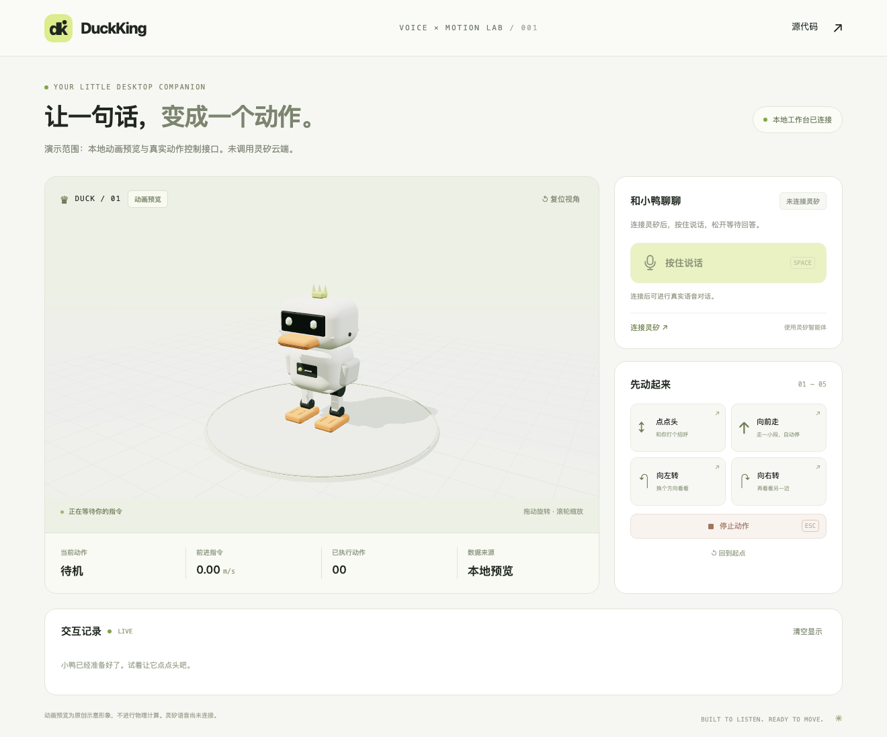

# DuckKing

用灵矽语音控制虚拟 Micro Duck 的本地交互项目。提供原创动画预览、使用官方模型和策略的 MuJoCo 物理实验室，以及官方 robotd 适配。



[真实灵矽语音演示](docs/media/live-linx-voice.mp4) · [本地演示](docs/media/local-preview.mp4) · [官方物理仿真演示](docs/media/official-simulation.mp4) · [架构与模块规格](docs/ARCHITECTURE.md) · [验证记录](docs/VALIDATION.md) · [演示复现](docs/DEMO.md)

新增「闪身步」「狗熊哆嗦毛」两个三秒小节目，可通过按钮或灵矽语音触发。[查看编排与演示](docs/CHOREOGRAPHY.md)。

## 本地运行

需要 Python 3.12+、[uv](https://docs.astral.sh/uv/) 和 Node.js 22.12+。

```bash
git clone git@github.com:zhoutingunl/DuckKing.git
cd DuckKing
scripts/setup_local.sh
scripts/run_local.sh
```

打开 <http://127.0.0.1:8765>。可直接使用点头、前进、左右转向、闪身步、狗熊哆嗦毛、停止和复位；Esc 可取消动作。

默认运行原创动画预览，不进行物理计算。语音需另外连接灵矽，不会把本地按钮操作冒充为识别结果。

初始化脚本检查 Node.js 版本、按锁文件安装 Python / 前端依赖并构建页面；可重复执行。默认使用 Python 3.12，由 uv 准备。启动脚本保持前台运行，Ctrl+C 退出；支持 `--port 8766` 等原有参数。缺少环境或构建时会明确提示初始化，不会启动空页面。

继续开发时保持后端运行，在第二个终端执行 `cd frontend && npm run dev`，打开 <http://127.0.0.1:5173> 获得前端热更新。安装、端口配置、验证及排障见 [本地开发指南](docs/DEVELOPMENT.md)。

## 连接灵矽

如需在 Linux 上复用现有 HTTPS 域名，参见 [YZH737 独立部署](deploy/README.md)。同一份前端支持 `/` 与 `/duckking/`，包含麦克风 worklet、API、语音通道和部署记录页面。ai_gateway 首次接入固定路由后，DuckKing 升级只重启自身服务；入口不支持 Upgrade 时可经 HTTPS 转发真实后端 WebSocket。安装默认只验证 loopback 独立服务；公网入口与真实云端语音需另行验收，暂存状态不会显示为完整验收成功。

安装原生 Opus 库：macOS 使用 `brew install opus`；Ubuntu 使用 `sudo apt-get install libopus0`。

如果已有平台 API Key，将原始 Key 单独放在 `~/.secrets/lingxi`，可显式运行一次初始化：

```bash
chmod 600 ~/.secrets/lingxi
uv run duckking-setup --key-file ~/.secrets/lingxi
```

该命令创建或复用名为 DuckKing 的智能体，并通过 OTA 激活码绑定本地设备；不会改写其他智能体或迁移已有设备的聊天历史。已有特定智能体时可传 `--agent-id`。平台初始化不会在打开页面时自动执行。

默认服务支持两个独立房间，打开页面自动选择空闲房间，也可在顶部切换。房间 1 沿用已有设备；房间 2 首次需执行 `uv run duckking-setup --room 2` 独立绑定。打开工作台点击「连接灵矽」，首次连接会显示设备激活码。在灵矽控制台将此设备绑定到支持工具调用的智能体，再点击重新连接。连接就绪后按住按钮或空格说话，松开后等待回答。回答或思考时可按住同一按钮“打断并说话”，立即静音并录制新命令；每次录音最多 15 秒。

如果已有设备连接凭证，将 `.env.example` 中对应项填入 `~/.secrets/duckking.env`；设置文件权限为 `600`。设备 token 不等于平台管理 API Key。后端读取凭证，浏览器不接触 token；本地设备身份保存于 `~/.local/share/duckking/identity.json`。文件填好后重新打开页面连接。

可用工具：`duck_nod`、`duck_walk_short`、`duck_turn_left`、`duck_turn_right`、`duck_stop`、`duck_get_status`、`duck_flash_step`、`duck_bear_shake`。可以说“向前走再向左转再向右转”，提示词要求逐个等待动作完成；也可明确点名两个舞步。转向限时 0.2–3 秒，不保证精确角度。新增工具需要断开旧语音会话后重连。断线后界面明确提示；首版不会自动恢复录音。

已有 DuckKing 智能体需要更新工具提示词时，显式执行 `uv run duckking-setup --sync-prompt`。此操作先在私有数据目录备份原提示词，只更新专用 DuckKing 智能体的 `systemPrompt` 并回读验证，不创建、重新绑定设备或修改模型设置。普通初始化命令仍不会覆盖已有提示词。

语音卡片提供「重置语音」和「连接诊断」。等待回答 20 秒没有有效进展、播放下行 15 秒没有新数据，或整轮超过 60 秒时，会停止动作并关闭旧会话，自动尝试重连一次；不重发录音、不自动继续录音。失败后可手动重连。脱敏日志位于 `~/.local/share/duckking/voice.jsonl`，也可查看 <http://127.0.0.1:8765/api/voice/diagnostics>；详见 [语音诊断与恢复](docs/DEVELOPMENT.md#语音诊断与恢复)。

iPhone 等移动设备若能执行指令却听不到回复，先点语音卡片的「启用 / 测试声音」，再检查媒体音量、静音开关和蓝牙输出。麦克风权限与声音播放是不同环节；「声音诊断」显示浏览器收到和播放的帧数，详见 [移动端声音排查](docs/DEVELOPMENT.md#移动端声音排查)。

主页「交互统计」在新标签页打开 <http://127.0.0.1:8765/statistics.html>（开发模式也支持 5173），保留原语音连接。查看识别原文、实际动作顺序、逐轮时间线、识别返回率、回复结束率、动作完成率、延迟 P50/P95 及连接恢复。每 5 秒更新，保留本次启动最近 500 轮，可按动画预览 / 官方 robotd 筛选。识别文本经过脱敏后写入本地日志；不保存录音。统计口径与边界见 [交互统计](docs/DEVELOPMENT.md#交互统计)。

**真实云端联调已完成。** 已使用系统合成中文语音验证灵矽 STT → MCP 工具调用 → 本地动作 → 真实 TTS，也验证了灵矽调用官方仿真前进。浏览器演示中的输入为合成语音，识别、工具调用和回复均来自真实灵矽服务；没有伪造回复。验收范围与记录见 [VALIDATION.md](docs/VALIDATION.md)。

## 本地物理实验室：踢球与双鸭

主页点击「物理实验室」，或打开 <http://127.0.0.1:8765/scenarios.html>。开发模式也支持 <http://127.0.0.1:5173/scenarios.html>。

```bash
scripts/setup_scenarios.sh
scripts/run_local.sh
```

此路径在本机 CPU 上运行 MuJoCo，加载固定版本的官方 MicroDuck MJCF 与 ONNX 策略，不需要 Rust、CUDA 或训练环境；它没有经过 robotd。原来的动画工作台和 robotd 连接方式仍是独立路径。缺少依赖或模型时页面明确报错，不回退为动画。

- **单鸭定点踢球**：选择左脚或右脚，每次先将 70 mm / 15 g 的球摆到所选脚前，再执行官方 0.5 秒踢球策略，随后观察至约 2 秒仿真时间。返回所选脚的实际接触及球位移；未踢中会失败，不保证距离，也不具备自主找球能力。
- **双鸭互动**：同一个 MuJoCo 模型、同一套物理推进。可分别控制鸭 A / B，或让两只鸭一起走、相向碰面。接触数是每个物理步的接触点累计，不等于碰撞次数。
- **发现同伴**：使用仿真位置、1.2 m 距离、120° 视野与射线遮挡判断；不是摄像头识别或真实蓝牙发现。
- **同步合唱**：两只鸭同步点头，浏览器用同一个音频时钟合成本地双声部短旋律。按钮触发时会启用声音；语音触发前先点「启用合唱声音」。不是灵矽 TTS，也没有实现官方 BLE 合唱协议。

场景页连接灵矽后可说“用左脚踢球”“用右脚踢球”“切换到双鸭场景”“发现同伴”“一起走”“相向碰面”“合唱”。已有专用 DuckKing 智能体可运行 `uv run --frozen --no-sync duckking-setup --sync-prompt` 更新提示词。新工具仅在物理实验室的语音连接中提供；请先断开原工作台的语音连接。

**已验证真实物理接触及真实灵矽调用左右脚踢球。** 合成中文录音经过真实 STT、MCP 和 TTS；记录见 [物理实测](docs/media/physics-scenes.json) 和 [语音实测](docs/media/scene-voice-verification.json)。停止、Esc 和场景切换会取消场景动作并清零两只鸭的运动意图；球仍可因惯性继续滚动，机器人仍运行站立策略。

## 连接官方 robotd 物理仿真

此路径需要 Rust/Cargo、pkg-config、uv、Python 3.12，首次会下载较大的上游依赖并编译 Rust。

```bash
scripts/setup_simulator.sh
scripts/run_simulator.sh
```

保持此终端开启，在另一终端启动 DuckKing：

```bash
uv run duckking --backend robotd --socket ~/.cache/duck-sim/duck-a.sock
```

`DUCKKING_SIM_DIR` 可指定已有的外部仓库目录；`DUCK_SIM_VIEWER=0` 可运行无窗口仿真。上游固定版本及许可见 [THIRD_PARTY.md](THIRD_PARTY.md)。

本机已运行官方 robotd + MuJoCo，验证了站立、点头指令、前进和停止；低速指令不足以触发明显步态，因此仿真端默认前进指令为 0.35 m/s，动作限时 0.2–3 秒。指令速度不等于实际位移速度；一次 1.2 秒实测位移约 14 cm，不作为固定距离保证。动画预览默认仍为 0.12 m/s。

连接 robotd 时，本页模型保持为原创示意图，物理画面应查看官方 MuJoCo 窗口。不会在连接失败时悄悄切回动画预览。适配器仅在上述仿真环境中测试，未验证实体机器人。

## 测试与覆盖率

```bash
scripts/setup_scenarios.sh
uv run ruff check src tests
uv run pytest --cov --cov-report=term-missing --cov-report=json --cov-report=html
uv run python scripts/check_coverage.py
cd frontend
npx playwright install chromium
npm run test:e2e
npm run test:e2e:dev
npm run test:unit
```

CI 硬性要求所有后端模块行覆盖率 ≥90%、分支覆盖率 ≥85%；不达标不能合入。每次检查上传 HTML/XML/JSON 覆盖报告和浏览器测试报告。

浏览器流程验证桌面动作、停止取消和移动端布局；单元测试重点覆盖限时、取消、去重、错误反馈和同源保护。新增协议模块也须遵守相同门槛，不从覆盖统计中排除。

目标：电脑麦克风 → 灵矽 → MCP 工具调用 → 本地动作控制 → 虚拟鸭子。提供无需账号的明确标注的动画预览，以及连接官方 robotd / MuJoCo 的适配路径。

## 开发基线

- `v0` 指向不包含任何文件的开发前基线，未导入现成应用代码。
- 空仓库必须先建立基础分支才能创建 PR；唯一直接初始化提交仅建立空基线。
- 所有后续文档、代码及修复通过功能分支和 Pull Request 进入 `main`。
- 官方 Microduck 是外部可选依赖；不会把它的代码、模型或策略声明为本项目原创。

参见 [贡献指南](CONTRIBUTING.md)、[团队与分工](docs/TEAM.md)、[第三方说明](THIRD_PARTY.md)。

## 交付计划

1. PR：协作规范、开发前基线、CI 与贡献说明。
2. PR：可运行的本地界面、受限动作控制与自动化测试。
3. PR：灵矽设备接入、音频、MCP 和官方仿真适配。
4. PR：演示视频、运行说明、架构与验收记录。

实现进度与验证以各 PR 的说明和 CI 为准。

## 许可

本项目原创代码使用 [MIT](LICENSE)；第三方代码和资源遵循其各自许可。
