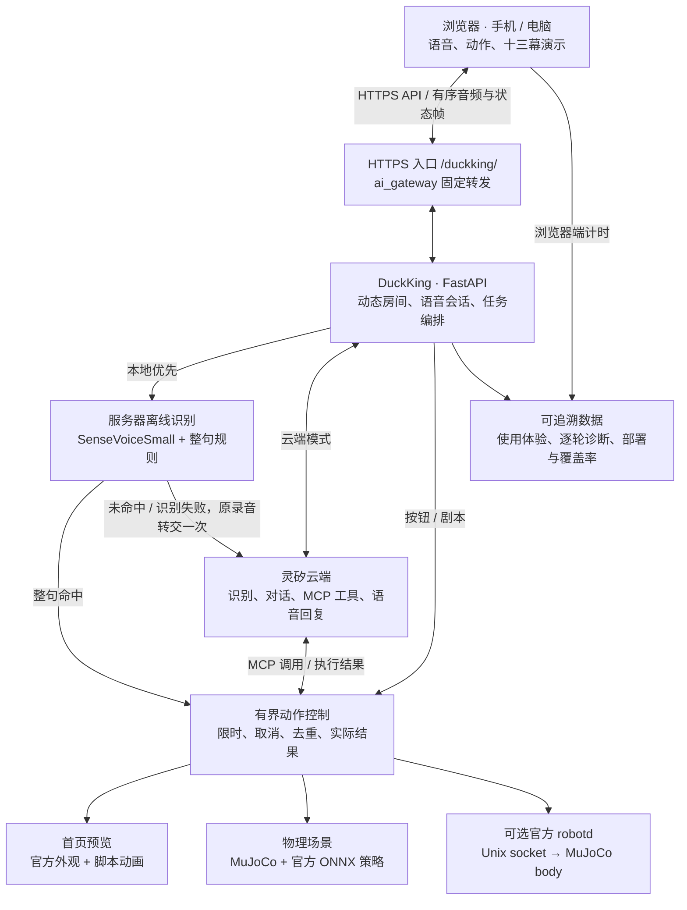
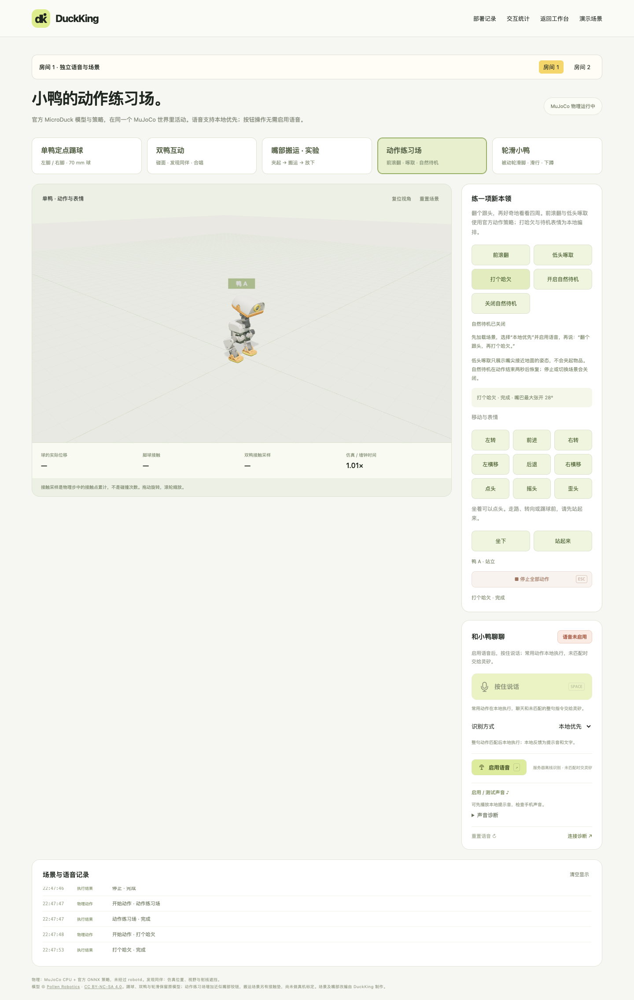
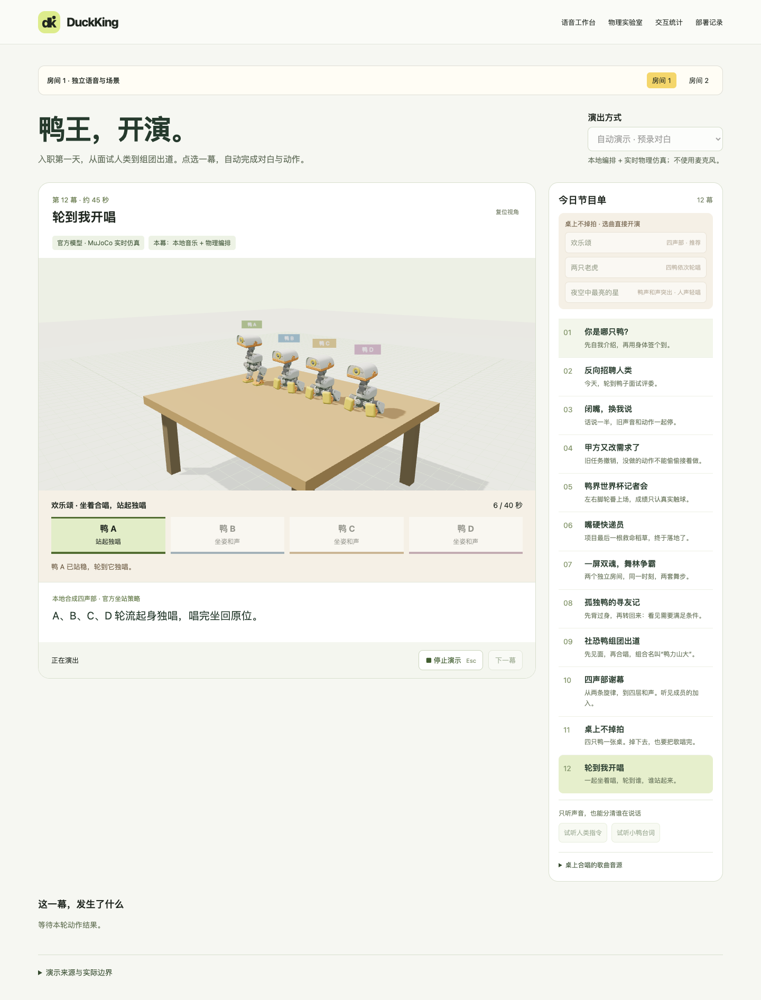

# DuckKing

让用户在购买硬件之前，先在浏览器里了解 MicroDuck、体验灵矽语音交互。通过语音和按钮控制仿真小鸭，完成踢球、搬运、前滚翻、轮滑与四鸭合唱。支持服务器离线识别优先、真实灵矽语音、动态独立房间和十三幕自动演示。

[在线体验](https://ztmonitor.qbox.net/duckking/) · [演示场景](https://ztmonitor.qbox.net/duckking/demos.html) · [物理实验室](https://ztmonitor.qbox.net/duckking/scenarios.html) · [部署记录](https://ztmonitor.qbox.net/duckking/deploys.html)


本文三张界面截图采集于 2026-10-25 的 `a8a6675`，展示当时运行画面；新增 UI 以当前页面和下文说明为准。[截图来源与版本](docs/media/README.md)

当前工作台使用官方模型外观，动作由本项目脚本驱动，属于**动画预览**。物理实验室与演示剧场使用**真实 MuJoCo CPU + 官方 ONNX 策略**；另有独立的官方 **robotd / MuJoCo** 适配。三条路径分别标识，连接失败会明确报错。项目目前是软件仿真，没有实体机器人验收。

**赛后外观更新（2026-11-01）：** 首页、物理实验室、演示剧场与互动工坊支持四种官方配色：奶油白 Cream、石墨灰 Graphite、薰衣草紫 Lavender、天空蓝 Sky。画面左下角可换色，多鸭场景先选择鸭子；默认 A/B/C/D 分别对应这四种颜色，走动、换位与重置不会交换身份。外壳、金属关节和镜头使用不同材质及环境反射；选择保存在当前浏览器，只影响外观，不改变运动策略或接触物理。四鸭共享模型网格，换色无需重新下载模型。

**竞赛演示视频：** [观看 4 分 46 秒自然配音版](https://github.com/zhoutingunl/DuckKing/releases/download/deploy-yzh737-20261025T165552Z/duckking-hackathon-20261027-natural.mp4) · [章节、量化数据与来源](docs/DEMO_VIDEO.md)

## 商业价值与产品设计

**先体验，再决定是否购买。** MicroDuck 官方预售价为 399 美元，未含税费和运费（2026-10-27 查阅[官方商店](https://store.pollen-robotics.com/products/microduck)）。DuckKing 为有兴趣但尚未购买硬件的用户提供体验窗口：不用先采购、组装或部署开发环境，就能尝试中文语音指挥、临场改令和多鸭演出，判断自己想用它做什么。

产品设计围绕“看一幕 → 亲口指挥 → 改变结果 → 了解能力边界”：自动演示负责引起兴趣，真实灵矽与物理场景负责让用户亲手尝试，源码和说明帮助开发者继续探索。官方已有仿真器；本项目增加语音接入、场景编排和体验统计，没有完成实体硬件复刻，也不表示官方购买后即可获得同样的全部玩法。

商业价值首先是降低了解与试用成本、减少购买预期偏差；对硬件和灵矽生态的转化贡献仍需用户验证，当前没有销售合作、支付或购买归因。完整的目标用户、体验路径、功能边界、验证指标和后续优先级见 [商业价值与产品设计](docs/PRODUCT_DESIGN.md)。

开始开发后，可继续复用部分语音与动作软件，再逐步接上实体硬件；模块复用、麦克风／扬声器边界与待实施的接入步骤见 [从仿真到实体](docs/SIM_TO_HARDWARE.md)。目前没有实机验收，也不能将全部场景通过切换地址直接移植。

## 从哪里开始

| 页面 | 可以做什么 |
|---|---|
| [语音工作台](https://ztmonitor.qbox.net/duckking/) | 点头、摇头、歪头、前后移动、横移、左右转、两个舞步；连接语音或选择本地优先 |
| [物理实验室](https://ztmonitor.qbox.net/duckking/scenarios.html) | 单鸭踢球、双鸭互动、嘴部搬运、动作练习场、轮滑；按钮无需启用语音 |
| [演示场景](https://ztmonitor.qbox.net/duckking/demos.html) | 十三幕逐幕点播；预录对白本地编排与灵矽实连预录指令可现场切换 |
| [现场互动工坊](https://ztmonitor.qbox.net/duckking/studio.html) | 十项语音任务、本地排练、临场改序与任务控制；真人语音固定走灵矽，见 [使用说明](docs/INTERACTIVE_STUDIO.md) |
| [使用体验](https://ztmonitor.qbox.net/duckking/experience.html) | 持续保存浏览器加载/语音与服务器处理时延；均值、P50/P90/P95、趋势、来源及版本筛选，跨重启保留，见 [口径说明](docs/EXPERIENCE_METRICS.md) |
| [交互统计](https://ztmonitor.qbox.net/duckking/statistics.html) | 识别文本、实际动作、逐轮时间线、本地/灵矽识别均值及 P50/P90/P95、本地命中与云端回退；按房间和后端查看 |
| [部署记录](https://ztmonitor.qbox.net/duckking/deploys.html) | 版本、验收结果、变更提交与 GitHub 对比、对应提交的后端行／分支覆盖率 |

页面可新建、切换房间，默认最多 10 个；没有指定房间的新页面优先分配空闲房间，满时按需创建。各房间隔离动作、设备身份、语音和统计，同房间只允许一个页面占用语音；这是公开演示空间。默认最多 4 个同时加载的 MuJoCo 世界，可在场景页释放；无人使用 5 分钟后回收。新增房间的云端设备需由管理员预先独立绑定；显式 robotd 后端只开放房间 1。

## 软件架构

围绕“复刻 Micro Duck，并通过灵矽语音交互”的题目，当前交付了从浏览器语音到动作执行、物理反馈与体验统计的软件链路。实体硬件复刻、传感器接入与实机验收仍未完成。



公网音频与状态帧经 HTTPS 长轮询转到真实后端 WebSocket，本地可直连 WebSocket。各房间隔离语音与动作；物理场景按需加载。三个动作后端显式区分，预览不计算接触，仿真也不等于实体硬件。灵矽回复、本地确认和预录音乐分别标记。

[架构设计文档](docs/ARCHITECTURE.md)包含部署图、语音时序、模块输入输出、故障边界和接口规格；[模块分工与验收](docs/TEAM.md)对应负责人和测试入口。两者共同组成竞赛的“架构设计文档（包含模块规格、分工）”。

## 本地运行

需要 Python 3.12+、[uv](https://docs.astral.sh/uv/) 和 Node.js 22.12+。默认 Python 3.12 由 uv 准备。

```bash
git clone git@github.com:zhoutingunl/DuckKing.git
cd DuckKing
scripts/setup_local.sh
scripts/run_local.sh
```

打开 <http://127.0.0.1:8765/>。初始化脚本按锁文件安装依赖、获取固定版本官方模型与策略并构建前端；不会创建灵矽账号或连接云端。模型缺失会明确报错。启动保持前台运行，Ctrl+C 退出；可传 `--port 8766`。

开发前端时，保持后端运行，在另一个终端执行 `cd frontend && npm run dev`，访问 <http://127.0.0.1:5173/>。Python 修改后重启后端；8765 页面需要重新构建才显示前端修改。完整步骤见 [本地开发指南](docs/DEVELOPMENT.md)。

## 语音：本地优先与灵矽云端

首页和物理实验室都支持“本地优先 / 灵矽云端”。本地优先使用服务器上的 **sherpa-onnx + SenseVoiceSmall INT8**，手机浏览器无需安装模型。整句动作命中后直接执行并用提示音、文字确认；问句、未匹配或识别失败时，把本轮原始录音一次性交给真实灵矽。否定句和未知后缀不会先执行已认识的半句；本地动作一旦开始，失败后不会再交云端重复执行。

本地启用离线识别：

```bash
scripts/setup_local_asr.sh
# 终端一
uv run --frozen --no-sync duckking-asr
# 终端二
DUCKKING_LOCAL_ASR=1 scripts/run_local.sh
```

worker 只监听 `127.0.0.1:8768`。浏览器选择“本地优先”，点“启用语音”，按住说话、松开执行。物理实验室先加载对应场景，例如动作练习场中说“前滚翻，再打个哈欠”或“向后退，再向左挪，再向右挪”。本地命中无需先连接云端；回退仍需要配置好的灵矽设备与网络。最多六个动作、总时长 20 秒，不是通用自然语言规划器。

真实灵矽连接需要原生 Opus：macOS 使用 `brew install opus`；Ubuntu 使用 `sudo apt-get install libopus0`。已有平台 API Key 时，将原始 Key 单独放在仓库外 `~/.secrets/lingxi`：

```bash
chmod 600 ~/.secrets/lingxi
uv run duckking-setup --key-file ~/.secrets/lingxi
# 需要第二路独立语音时，另行绑定房间 2
uv run duckking-setup --room 2
```

初始化显式创建或复用专用 DuckKing 智能体并绑定设备，不在页面加载时执行。也可按页面激活码在灵矽控制台绑定。手工设备凭证填写到 `~/.secrets/duckking.env`，参考 [.env.example](.env.example)，权限设为 600；设备 token 不等于平台管理 Key。新增工具后重新连接语音；已有专用智能体可用 `uv run duckking-setup --sync-prompt` 备份并同步工具提示词。

回答或思考时按住“打断并说话”，立即清空旧播放并录制新命令；每次最多录音 15 秒。无进展的回答有超时保护、一次重连及手动“重置语音”，不会重放旧录音。iPhone 的 Chrome / 企业微信首次使用先点“启用 / 测试声音”；麦克风权限与声音播放权限不同。详情见 [声音排查](docs/DEVELOPMENT.md#移动端声音排查) 和 [日志与恢复](docs/DEVELOPMENT.md#语音诊断与恢复)。

连接后会先准备麦克风，按钮可用后再按住说话。麦克风在连接期间保持静音待命，仅按住时发送声音，松开静音、断开释放，减少每轮重新启动麦克风造成的句首遗漏。

## 五类物理场景



| 场景 | 当前能力与边界 |
|---|---|
| 单鸭定点踢球 | 指定左右脚，先摆球，再执行官方策略；以实际脚球接触与球位移验收；球通过地面滚动阻力自然停下，页面显示球速，不会自主追球 |
| 双鸭互动 | 同场行走、碰撞、发现同伴与双声部合唱；发现依据仿真位置、视野和射线遮挡，不是摄像头识别 |
| 嘴部搬运 · 实验 | 可动嘴部与接触垫夹起固定轻棒、搬运、放稳；自由刚体靠接触与摩擦运动，无吸附或焊接 |
| 动作练习场 | 前滚翻并恢复站稳、低头啄取姿态、打哈欠、自然待机；啄取没有夹起物品，待机是本地编排 |
| 轮滑小鸭 | 官方四个被动轮模型滑行、下蹲并站稳；轮子由实际接触带动，停止后仍有惯性 |

球场、双鸭和动作练习场支持坐下、站起；坐着可以点头，移动或踢球前要站起。前滚翻等新策略只接入进程内 MuJoCo，不直接扩展原生 robotd 的策略切换。没有翅膀／手部自由度，没有接入跳跃、摄像头／ToF 识别或空气琴。

停止和 Esc 会取消动作并清零运动意图，物理重力继续；搬运停止保留已建立的夹持，放下需显式操作。动作失败显示实际原因，不以预设动画代替成功。接触计数是物理步中接触点的累计，不是独立碰撞次数。

## 十三幕自动演示



点选节目即可自动准备场景、播放预录指令／角色对白并执行动作，无需真人讲话。两种演出方式分别是“自动演示 · 预录对白”和“灵矽实连 · 预录指令”；后者实际调用云端 STT、工具和 TTS。人类指令与小鸭台词使用不同系统合成音色。任何失败都会停止并显示原因。

1. 你是哪只鸭？
2. 反向招聘人类
3. 闭嘴，换我说
4. 甲方又改需求了
5. 鸭界世界杯记者会
6. 嘴硬快递员
7. 一屏双魂，舞林争霸
8. 孤独鸭的寻友记
9. 社恐鸭组团出道
10. 四声部谢幕：官方 `wistful` 乐谱节选；两只物理鸭加两个虚拟声部。
11. 桌上不掉拍：四鸭踏步和声，鸭 D 真实离桌、落地、站稳后续舞；可选《欢乐颂》《两只老虎》及用户提供的《夜空中最亮的星》片段。
12. 轮到我开唱：四鸭坐着合唱《欢乐颂》，A—D 轮流站稳独唱、唱完坐回。

13. 黄仁勋的四只小鸭：随机散落、集结排队后坐下、点名前滚翻就地坐下、选中鸭同拍齐舞；另有真人语音、指挥棒点选与物理轻戳。

第 10—12 幕在两种模式下均明确标为本地音乐与物理编排，不是灵矽生成歌声或官方 BLE 合唱。桌上跌落是预设剧情，结果由 MuJoCo 决定；个别跌落姿态可能无法恢复，届时会报失败。第 7 幕需要两个空闲房间。节目来源、音源处理与效果说明见 [演示剧场](docs/DEMO_THEATRE.md)。

## 官方 robotd 与 Linux 部署

官方 robotd 路径另需 Rust/Cargo、pkg-config 和较大的上游依赖：

```bash
scripts/setup_simulator.sh
scripts/run_simulator.sh
# 另一个终端
uv run duckking --backend robotd --socket ~/.cache/duck-sim/duck-a.sock
```

`DUCKKING_SIM_DIR` 可指定外部资源目录，`DUCK_SIM_VIEWER=0` 可无窗口运行。首页此时仍是动画示意，真实物理画面查看官方 MuJoCo 窗口；不在适配失败时切回预览。适配器已做仿真联调，未做实体机器人测试。

Linux 在 YZH737 上使用独立 DuckKing / ASR systemd 服务，复用现有 `ztmonitor.qbox.net` HTTPS 入口。固定网关路由建立后，DuckKing 升级无需重启 ai_gateway。前置代理没有 WebSocket Upgrade 时使用 HTTPS 转发到同一个真实后端。发布包带固定模型、来源与 SHA-256；安装自检、公网检查、真实语音验收分别记录，暂存不等于验收成功。步骤见 [部署指南](deploy/README.md)。

## 开发检查与文档

```bash
scripts/setup_local.sh
scripts/setup_local_asr.sh
uv run ruff check src tests
uv run pytest --cov --cov-report=json --cov-report=html
uv run python scripts/check_coverage.py
cd frontend
npm run test:unit
npx playwright install chromium
npm run test:e2e
npm run test:e2e:dev
```

CI 要求后端总体行覆盖率 ≥90%、分支覆盖率 ≥85%。后端、前端和 12 个浏览器任务使用独立 runner 并行；浏览器按生产／开发 × 演示旅程／舞台交互／其余检查 × 两个分片运行，清单保证不遗漏、不重复。全部成功后 `quality` 才通过，共 15 个任务；同一 PR 的新提交自动取消旧运行。历史首轮并行实测从约 34 分钟缩短到 **9 分 21 秒**，不代表当前十三幕完整套件的固定耗时，见 [CI 分析](docs/DEVELOPMENT.md#ci-并行分组)。

[验证记录](docs/VALIDATION.md) 提供绑定具体提交的测试数量和覆盖率；前端当前覆盖门槛只统计 `audio-codec.js`，不能作为全前端覆盖率。部署页展示的是对应发布提交的 Python 后端覆盖率。安装器将 CI 报告独立保存在 `/var/lib/duckking/release-coverage.json`，自动汇入历史发布包的报告，升级或清理旧发布目录后仍保留；没有真实报告的版本继续显示“未记录”。

- [商业价值与产品设计](docs/PRODUCT_DESIGN.md)、[架构与模块规格](docs/ARCHITECTURE.md)、[本地开发与排障](docs/DEVELOPMENT.md)
- [AI 协作说明](docs/AI_COLLABORATION.md)、[工程经验与回归检查](docs/LESSONS_LEARNED.md)、[持续使用体验口径](docs/EXPERIENCE_METRICS.md)
- [演示复现与历史视频](docs/DEMO.md)、[舞步编排](docs/CHOREOGRAPHY.md)、[媒体来源](docs/media/README.md)
- [贡献指南](CONTRIBUTING.md)、[团队与分工](docs/TEAM.md)、[原创贡献](docs/CONTRIBUTION_SCOPE.md)、[安全说明](SECURITY.md)

`v0` 保留空仓库基线；后续变更使用功能分支与 Pull Request。原创代码采用 [MIT](LICENSE)，官方模型、策略、谱面与歌曲分别遵循其原许可，详见 [第三方来源](THIRD_PARTY.md)。

## 项目成员与分工

本项目由 **周霆（[@zhoutingunl](https://github.com/zhoutingunl)）** 和 **陶纯堂（[@evanwooo](https://github.com/evanwooo)）** 合作完成。

| 成员 | 主要分工 |
|---|---|
| 周霆 · zhoutingunl | 项目方案与需求、开发集成、语音与仿真联调、部署和演示交付 |
| 陶纯堂 · evanwooo | 持续参与各阶段 PR 的 review、comment 与改进反馈，协助代码质量把关；参与界面代码改进 |

协作记录包括陶纯堂在 [PR #30 的审阅评论](https://github.com/zhoutingunl/DuckKing/pull/30#pullrequestreview-5648738898)、[PR #36 的审阅](https://github.com/zhoutingunl/DuckKing/pull/36#pullrequestreview-5656580760)，以及[语音连接按钮样式提交](https://github.com/zhoutingunl/DuckKing/commit/324423d0ca917ec8cb23053b340ad2af1101b83d)。完整模块责任与协作边界见 [团队分工](docs/TEAM.md)。

## AI 协作说明

DuckKing 采用两位成员协作、AI 辅助开发的方式：人负责需求、方案选择、代码审阅和实际体验反馈，AI 辅助实现、排障、测试与文档。本轮维护使用 Codex；AI 不计作额外参赛成员，代码生成比例未经统计。实际修改与审阅通过功能分支、PR、CI 和发布验收追溯。

后续协作者先读 [AGENTS.md](AGENTS.md) 与 [贡献指南](CONTRIBUTING.md)，再按 [AI 协作说明](docs/AI_COLLABORATION.md)定位代码与验证方式。可复用的教训统一整理在 [LESSONS_LEARNED.md](docs/LESSONS_LEARNED.md)；具体版本的测试证据留在 [VALIDATION.md](docs/VALIDATION.md)、PR、CI 和 Release 中。私有日志留在数据目录，不提交录音、凭证或设备身份。
