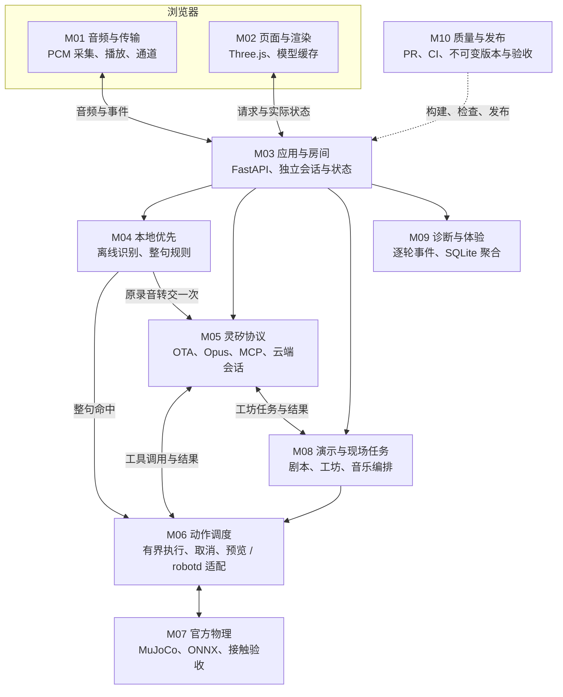
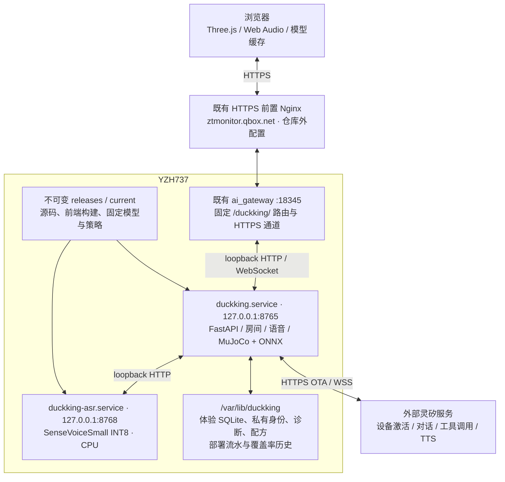
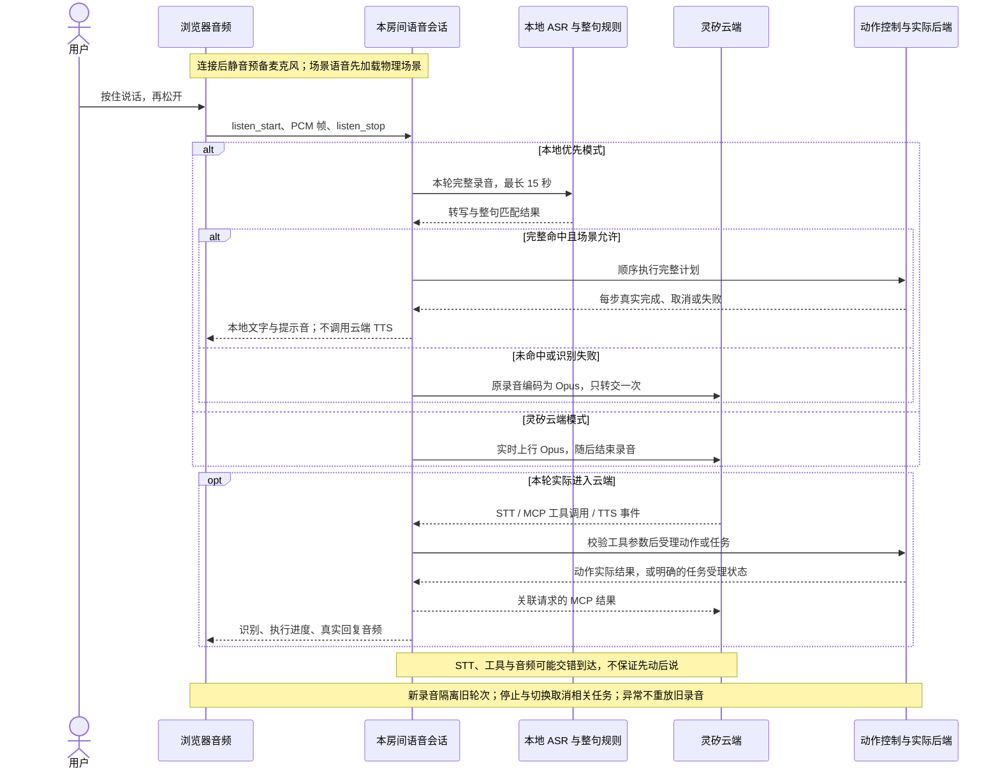

# DuckKing 架构与模块规格

## 交付范围

DuckKing 是可本地运行或部署在 HTTPS 入口后的语音、动作与自动演示应用。动画预览使用官方外观和本项目的脚本；物理实验室使用进程内 MuJoCo CPU / ONNX，另有独立的 robotd/MuJoCo 适配路径。已完成真实灵矽设备绑定、语音识别、MCP 动作调用与语音回复联调，测试输入为系统合成中文语音。

它没有完成实体硬件复刻或实机验收；物理结果仅对当前仿真配置成立。

本文是竞赛的架构设计入口：下面给出运行模块、部署、时序与接口规格；[TEAM.md](TEAM.md)用相同模块编号列出负责人、交付边界和验收入口；[CONTRIBUTION_SCOPE.md](CONTRIBUTION_SCOPE.md)区分自研接线与官方模型、策略、引擎。代码核对基线为 `2089d6e`（PR #36 合入后的 main），历史测试数据按 [VALIDATION.md](VALIDATION.md)各自的提交读取。

## 架构



robotd 路径的物理计算在官方 MuJoCo body 中完成，官方 robotd 运行已有策略。首页网格来自官方模型，但姿态动画仍是运动学示意；真实实时接触画面在独立物理实验室中呈现。

## 模块规格

| 模块 | 文件 | 输入 / 输出 | 责任边界 |
|---|---|---|---|
| 本地应用与房间 | `src/duckking/app.py`、`rooms.py` | HTTP API、状态 WS、语音 WS | 默认只绑定 loopback；同源校验；默认最多 10 个房间、4 个物理世界，每房间一个页面拥有语音 |
| 动作调度 | `motion.py` | Action → 执行记录 / 状态 | 限时、取消、去重、失败反馈；不直接控制舵机 |
| 组合动作 | `choreography.py` | 动作名 / 时间 → 高层意图帧 | 闪身步与狗熊哆嗦毛；有界、连续的阶段编排 |
| 预览后端 | `motion.py:PreviewBackend` | 速度 / 头部意图 → 动画状态 | 运动学示意，不计算接触、平衡与真实步态 |
| 官方适配 | `robotd.py` | NDJSON → 官方状态 | 订阅 20 Hz 遥测；发送连续意图；拒绝使用过期状态 |
| 设备配置 | `config.py` | 私有配置、OTA → 设备连接参数 | 设备身份持久化；凭证留在后端；公网连接要求 TLS |
| 显式初始化 | `onboarding.py` | 平台 API Key 文件 → 智能体/设备绑定 | 仅在运行 setup 命令时创建或复用 DuckKing，不迁移已有设备历史 |
| 音频编解码 | `opus.py` | PCM16 ↔ Opus | 原生 libopus；16 kHz 上行；按服务器协商解码下行 |
| 灵矽会话 | `voice.py` | 浏览器音频 ↔ 云端事件 | 激活、握手、按键打断、音频、工具转发、断线清理 |
| 语音诊断 | `diagnostics.py` | 阶段 / 计数 / STT → 有界日志 | 字段白名单、STT 脱敏与长度限制、内存最近 200 条、私有轮转文件；不保存录音或设备标识 |
| 交互统计 | `statistics.py`、`frontend/src/statistics.js` | 脱敏事件 → 最近 500 轮、百分位、统计页 | 单调时钟、进程内唯一轮次；缺失不补零、不同后端可筛选；不推断物理或扬声器延迟 |
| 端侧 MCP | `mcp.py` | JSON-RPC → 工具结果 | 初始化 / 工具发现 / 白名单调用；结果关联原请求 ID |
| 浏览器音频 | `frontend/src/voice.js`、`audio-output.js`、`audio-codec.js` | 麦克风 / 语音事件 | 录音权限、流式重采样、分帧、播放队列与释放麦克风 |
| 离线语音路由 | `hybrid_voice.py`、`local_commands.py` | PCM / 转写 → 本地动作或一次云端回退 | 有界内存录音、整句匹配、取消隔离；不保存录音 |
| 离线识别进程 | `asr_service.py`、`asr_client.py` | loopback HTTP → 转写 | sherpa-onnx / SenseVoiceSmall、单推理线程、限流；仅共享 worker，不共享房间动作 |
| 物理场景 | `simulation.py`、`official_skills.py`、`grasp.py`、`posture.py` | 动作 → 实际状态 / 接触结果 | 独立房间的 MuJoCo 数据、固定官方策略、有界验证 |
| 四鸭演出 | `table_choir.py`、`seated_choir.py`、`frontend/src/demos.js` | 剧本 / 乐谱 → 可取消演出 | 本地音乐与云端语音分别标记；失败不补造动作 |
| 四鸭发布会 | `stage.py`、`frontend/src/demo-runtime.js` | 选中集合 / 指令 → 集结、翻滚、齐舞与实际结果 | 仿真位置反馈寻路；本轮目标锁定；翻滚后就地坐下，不自动归队 |
| 现场互动工坊 | `studio.py`、`studio_tasks.py`、`voice_profiles.py`、`frontend/src/studio.js` | 按节目收窄的工具 / 本地排练 → 任务、配方、角色配置 | 每房间可取消任务；配方确认后持久化；音色样本不等于已完成克隆 |
| 持续使用体验 | `experience.py`、`frontend/src/experience.js`、`experience-stats.js` | 浏览器 / 服务端阶段 → SQLite 与聚合页面 | 跨重启保留，最多 90 天 / 50,000 条观测；不存转写正文；观测端、流量来源分开统计 |
| 模型传输与物理渲染 | `model_assets.py`、`model_metrics.py`、`frontend/src/model-loader.js`、`physics-view.js` | 清单 / DKM1 / revision / 实时状态 → 画面与加载计时 | 公开几何可缓存，动态姿态不可复用；模型不匹配或失败显式报错 |
| 发布元数据 | `deployment.py`、`release_changes.py`、`release_coverage.py` | Git 历史 / CI 摘要 → 部署页 | 上次成功部署的提交差异、准确 SHA 对应的后端覆盖率、字段白名单 |
| 三维界面 | `frontend/src/duck.js`、`main.js` | 后端状态 → 画面 / 记录 | 官方外观 + 脚本关节动画；不计算物理，加载失败显式报错 |

上表未写目录的 Python 文件位于 `src/duckking/`；前端短文件名沿用同格的 `frontend/src/`。模块协作以以下十个边界划分，不代表十个独立服务或十位成员。

| 编号 / 模块规格 | 输入 → 输出契约 | 状态与失败处理 | 验收负责人 |
|---|---|---|---|
| M01 浏览器音频与传输 | 按住说话 → 16 kHz PCM16 / 60 ms 帧；下行 PCM → 播放队列 | 静音预备麦克风；最多 15 秒；打断清旧音频；公网 HTTPS 通道不重放录音 | [分工表](TEAM.md) |
| M02 页面、外观与物理渲染 | 官方清单 / 几何 / 状态 → 首页、练习场、剧场、工坊 | 首页脚本预览与实际物理明确区分；revision 防错配；加载失败可重试 | [分工表](TEAM.md) |
| M03 应用与房间 | 同源 HTTP / WS、房间号 → 本房间控制器与会话 | 15 秒预留；语音独占；房间 / 物理容量有上限；空闲回收保留私有身份 | [分工表](TEAM.md) |
| M04 本地优先识别 | 有界 PCM → 离线转写 → 完整动作计划或原录音转交 | 六步 / 20 秒；否定或未知片段整句转交；本地动作开始后不云端重做 | [分工表](TEAM.md) |
| M05 灵矽与设备协议 | OTA / WSS / Opus / MCP → STT、工具结果、TTS | 身份与凭证只在服务端；请求关联与去重；超时恢复一次；云端失败不冒充本地成功 | [分工表](TEAM.md) |
| M06 动作调度与后端适配 | 受校验 Action → 受理 ID → 完成 / 取消 / 失败 | 每控制器一个当前动作；新动作取消旧动作；预览、MuJoCo、robotd 显式选择 | [分工表](TEAM.md) |
| M07 官方物理与实验机构 | 有界速度 / 姿态 / 策略 → 状态、接触与动作验收 | 50 Hz 控制、200 Hz 积分；独立 MjData；无接触证据则不报成功；实验嘴部未实机标定 | [分工表](TEAM.md) |
| M08 演示与现场任务 | 十三幕剧本 / 工坊工具 / 音乐 → 可取消任务与当次证据 | 自动排练、实连语音、现场工具分别标记；音乐由浏览器合成或播放，不是云端作曲 | [分工表](TEAM.md) |
| M09 诊断与体验统计 | 白名单事件 / 耗时 → 逐轮诊断、跨版本分位数 | 进程内最近 500 轮与 SQLite 分开；缺失不补零；不将合成验收当日常用户样本 | [分工表](TEAM.md) |
| M10 质量与发布 | 提交 / 固定资产 / CI 报告 → 不可变包、部署流水 | 安装失败回滚；staged 与公网 success 分开；历史覆盖率按准确 SHA 独立保存 | [分工表](TEAM.md) |

## 部署与数据边界



前置 Nginx 的完整配置不在仓库中；当前验证过的公网入口由 ai_gateway 承接，不在图中假设可直接改动 Nginx。浏览器依据网关能力声明使用 HTTPS 长轮询，网关保持到 DuckKing 的真实 WebSocket；本地可直连 8765，开发 Vite 为 5173。DuckKing 与 ASR 独立升级，保持端口和协议即可，无需重启 ai_gateway。

房间的控制器、实时物理状态、语音连接和最近 500 轮统计在内存中，重启后重建；所有房间共享有界 ASR worker 和体验库，但不共享动作任务。官方只读几何与 ONNX 会话可复用，每个物理世界的动态状态独立。设备身份、确认后的工坊配方、体验库、部署流水和覆盖率保存在版本目录外。公开 API 只暴露必要状态及过滤后的数据，技术体验库不存识别正文；语音诊断可能含规则脱敏后的文本，不能当成完全匿名的使用记录。

## 一轮语音的时序



图中的“本地优先”用于工作台和动作练习场；现场互动工坊的真人语音固定走灵矽，自动剧场则显式选择本地剧本或预录指令实连。低能量录音可直接结束为未听清，不必进入云端。工坊长任务的受理不等于完成，完成以随后任务状态与实际结果为准；指挥和专注任务在打断回复时可按各自约定保留，见 [工坊说明](INTERACTIVE_STUDIO.md)。

## 本地接口

生产 demo 由 FastAPI 提供 `frontend/dist`；开发模式由 Vite 在 5173 提供源文件和热更新，转发 `/api`、`/ws`、`/voice` 到同一 FastAPI 后端。代理保留 Host / Origin，沿用同源校验，不引入替代动作或语音实现。安装与端口配置见 [本地开发指南](DEVELOPMENT.md)。

| 接口 | 用途 |
|---|---|
| `GET /api/rooms`、`POST /api/rooms/claim`、`POST /api/rooms` | 房间可用性、15 秒预留和显式新建，不创建私人账户 |
| `POST /api/experience`、`GET /api/experience`、`GET /experience.html` | 白名单技术计时上报、跨重启聚合和持续体验页 |
| `GET /api/studio`、`POST /api/studio/select`、`POST /api/studio/action` | 本房间工坊节目、任务状态与本地排练 |
| `GET /api/voice/profiles` | 可用音色 / 角色显示信息，不返回私有 ID |
| `GET /api/voice/modes` | 本地优先配置与 worker 可用性 |
| `GET /api/deployments`、`GET /deploys.html` | 发布版本、最多 100 条流水、提交变更、覆盖率 |
| `GET /api/health` | 版本、后端类型与服务可达性 |
| `GET /api/models/microduck` | 缓存的官方视觉网格、局部关节轴和默认姿态；不启动物理循环或 ONNX 推理 |
| `GET /api/models/microduck/manifest`、`GET /api/models/microduck/assets/{version}.dkm.gz` | 首页当前使用的内容版本清单与无损压缩模型；旧 JSON 接口保留兼容 |
| `POST /api/models/load-metrics` | 浏览器模型加载分阶段日志，区别于服务端准备计时 |
| `GET /api/state` | 当前动作、后端状态、近期事件 |
| `GET /api/voice/diagnostics` | 语音阶段、停留时间、音频帧数和脱敏诊断事件 |
| `GET /api/voice/statistics?backend=all` | 本进程最近 500 轮统计；可筛选 `preview` / `robotd` / `mujoco`；同源检查、禁止缓存 |
| `GET /statistics.html` | 主页链接打开的独立统计页面；不创建语音连接 |
| `POST /api/actions` | 提交受限动作，返回 202 和请求 ID |
| `GET /api/actions/{request_id}` | 查询完成、取消或失败结果 |
| `WS /ws` | 推送工作台状态 |
| `WS /voice` | 工作台语音：按所选模式创建云端或本地优先会话 |
| `POST /api/scenes/start`、`GET /api/scenes/state` | 惰性加载物理场景及当前状态 |
| `POST /api/scenes/close` | 无语音占用时停止并释放本房间物理世界 |
| `POST /api/scenes/stage/selection` | 四鸭发布会的选中集合、镜头左右顺序与 revision 校验 |
| `POST /api/scenes/actions`、`GET /api/scenes/actions/{request_id}` | 物理动作受理与实际结果 |
| `GET /api/scenes/model.dkm.gz`、`WS /scene-ws` | 真实物理几何与有确认机制的状态流 |
| `WS /scene-voice` | 物理场景语音；先加载场景，同房间与工作台共用一个语音名额 |

动作请求示例：

```json
{"name":"walk","duration":1.2,"request_id":"caller-generated-unique-id"}
```

工作台动作名称：`nod`、`walk`、`backward`、`strafe_left`、`strafe_right`、`shake_head`、`tilt_head`、`turn_left`、`turn_right`、`stop`、`reset`、`flash_step`、`bear_shake`。物理专属动作见下文各场景与 `motion.py:Action`。普通动作时长范围 0.2–3 秒；两个组合动作默认 3 秒，范围 2.4–3 秒。普通移动的可选速度范围为 0.02–0.4 m/s；不提供时，预览后端使用 0.12，官方仿真适配器使用实测可启动步态的 0.35。组合动作使用固定速度编排，不接受 `speed`。速度指令不保证固定距离。

工作台接口的 `reset` 只支持动画预览；独立物理场景接口另支持场景重置。官方适配器不会把它映射成实体机器人上电、断扭矩或未知重置指令。

执行记录状态为 `running`、`completed`、`cancelled`、`failed`。`completed` 表示本地指令序列完成、停止请求获确认，不保证机械位移达到某个目标值；实际运动需看官方遥测和物理状态。MCP 会将取消或失败结果标为错误，不返回虚构成功。

## 动作与取消

一个控制器同一时刻执行一个动作。新动作先取消旧动作；前进和转向每 50 ms 发送一次意图，到本地期限自动停止。浏览器串行提交请求的接收过程，不等待整个动作完成，因此快速点击“前进→停止”不会因两个 HTTP 请求乱序而先停后走。

相同请求 ID 和参数重试复用原结果；相同 ID 配不同参数会拒绝。历史与事件数量有上限。官方后端在状态超过 1 秒未更新时拒绝开始移动，不悄悄回退到动画模式。

点头使用小幅轨迹，并保留动作开始时的头部姿态；不假设所有模型或版本的机械零位相同。

组合动作额外控制横向速度、头部偏航/侧倾和身体姿态。站姿模式和步行分段互斥；结束或取消时关闭站姿模式并恢复头部目标。详细阶段及幅度见 [CHOREOGRAPHY.md](CHOREOGRAPHY.md)。

## 语音与工具

按键说话时，浏览器采集单声道音频，转换为 16 kHz、PCM16、60 ms 一帧。后端编码 Opus 后上传。服务端下行可能使用不同采样率，后端按握手参数解码，再让浏览器按正确采样率播放。

连接时先准备麦克风和 AudioWorklet，准备完成才启用说话按钮。连接期间复用同一静音轨道；仅按住时启用输入、保留并发送音频，松开立即静音，断开或离开页面停止轨道。按下时立即开始分帧，场景选择同步或音频恢复尚未完成时，首批音频按序暂存于内存（最多 250 帧）；先发送 `listen_start` 再发送暂存音频。即使很快松手，也保留完整短句后发送 `listen_stop`。准备失败或取消会丢弃待发帧；未按住期间不缓存或上传声音。

每次录音最多 15 秒。播放时可按住按钮打断，清除播放队列后录制新命令；非打断的 TTS 结束会等待已有音频播放完成。断线后停止相关动作、释放音频资源并提示用户重新连接。当前不做唤醒词、全双工或自动恢复录音。

后端独立监控录音时限，即使浏览器不再发音频也会在 15 秒结束录音。思考阶段 20 秒没有 STT / MCP / TTS / 音频等有效进展，或回答阶段 15 秒没有新进展时，关闭旧云端会话并重连一次；包括录音在内的整轮另有 60 秒上限。重连前取消工具任务、停止动作、关闭编解码器并通知浏览器清空播放队列。旧录音不重发，恢复到 ready 后需重新按键说话；重连失败会进入 error，不无限重试。

第 13 幕长动作仍在执行时，只有实际推进的 MuJoCo 时钟才能刷新无进展计时，冻结的物理状态不会持续续期；整轮 60 秒上限不变。工坊后台任务的受理和完成分开记录，不能用任务已排队替代实际完成。

浏览器采集和播放复用一个硬件默认采样率的 AudioContext，采集端仍通过 PCMFramer 连续重采样为 16 kHz / 60 ms 帧。松开说话按钮静音麦克风并结束本轮分帧，保留轨道、采集节点和声音上下文供下一轮复用；断开才释放麦克风。AudioWorklet 每个上下文只加载一次。连接、说话、松手及本地声音测试的用户手势中尝试激活播放，恢复等待限时 1.5 秒，不阻塞网络连接或断开。支持可选 Audio Session API 的浏览器在录音时请求 `play-and-record`，结束后请求 `playback`，其他浏览器继续使用 Web Audio。

下行待播和已调度音频合计最多 12 秒 / 300 帧，超出部分丢弃并提示重新说话；恢复播放按原顺序处理，打断会同时清理待播和已调度节点，迟到的恢复不能复活旧音频。本地 250 ms 测试提示音明确标为声音测试，不是灵矽回复。「声音诊断」的计数及 `browser_audio` 事件由浏览器上报，按房间隔离，只接受状态枚举和非负整数白名单，不收集录音或设备标识；同状态最多每秒落盘一次，状态变化立即记录。`ended_frames` 只代表浏览器播放节点结束，不能作为扬声器确实出声的证明。

云端连接整体限时 35 秒，发送/关闭云端 socket 限时 5 秒。连接任务与浏览器指令接收分离，用户可以在连接或恢复期间断开，也可以用「重置语音」取消卡住的一轮并重建会话。日志接收枚举字段、整数计数、本地产生的时间/序号及脱敏 STT 文字（最多 2000 字符）；不写入云端 session ID、原始工具调用 ID、原始异常正文或音频。统计直接消费过滤后的事件，独立于最近 200 条事件窗口，不从旧文件回放。

工作台端侧 MCP 提供 13 个工具；普通物理场景再增加 18 个专属工具。第 13 幕 stage 仅提供停止、状态和集结／翻滚／齐舞三个专属工具；工坊按当前节目收窄工具并追加相应任务与已配置的声音工具，不能把所有工具数量相加当作任一会话的工具数。完整筛选逻辑见 `mcp.py:DeviceMCP._dispatch`。工作台工具如下：

| 工具 | 参数 | 结果 |
|---|---|---|
| `duck_nod` | 无 | 点头任务的真实执行记录 |
| `duck_walk_short` | 可选 `duration` | 限时前进任务的执行记录 |
| `duck_turn_left` | 可选 `duration` | 限时原地左转任务的执行记录 |
| `duck_turn_right` | 可选 `duration` | 限时原地右转任务的执行记录 |
| `duck_stop` | 无 | 取消当前动作并发送停止 |
| `duck_get_status` | 无 | 后端类型、连接、当前动作 |
| `duck_flash_step` | 无 | 三秒闪身步编排及执行结果 |
| `duck_bear_shake` | 无 | 三秒狗熊哆嗦毛编排及执行结果 |
| `duck_backward`、`duck_strafe_left`、`duck_strafe_right` | 无 | 默认时长的后退与左右横移 |
| `duck_shake_head`、`duck_tilt_head` | 无 | 摇头、歪头后回正 |

一次会话内按 JSON-RPC ID 去重，最多同时处理 32 个工具消息。工具调用不阻塞音频接收，使停止调用可以打断正在等待结果的前进调用。

提示词要求多动作按用户顺序串行调用，失败/取消后停止后续步骤，不将普通转向替换为舞步。这是云端指令约束，不是本地语义规划器；模型仍可能选错工具，统计页显示实际调用供核对。`action_start/end` 仅在去重后的真实调度处产生，使用本地序号关联并捕获原轮次，避免重连和新录音串轮。控制器受理时间不代表首帧物理动作或浏览器画面出现时间。

## 共享物理场景

Linux 部署使用独立的 `duckking.service`，按要求以 root 运行，发布目录为 `/root/zt_dir/hackathon_base/DuckKing`，不嵌入 ai_gateway。应用支持显式公网 Host 白名单与反向代理 `root_path`；前端资源、链接、API、音频 worklet 和 WebSocket 均按页面目录解析，同一构建可以挂在 `/duckking/`。Host / Origin 原样保留，跨来源请求仍然拒绝。部署方案见 [deploy/README.md](../deploy/README.md)。

ai_gateway 可独立添加固定 loopback 路由；现有前置代理不透传 Upgrade 时，浏览器使用网关声明的 HTTPS 通道，网关转为真实后端 WebSocket。文本与二进制帧按序传输，失败关闭、不重放录音，不改变预览、物理仿真或真实云端的能力边界。DuckKing release 切换不需要修改或重启网关。

`GET /api/deployments` 仅返回发布字段白名单与最近 100 条流水；当前进程启动时固定读取版本元数据，原子切换磁盘链接不会给旧进程贴上新版本。`staged` 代表独立后端本机自检通过，`success` 需要入口验收后确认。发布失败与回滚结果分别记录；`CommitHistory` 按目标的上次成功部署计算新增提交，暂存／失败不推进基准。覆盖率从 CI 摘要读取，只关联完全相同的 SHA，范围限定后端；旧版缺失报告时显示未记录。密钥、设备身份和原始配置不出现在该 API 中。

安装器在部署锁内，将各发布目录中的 `release-coverage.json` 与 `/var/lib/duckking/release-coverage.json` 合并，校验后原子写入独立存储（0600 权限）。任何输入损坏或写入失败都会中止安装，不覆盖已有报告。清理旧发布目录不再删除覆盖率历史。接口每次刷新读取独立存储，并用当前包的同 SHA 报告优先覆盖；因此补入经过核验的历史报告无需再次重启服务。只恢复存在的 CI 证据，不把当前数值套用到其他提交。


`simulation.py` 在 Python 进程中运行 MuJoCo CPU 与官方 ONNX 推理，`kind=mujoco`、`physics=true`、`runtime=mujoco_cpu_onnx`；它不是 robotd 适配器，也不复用首页预览的姿态动画。原工作台控制器与场景控制器相互独立。

`POST /api/scenes/start` 显式惰性加载模型；模型文件和策略位于 `external/`，不进入 Python 包，本地开发显式下载，Linux 发布包携带固定版本及来源信息。球场使用官方 `scene_ball.xml`，双鸭场景用 `MjSpec.attach` 将两个官方 `robot_allcollisions.xml` 放到同一个模型中。控制频率 50 Hz，每次推进 4 个 5 ms 物理步，双鸭共用一次 `mj_step`。策略采用官方 61 维观测、14 维关节输出、默认姿态与 0.5 秒踢球时长；沿用 MJCF 的位置执行器参数，没有接入训练时的动态 BAM 电机模型。

球场对 `ball_geom` / `floor` 单独增加 `condim=6` 接触对，滑动／扭转摩擦保持原来的合成参数，滚动摩擦设为 0.003 m；这是 DuckKing 的演示场地参数，未经过实物标定。官方场景默认 `condim=3` 只阻止滑动，纯滚动不会减速，曾导致连续左右脚踢球后位移增长到数百米。参见 [MuJoCo 接触维数说明](https://mujoco.readthedocs.io/en/3.3.7/XMLreference.html#body-geom-condim)。修复仅改变球地接触，脚球接触和机器人步态接触保持原参数。球通过接触求解自然停下，不截断显示数字、不重置球的位置或速度。位移仍是相对本次摆球点的实时水平距离，踢球动作完成不等于球已静止；页面另显示球速，小于 0.01 m/s 标记已停稳。回归检查左脚、右脚和连续左右脚，动作完成后继续推进 60 仿真秒，验证停球与后续漂移。

`/api/scenes/actions` 与原工作台共用有界、可取消、按请求 ID 去重的 `MotionController`。场景动作结束前会验证所选脚接触和位移，或者双鸭接触；失败不会返回完成。正常动作的 `target` 可为 a/b/both；停止与场景切换取消当前动作。球场和双鸭清零运动、头部和身体意图；搬运停止会保持已夹住物品所需的嘴部与头部目标。标准动作最长 3 秒，实验性放下为固定 4.5 秒，桌上跌落编排为固定 36 秒，坐姿轮唱为至多 44 秒（准备至多 3 秒 + 音乐 40 秒）、随时可取消；物理场景等待按仿真时间计时，另有「目标时长 + 3 秒」墙钟超时。清零命令不冻结物理世界。

`GET /api/scenes/model` 提供编译后的官方网格和外观，顶点 float32、索引 uint32 以小端 base64 传输，按场景缓存。`/scene-ws` 只发送实际 `geom_xpos/geom_xmat`、接触计数、球位移、双鸭姿态和合唱节拍。浏览器处理后发送文本 `next` 请求最新快照，频率上限 20 Hz；每个连接只保留一帧待确认数据，30 秒没有确认就关闭并由页面重连，避免慢客户端积压旧物理状态。非法确认帧以 1008 关闭。模型响应与状态流使用 revision 配对，避免切换时套用旧模型；revision 属于编译模型，同场景重置复用几何，重启进程重新生成。

Three.js 渲染官方几何，不会用预设踢球动画替换实际关节结果。每次绘制后留出至少 33 ms 空闲时间；检测到 SwiftShader / llvmpipe 等软件渲染器或连续慢帧时关闭阴影，将画布宽度先限制为 640 像素，持续慢帧时降到最低 240 像素；按绘制与 GPU 等待耗时的两倍留出 100–2,000 ms 空闲间隔。软件显卡上降低画面分辨率与刷新频率，仍显示完整官方几何。这样可以为输入、语音和状态处理留出时间，不改变物理步进和接触判定。

`/scene-voice` 根据模式选择 `VoiceSession` 或 `HybridVoiceSession`，连接场景控制器，按同源规则保护。同一房间内和 `/voice` 共用一个语音名额；各房间使用独立设备身份与控制器，物理世界按需初始化并另设并发上限。物理专属 MCP 工具仅对 MuJoCo 控制器公布：`duck_set_scene`、`duck_kick`（必填 left/right）、`duck_find_companion`、`duck_duo_walk`、`duck_collide`、`duck_chorus`、`duck_pick_up`、`duck_carry`、`duck_put_down`、`duck_sit`、`duck_stand`、`duck_roulade`、`duck_ground_pick`、`duck_yawn`、`duck_idle_on`、`duck_idle_off`、`duck_skate`、`duck_roller_crouch`。桌上与坐姿四鸭演出由应用编排，不增加云端工具。状态工具剔除渲染网格，避免将大量图形数据送入模型上下文。统计按 `mujoco` 单独筛选。

发现同伴使用仿真真值：距离 ≤1.2 m、相对朝向 ±60°、`mj_ray` 检查遮挡。合唱为应用自己的 3 秒双声部旋律，两只鸭收到相同点头节拍，浏览器两个声部共享 AudioContext；声音依赖用户启用，工具成功表示控制编排完成，不承诺扬声器播放或跨设备同步。不是官方 BLE/duckether 合唱实现。

## 身份与配置

默认私有配置路径是 `~/.secrets/duckking.env`，设备身份位于 `~/.local/share/duckking/identity.json`。已有身份保持不变；新设备 ID 使用随机生成并持久化的本地管理 MAC 格式标识，Client ID 使用 UUIDv4，避免同机两个房间身份碰撞；身份文件以 `0600` 权限创建。房间 2 使用数据目录下 `rooms/2/identity.json`，通过 `duckking-setup --room 2` 独立绑定。

没有手工设备凭证时，走 OTA 激活与控制台绑定。浏览器只接收激活码与必要状态，不接收设备 token；网络错误只输出错误类型，避免将含凭证的 URL 或请求头写入界面。

`duckking-setup` 可从 `~/.secrets/lingxi` 读取一行平台 API Key，用于显式创建/选择智能体和绑定。该 Key 不发往设备 OTA 接口，也不作为设备连接 token 使用。实测 OTA 返回官方网关的 `ws://` 地址；客户端仅对已知官方主机升级为 `wss://`，其他公网明文地址仍被拒绝。

## 分工与验证

实际参与者见 [TEAM.md](TEAM.md)，贡献边界见 [CONTRIBUTION_SCOPE.md](CONTRIBUTION_SCOPE.md)，测试与已知限制见 [VALIDATION.md](VALIDATION.md)。

开发协作过程见 [AI 协作说明](AI_COLLABORATION.md)，跨模块故障与回归经验见 [LESSONS_LEARNED.md](LESSONS_LEARNED.md)。

本项目不把 AI 辅助开发记作额外参赛成员，也不把第三方步态策略或官方仿真器记作原创成果。

动态房间分配、接口选择和打断录音缓冲的规则见 [开发指南](DEVELOPMENT.md#打断回复并说新命令)。设备接入与 abort 格式依据 [灵矽官方 WebSocket 协议](https://linx.qiniu.com/docs/xrobot/platform/websocket)；没有假定同一设备支持多连接。

## 嘴部夹取与首页官方外观

`model_assets.py` 从固定官方 MJCF 导出 70 个视觉 geom、复用的 STL 网格和 14 个关节的局部轴 / 枢轴 / 默认角度。`GET /api/models/microduck` 只编译模型，不做物理推进；浏览器用 Three.js 关节树播放既有预览状态。没有翅膀或手部关节。API 与首页均标识 `physics=false`；依赖缺失返回 503，页面可显式重试。该外观接口不依赖房间物理场景，首次加载不会启动场景或云端语音。

首页现通过 `/api/models/microduck/manifest` 查询内容版本，再获取 `assets/<sha256>.dkm.gz`，旧 JSON 接口保留兼容。DKM1 为 4 字节魔数、uint32 小端 JSON 头长度、4 字节对齐的 JSON 头及网格缓冲；坐标保留 float32，索引仅在所有值均可表示时无损改存 uint16。没有减面或改变模型。显式 `.gz` 地址始终返回 gzip 表示及 `Content-Encoding: gzip`，浏览器自动解压；现有 ai_gateway 虽向上游发送 `Accept-Encoding: identity`，仍会原样转发这些压缩字节和响应头，无需修改或重启网关。

服务端在工作线程中构建并缓存压缩包，同一进程用锁避免多个房间同时重复构建。内容哈希决定资源 URL，资源使用 immutable 缓存，清单每次重新验证。浏览器 CacheStorage `duckking-official-model-v1` 只保存一份经过验证的公开模型，URL 不含房间参数；缓存失效或模型版本变化时获取新包，存储不可用时仍请求真实模型。损坏缓存被删除并明确提示重试。模型加载不会启用物理或语音。

页面交互记录显示总耗时；控制台 `[DuckKing:model-load]` 和 `POST /api/models/load-metrics` 上报查询版本、读取资源、解析、组装、首帧提交耗时及缓存来源。`elapsed_ms` 从加载开始计时，`navigation_ms` 从导航开始计时；首帧计时到 Three.js 提交绘制后的下一帧，不是显示屏出光测量。`encoded_bytes/decoded_bytes` 是清单声明的模型规格，`transfer_bytes` 来自资源计时或为持久缓存读取的零。服务器以 `official_model_load source=browser_reported` 打印白名单数值，资源首次构建另打印 `official_model_asset_built`。不上报 URL、设备标识、音频或自由文本；客户端计时不冒充服务端测量。

## 自动演示剧场

`demos.html` 提供十三幕可独立点播的节目，清单和角色台词在 `demo-catalog.js`。每次运行持有一个 AbortController 和所用房间集合；切换节目等待旧运行完成清理，旧请求不会更新新节目状态。正常关闭附加房间的画面连接不算连接故障。音频、脚本停止后，向所用物理控制器发送有界停止，并释放本页建立的语音会话。

排练模式通过既有场景 API 执行动作，台词明确标记为预录；实连模式由 `DemoVoice` 将预录 PCM 按同一协议送入 `scene-voice`，保持 heartbeat、generation 过滤、打断与房间选择。云端结果只从本轮动作事件中取证，不从历史成功记录借用，也不在缺少动作时以本地编排补齐。两个模式的旁白仍为预录。四声部试听在共享 AudioContext 上播放官方乐谱节选，并不经过灵矽生成音乐。

`/api/scenes/model.dkm.gz` 将实际物理模型导出为 DKM1，带 `official_microduck_physics` / `physics=true` 和原 revision；解析与首页的非物理外观资源分开验证。服务器按编译模型 revision 缓存，浏览器在页内内存与 CacheStorage 中按房间 URL、revision 缓存最多六份模型。模型重置保持 revision，场景变化时重新核对版本；DKM1 允许多个网格描述符引用相同偏移的数组，服务端按数据类型与字节内容去重，浏览器复用几何与法线。模型坐标和拓扑没有减面或改写。详细节目来源、评估和限制见 [演示剧场](DEMO_THEATRE.md)。

`grasp_model.py` 构造 `carry` 场景：原 14 个 ONNX 策略执行器按名称选择，观测仍为 61 维，输出仍为 14 维；新增第 15 个 mouth 执行器独立控制。嘴部角度范围 −5° 至 30°，力矩限制 ±0.025 N·m；上下接触垫的尺寸不同，以允许张嘴时物品脱离下垫。质量 / 惯量拆分和接触垫是实验性近似。小棒为 20×130×8 mm、4 g 的自由刚体；只在场景加载/重置时采用初始状态，动作过程中不写它的位姿，不加焊接、吸附或外力搬运。物品碰撞使用显式嘴垫、地面和支架，不能据此证明完整头部 CAD 的所有接触都准确。

`grasp.py` 每个 5 ms 物理步汇总 `mj_contactForce` 的真实法向力。夹起需要上下垫均超过 0.01 N、持续至少 0.2 秒、物品最低角点高于原支架 8 mm 且没有支架接触。搬运需要物品水平位移 >10 cm、躯干位移 >8 cm、保持夹持且到达接物台范围。夹持丢失超过 0.12 秒、相对嘴部滑移 >18 mm 或跌倒会明确失败，并停止移动。步态期间头部意图清零，遵循原策略的站立/行走输入约定。

放下先张嘴，再低头让物品落到接物台；确认接物台接触后才退开。完成要求上下嘴垫接触力合计 <0.001 N、接物台接触力 >0.005 N，且物品线速度 <0.02 m/s、角速度 <0.1 rad/s，持续至少 0.2 秒。工具固定仿真时长为夹起 2.2 秒、搬运 3 秒、放下 4.5 秒，整段动作另设「时长 + 3 秒」墙钟截止。停止不会宣布成功；已建立的夹持继续保留，动作中断后可显式重置。MuJoCo 数值异常导致时钟倒退/重置也会报错，不静默重置为成功。

该流程仅验证固定取物架到固定接物台的轻载搬运。没有物体视觉定位、任意物品规划、地面拾取、新策略训练或真机验收。页面给出夹持阶段、接触力、最高离架高度和实际搬运位移；它们与云端语音统计分别记录。


桌上演出由 `table_choir.py` 管理，`scene_table` 懒编译四个官方全碰撞模型和有限桌面；原 ball / duo / carry 不必预先付出四鸭编译成本。首次编译任务使用 shield 共享等待；取消页面请求不会重复启动不可中断的原生编译，也不会让已取消请求在编译结束后切换场景。`table_show` 是固定 36 秒的整段应用编排，不接受速度或成员变更，其他动作的上限不变。物理仍按 5 ms 步进；桌面/地面接触和根节点高度来自每个物理步。表演按仿真时间、每 20 ms 物理控制步更新，音乐读取实际演出进度；推进不足墙钟 50% 则明确失败。鸭 D 在第 14–16 秒停止踏步，确认桌面支撑、站立高度及身体朝上持续 0.4 秒后才离桌，避免从摆腿相位直接冲出桌沿；未站稳则失败。只有重置写入初始根位姿；失足由官方步态走出桌沿产生。这个节目未添加灵矽工具或改变现有真人语音模式。

桌上合唱的鸭 D 在离桌后保持世界坐标向外的受限速度请求，直到实际地面接触后 0.4 秒，再交还静止恢复与原地续舞控制，避免落地卡在桌脚旁。该衔接与其余编排一样按物理时间推进；36 秒上限、取消清零、14cm 舞步站位保护和真实接触检查不变。

桌上舞步用四拍交替的短距离前后踏步和站立摇摆。步态反馈限 vx ±0.4 m/s、vy ±0.22 m/s、yaw ±0.5 rad/s；在机器人坐标中发送速度，站位偏离超过 14 cm 立即失败并清零命令。D 的离桌阶段单独处理。每个物理步测量左右膝关节实际摆幅、踝部参考点垂直位移范围和最大水平偏移；D 的测量仅取前 16 秒，排除跌落造成的虚高幅度。踝部位移不是脚底离桌净空或硬件测量。

`table-scores.js` 包含两首公共领域旋律的有界音符事件：SATB《欢乐颂》及依次入场的《两只老虎》。Web Audio 三角波保留基频、低通柔化音色，独立声部总增益受限；退出、停止、失去物理状态或音频时钟暂停均清理所有振荡器。声部卡按实际音乐时钟显示等待/入唱。原录音叠唱版仍使用四条 MP3，并以版本参数避免旧音源缓存；鸭 D 改为居中的主唱层。

鸭 D 落地后先由官方策略恢复平衡；落地至少 1.2 秒、根高度 >10 cm 且身体上轴朝上分量 >0.85，持续站稳 0.4 秒后，记录当时的位置和朝向作为地面舞步中心。随后使用同一有界踏步/摇摆控制器；地面偏移同样限 14 cm。`floor_dance` 单独记录起舞时刻、站稳之后的膝关节摆幅、踝部垂直位移范围和最大偏移，排除跌落及起身过程。完整演出还要求地面左右膝实际摆幅均超过 25°，才返回完成。


## 官方坐站与坐姿独唱

`posture.py` 使用固定版本的 `alpha_sitstand.onnx`（61 维观测 / 14 关节输出），其 twist.vx 输入是坐姿标志，单独注入策略观测，绝不计为走路速度。`sit` / `stand` 的 API 时限为 3 秒。完成条件是实际接触支撑、身体竖直分量 >0.94、坐姿相对支撑面高度 4.5—7.8 cm 且双膝弯曲 >1 rad，或站姿高度 10—14.5 cm 且双膝 <0.55 rad；连续满足 0.3 秒仿真时间才完成。偏移 >10 cm 或超时明确失败。

停止清除速度、身体和头部指令；坐站策略保留最近一次已确认的稳定姿势。过渡中取消会恢复上一次确认的坐姿或站姿，因此物理平衡仍继续，不能理解为冻结关节。坐姿可以点头；走路、转向、踢球必须先成功站起。搬运和跌落舞台拒绝混入坐站动作。只向 MuJoCo 场景语音发布这两个工具，动画预览和 robotd 未添加坐站替代实现。

`scene_seated` 与 `scene_table` 共享不可变编译模型与几何，重置时采用居中四鸭站位，各房间仍有独立动态状态。`seated_show` 在四鸭坐稳后开始 40 秒应用编排：4 秒合唱，A—D 各 8 秒（2 秒起身 / 4 秒独唱 / 2 秒坐回），最后 4 秒坐姿合唱。站稳和坐回均需连续实测确认，离桌、偏移 >12 cm、时钟推进不足 60% 或姿态不符合要求会失败。独唱时前端只播放该鸭的旋律，另三轨静音；过渡时轻声和声。音频使用同一个浏览器 AudioContext，按收到的物理阶段启用独唱，不承诺跨设备 BLE 同步。

坐姿合唱按服务端确认的阶段及 elapsed 选取音符；某位歌手站稳进入独唱后，预排该段尚未结束的音符，由 AudioContext 负责播放，避免渲染延迟让浏览器时钟越过整个声部。仍要求实际调度 A–D 四段独唱，不能用历史 completed_solos 补造已播放；物理失败、状态失联超过 4 秒、总等待超限或取消都会停止音频。

## 动作练习场与轮滑

固定资产新增 `roulade.onnx`、`alpha_ground_pick.onnx`、`roller.onnx`、`roller_crouch.onnx`，仍来自同一固定策略 commit，逐文件 SHA-256 校验。总计加载八个策略。`Driver` 按执行器名称选择 14 个主动关节，排除轮滑模型的四个被动轮关节；滚轮模式使用动作缩放 0.8 和原生推理脚本的 0.003 轴承摩擦。`skills` 使用原官方地面模型加实验性嘴部铰链；`rollers` 使用官方 `robot_groundcontact_rollers.xml`。新增场景模型按需编译，几何缓存按场景 revision 隔离。

`official_skills.py` 使用仿真时间驱动动作与结束检查，墙钟上限为动作时长加 3 秒。前滚翻执行策略 2 秒（采用上游 `infer_policy.py` 的默认行为时长，比发布 manifest 的 1 秒交接更晚），关节输出单独缩放 0.9，观测中的上一动作保留网络原单位；之后交还 velstand，整个观察窗口 6 秒。原幅度 1.0 在不同静置时长后曾出现未完整翻转或未站起，不能仅验证刚重置的姿态。必须曾倒置（竖直分量 <−0.5）、展开后的俯仰投影跨度 >5 rad，并最终接触地面、竖直分量 >0.94、身体高度 >10 cm、平移速度 <0.08 m/s 连续 0.3 秒。该角度是姿态投影的累计量，不是精确的特技评分。

仿真循环按单调时钟的连续 20 ms 截止点调度，避免每帧的调度延迟不断累积；落后时最多保留三个控制步的待追赶时间，每次仍实际执行物理积分并让出事件循环，不修改仿真时钟补数。长期算力不足仍会触发动作/合唱的超时或推进过慢错误。

低头啄取以 4 秒周期在命令前两维编码 cos/sin 相位，执行 2.8 秒后交还站立；整个窗口 5 秒。嘴尖最低 <4 cm 且比开始下降 >12 cm，并恢复稳定站姿，才完成。没有地上物品、抓取力或附着约束，因此始终返回 `object_grasped=false`。轮滑下蹲以 5 秒周期执行 3.5 秒，再交还 roller，整个窗口 6 秒；身体下降 >3.5 cm 且站稳才完成。滑行指令为 0.35，保持 3 秒、总窗口 5 秒；要求实际位移 >5 cm、被动轮转角 >1 rad 并稳定收势。初始静止时间会影响起步，不能只在刚 reset 的状态验收。

后退和横移复用 velstand，默认命令幅值分别为 0.35、0.30，显式 speed 仍遵循 API 的 0.02–0.4 边界。较小命令在该模型上存在不迈步区间，因此记录每个目标相对于起始朝向的实际位移；只有沿指定方向 >5 mm 且躯干竖直分量 >0.90 才返回完成。时限由仿真时间控制，最长 3 秒；原来的预览运动仍明确是运动学动画。

`idle.py` 是参考官方待机行为概念的 DuckKing 本地适配，没有导入 Rust robotd、感知模型或自主行为栈。仅在动作练习场显式启用；动作运行时暂停、结束后两秒恢复，停止/重置/切场景关闭。看向不同方向并不表示识别到了物体。哈欠使用独立嘴部执行器，4 秒平滑张合、0.5 秒收势，最大目标约 27.5°；完成检查实际嘴角 >0.20 rad 和支撑稳定。取消后不会残留阶段回调、嘴部或位移意图。轮滑取消返回 roller，普通脚返回 velstand，坐姿保持最近已确认姿势，物理世界不冻结。

所有新工具复用 MCP 的请求重放去重和失败返回；新增策略只向 MuJoCo 场景语音暴露。普通头部与后退横移可用于预览、robotd 的现有接口，但不将动画结果标记为物理验证。官方摄像头／ToF／同伴检测和空气琴未在本次动作扩展中接入。

## 服务器离线识别与整句回退

`DUCKKING_LOCAL_ASR=1` 开启可选“本地优先”模式，页面仍保留“灵矽云端”。`GET /api/voice/modes` 返回配置开关和 worker 可用性；不返回设备身份。普通手机浏览器仍用现有 HTTPS 麦克风和音频传输，不安装识别模型。

本地路径：浏览器 PCM → `HybridVoiceSession` 内存录音 → loopback `duckking-asr` → SenseVoiceSmall INT8 → `local_commands.py` 整句语法 → 同一个 `MotionController`。音频不落盘，最多 15 秒 / 250 帧。模型使用单 CPU 推理线程；独立进程最多容纳两个未结束任务，调用者取消不会提前释放仍在运行的原生推理占位。主应用等待识别最多 3 秒，worker 最多等待 8 秒，繁忙或失败显式转交灵矽。

常用动作词与顺序连接词组成白名单；最多六个动作、总动作时长 20 秒，支持普通移动指定 0.2–3 秒。场景、目标鸭和所有片段在第一步执行前一起检查。否定、问句、条件、未知后缀或场景不匹配整句转交，绝不先执行已认识的半句。模型没有可校准置信度，当前不使用虚构分数；低能量录音返回未听清，识别结果仍可能出错，需要真机、口音与噪声评估。

转交时新建真实灵矽会话，仅发送这轮原始 PCM 经 Opus 编码后的录音一次；没有第二次录音，也没有发送失败自动重传。云端仍做自己的 STT/MCP/TTS。本地动作一旦开始，任何执行失败都结束本地轮次，不再云端重做。按住“打断并说话”取消识别/动作、停止旧音频并接收新录音，旧 generation 的云端工具不能继续执行。每个房间有独立会话与动作控制器，只有有界 ASR worker 共享。

本地命中采用短提示音和文字反馈，明确标为本地，未调用云端 TTS。统计记录 `mode`、`route`、本地识别耗时、回退原因、动作受理时间与本地完成；本地完成不计入云端回复率。动作延迟是松手至控制器受理，不等于画面显示或实际扬声器延迟。识别命中率的分母为已判定的本地优先轮次，包含未听清，不是字准确率。

坐站策略结束后直接踢球时，先由行走策略执行 0.4 仿真秒的站姿衔接，再按所选脚放球并切换踢球策略；剩余 1.6 仿真秒用于踢球与接触验证。衔接可取消，取消后不会迟到地放球或启动踢球。正常行走站姿的踢球仍使用原来的完整 2 仿真秒。


### 场景加载与语音识别统计口径

物理实验室改用 `/api/scenes/model.dkm.gz` 的 DKM1 压缩几何；与 MuJoCo 原始网格数值一致，不做模型简化。浏览器按房间 URL 和服务端 revision 缓存最多六份已验证的模型（页内内存、CacheStorage `duckking-physics-model-v1`），再次选择或刷新可复用；revision 变化重新获取。状态、姿态与动作仍通过实时通道获取，缓存不会复用旧物理状态。存储不可用继续访问真实模型；损坏缓存删除，场景变化时拒绝错配几何。

场景页交互日志显示外观就绪耗时，控制台 `[DuckKing:scene-load]` 与服务器 `official_model_load` 日志包含 `view=scenario`、场景名、缓存来源及下载/解析/组装/首次绘制调用耗时。点击切换时总耗时从点击计，打开已有场景时从首次收到有效状态计；`navigation_ms` 始终从导航计。首次绘制不是显示器出光计时。压缩接口的 `Server-Timing: model_prepare` 单独测服务端准备耗时。浏览器上报仍只接受有界白名单字段。

统计 API 的分布包含 `count`、`mean_ms`、`p50_ms`、`p90_ms`、`p95_ms`，空样本返回 null，百分位采用最近秩法。`routing.recognition_latency` 分别使用首个本地/云端非空 STT 事件，均相对服务端收到结束录音计时；本地识别后转交的轮次可以为两个引擎分别贡献一个样本。灵矽包含网络、排队及转交等待，不等于其内部纯推理耗时；录音结束前已返回的识别不纳入非负分布。本地 ASR 工作进程耗时另列，包含其排队与返回。统计页显示均值、P50/P90/P95 和样本数；少量样本不能代表稳定性能。


### 动态房间与资源回收

`rooms.py` 管理有界公开房间集合。`POST /api/rooms/claim` 原子预留空闲房间 15 秒，没有空闲时按需创建；`POST /api/rooms` 显式新建。默认最多 10 个，满额返回 409；`GET /api/rooms` 返回已有编号、使用状态和容量，不包含设备身份或凭据。每 15 秒检查空闲实例，默认 300 秒无查看、语音和执行中动作才回收；默认房间 1/2 仅释放重场景，新房间还移除运行控制器。私有身份目录保留，旧运行统计不冒充新房间记录。状态连接断开和语音释放都会更新空闲起点。

场景初始化另用全局锁限制并发世界数（默认 4），房间创建不会预先加载模型。`POST /api/scenes/close` 在无语音占用时停止并释放该房间物理控制器，其他房间不变。双房间演出通过分配 API 取得另一个空闲房间，编号不再写死为 1/2；演出结束后关闭借用房间的查看连接，再通过 `if_unused=true` 释放物理场景，有新查看者、语音或动作时保留。10 路房间不代表 10 个四鸭重场景能实时运行。部署预算仅调整 DuckKing 到 CPUQuota=400%、MemoryMax=8G，不改 ai_gateway；离线 ASR 的两任务队列仍保持有界。

演示场景也使用按 revision 的压缩模型缓存。公网大模型下载可能占用浏览器/网关传输时间，`scene-ws` 确认帧的发送等待上限由 7 秒调整为 20 秒，仍小于后端 30 秒确认等待。语音发送仍为 7 秒；队列、帧大小、顺序检查和不重发语音的规则不变。

### 持续使用体验统计

`experience.py` 为所有房间提供独立 SQLite WAL 技术统计库和有界后台写入队列。`VoiceDiagnostics` 将结构化阶段筛选后送入库；浏览器 `experience.js` 在用户松手、文字/回执/音频到达以及模型绘制后的帧采样，经 `/api/experience` 持久化。原进程内统计保留用于逐轮诊断；新 `experience.html` 区分浏览器与服务器、本地命中与云端转交、日常与验收流量，按时间/场景/设备/缓存/房间/版本查询精确分位数及趋势。保存和失败口径见 [持续使用体验](EXPERIENCE_METRICS.md)。


### 四鸭发布会

`stage.py` 装配四个带近似嘴部的官方模型，`FloorStage` 执行寻路集结、真实接触触发的坐站、指定成员前滚翻后就地坐下和共享仿真时钟齐舞。舞台有位置/失稳/超时约束；停止取消所有命令、嘴部动作和外力。`stage_*` 是独立有界动作，不扩展原生 robotd。屏幕射线拾取映射到 geom owner；selection 接口校验 A—D 排列和模型 revision。真人录音前同步当前镜头下的左右顺序，云端调用受限 stage MCP 工具。轻戳仅有固定限幅推力，无任意外力入口。第十三幕正常完成才写入演出证据。

四鸭 selection 支持原子 toggle 与完整集合设置、仅更新左右顺序。浏览器串行提交点选，版本号防止旧状态回推覆盖新选择；录音冻结集合。多成员翻滚共用起始仿真时刻并逐成员验收，取消整个任务清除所有成员运动意图。

四鸭动作的坐站交接复用官方 sitstand 策略并以真实支撑和关节姿态确认：集结后所控成员坐下；翻滚前四鸭起身，所选成员完成翻转后就地坐下；齐舞只使所选成员起身并执行共享时钟编排。翻滚和齐舞不依赖历史 arrived 标记，允许在当前稳定姿态重复操作。第十三幕自动脚本完成后保留 DemoRun 的操作生命周期，停止和换幕仍统一取消任务及音频。

桌上第11幕的控制编排在 `TableChoir.step()` 中按50 Hz物理控制步更新，异步 `perform()` 只等待完成和检查推进超时；离桌、触地与恢复踏步仍由实际接触、姿态和关节行程验收。WebGL 对共享几何与材质使用 InstancedMesh 合批，实例索引映射回 geom owner 供指挥棒拾取；画布移出视野仅暂停绘制，状态接收和物理控制继续。
