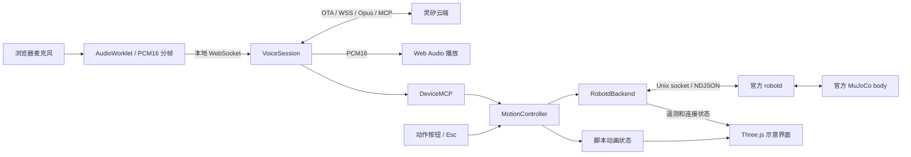

# DuckKing 架构与模块规格

## 交付范围

DuckKing 是本地运行的语音与动作工作台。动画预览使用官方外观和本项目的脚本；物理实验室使用进程内 MuJoCo CPU / ONNX，另有独立的 robotd/MuJoCo 适配路径。已完成真实灵矽设备绑定、语音识别、MCP 动作调用与语音回复联调，测试输入为系统合成中文语音。

它不等于实体硬件复刻，是否满足原竞赛题的实物要求仍需主办方认可。

## 架构



robotd 路径的物理计算在官方 MuJoCo body 中完成，官方 robotd 运行已有策略。首页网格来自官方模型，但姿态动画仍是运动学示意；真实实时接触画面在独立物理实验室中呈现。

## 模块规格

| 模块 | 文件 | 输入 / 输出 | 责任边界 |
|---|---|---|---|
| 本地应用 | `src/duckking/app.py` | HTTP API、状态 WS、语音 WS | 默认只绑定 loopback；同源校验；两个独立房间，每房间一个页面拥有语音 |
| 动作调度 | `motion.py` | Action → 执行记录 / 状态 | 限时、取消、去重、失败反馈；不直接控制舵机 |
| 组合动作 | `choreography.py` | 动作名 / 时间 → 高层意图帧 | 闪身步与狗熊哆嗦毛；有界、连续的阶段编排 |
| 预览后端 | `motion.py:PreviewBackend` | 速度 / 头部意图 → 动画状态 | 运动学示意，不计算接触、平衡与真实步态 |
| 官方适配 | `robotd.py` | NDJSON → 官方状态 | 订阅 20 Hz 遥测；发送连续意图；拒绝使用过期状态 |
| 设备配置 | `config.py` | 私有配置、OTA → 设备连接参数 | 设备身份持久化；凭证留在后端；公网连接要求 TLS |
| 显式初始化 | `onboarding.py` | 平台 API Key 文件 → 智能体/设备绑定 | 仅在运行 setup 命令时创建或复用 DuckKing，不迁移已有设备历史 |
| 音频编解码 | `opus.py` | PCM16 ↔ Opus | 原生 libopus；16 kHz 上行；按服务器协商解码下行 |
| 灵矽会话 | `voice.py` | 浏览器音频 ↔ 云端事件 | 激活、握手、按键打断、音频、工具转发、断线清理 |
| 语音诊断 | `diagnostics.py` | 阶段 / 计数 / STT → 有界日志 | 字段白名单、STT 脱敏与长度限制、内存最近 200 条、私有轮转文件；不保存录音或设备标识 |
| 交互统计 | `statistics.py`、`frontend/src/statistics.js` | 脱敏事件 → 最近 500 轮、百分位、统计页 | 单调时钟、进程内唯一轮次；缺失不补零、不同后端可筛选；不推断物理或扬声器延迟 |
| 端侧 MCP | `mcp.py` | JSON-RPC → 工具结果 | 初始化 / 工具发现 / 白名单调用；结果关联原请求 ID |
| 浏览器音频 | `frontend/src/voice.js`、`audio-output.js`、`audio-codec.js` | 麦克风 / 语音事件 | 录音权限、流式重采样、分帧、播放队列与释放麦克风 |
| 三维界面 | `frontend/src/duck.js`、`main.js` | 后端状态 → 画面 / 记录 | 官方外观 + 脚本关节动画；不计算物理，加载失败显式报错 |

## 本地接口

生产 demo 由 FastAPI 提供 `frontend/dist`；开发模式由 Vite 在 5173 提供源文件和热更新，转发 `/api`、`/ws`、`/voice` 到同一 FastAPI 后端。代理保留 Host / Origin，沿用同源校验，不引入替代动作或语音实现。安装与端口配置见 [本地开发指南](DEVELOPMENT.md)。

| 接口 | 用途 |
|---|---|
| `GET /api/health` | 版本、后端类型与服务可达性 |
| `GET /api/models/microduck` | 缓存的官方视觉网格、局部关节轴和默认姿态；不启动物理循环或 ONNX 推理 |
| `GET /api/state` | 当前动作、后端状态、近期事件 |
| `GET /api/voice/diagnostics` | 语音阶段、停留时间、音频帧数和脱敏诊断事件 |
| `GET /api/voice/statistics?backend=all` | 本进程最近 500 轮统计；可筛选 `preview` / `robotd`；同源检查、禁止缓存 |
| `GET /statistics.html` | 主页链接打开的独立统计页面；不创建语音连接 |
| `POST /api/actions` | 提交受限动作，返回 202 和请求 ID |
| `GET /api/actions/{id}` | 查询完成、取消或失败结果 |
| `WS /ws` | 推送工作台状态 |
| `WS /voice` | 浏览器录音、连接控制、语音事件与下行音频 |

动作请求示例：

```json
{"name":"walk","duration":1.2,"request_id":"caller-generated-unique-id"}
```

动作名称：`nod`、`walk`、`turn_left`、`turn_right`、`stop`、`reset`、`flash_step`、`bear_shake`。普通动作时长范围 0.2–3 秒；两个组合动作默认 3 秒，范围 2.4–3 秒。普通移动的可选速度范围为 0.02–0.4 m/s；不提供时，预览后端使用 0.12，官方仿真适配器使用实测可启动步态的 0.35。组合动作使用固定速度编排，不接受 `speed`。速度指令不保证固定距离。

`reset` 只支持动画预览。官方适配器不会把它映射成实体机器人上电、断扭矩或未知重置指令。

执行记录状态为 `running`、`completed`、`cancelled`、`failed`。`completed` 表示本地指令序列完成、停止请求获确认，不保证机械位移达到某个目标值；实际运动需看官方遥测和物理状态。MCP 会将取消或失败结果标为错误，不返回虚构成功。

## 动作与取消

一个控制器同一时刻执行一个动作。新动作先取消旧动作；前进和转向每 50 ms 发送一次意图，到本地期限自动停止。浏览器串行提交请求的接收过程，不等待整个动作完成，因此快速点击“前进→停止”不会因两个 HTTP 请求乱序而先停后走。

相同请求 ID 和参数重试复用原结果；相同 ID 配不同参数会拒绝。历史与事件数量有上限。官方后端在状态超过 1 秒未更新时拒绝开始移动，不悄悄回退到动画模式。

点头使用小幅轨迹，并保留动作开始时的头部姿态；不假设所有模型或版本的机械零位相同。

组合动作额外控制横向速度、头部偏航/侧倾和身体姿态。站姿模式和步行分段互斥；结束或取消时关闭站姿模式并恢复头部目标。详细阶段及幅度见 [CHOREOGRAPHY.md](CHOREOGRAPHY.md)。

## 语音与工具

按键说话时，浏览器采集单声道音频，转换为 16 kHz、PCM16、60 ms 一帧。后端编码 Opus 后上传。服务端下行可能使用不同采样率，后端按握手参数解码，再让浏览器按正确采样率播放。

每次录音最多 15 秒。播放时可按住按钮打断，清除播放队列后录制新命令；非打断的 TTS 结束会等待已有音频播放完成。断线后停止相关动作、释放音频资源并提示用户重新连接。首版不做唤醒词、全双工或自动恢复录音。

后端独立监控录音时限，即使浏览器不再发音频也会在 15 秒结束录音。思考阶段 20 秒没有 STT / MCP / TTS / 音频等有效进展，或回答阶段 15 秒没有新进展时，关闭旧云端会话并重连一次；包括录音在内的整轮另有 60 秒上限。重连前取消工具任务、停止动作、关闭编解码器并通知浏览器清空播放队列。旧录音不重发，恢复到 ready 后需重新按键说话；重连失败会进入 error，不无限重试。

浏览器采集和播放复用一个硬件默认采样率的 AudioContext，采集端仍通过 PCMFramer 连续重采样为 16 kHz / 60 ms 帧。松开说话按钮只停止麦克风轨道和采集节点，不关闭声音上下文；AudioWorklet 每个上下文只加载一次。连接、说话、松手及本地声音测试的用户手势中尝试激活播放，恢复等待限时 1.5 秒，不阻塞网络连接或断开。支持可选 Audio Session API 的浏览器在录音时请求 `play-and-record`，结束后请求 `playback`，其他浏览器继续使用 Web Audio。

下行待播和已调度音频合计最多 12 秒 / 300 帧，超出部分丢弃并提示重新说话；恢复播放按原顺序处理，打断会同时清理待播和已调度节点，迟到的恢复不能复活旧音频。本地 250 ms 测试提示音明确标为声音测试，不是灵矽回复。「声音诊断」的计数及 `browser_audio` 事件由浏览器上报，按房间隔离，只接受状态枚举和非负整数白名单，不收集录音或设备标识；同状态最多每秒落盘一次，状态变化立即记录。`ended_frames` 只代表浏览器播放节点结束，不能作为扬声器确实出声的证明。

云端连接整体限时 35 秒，发送/关闭云端 socket 限时 5 秒。连接任务与浏览器指令接收分离，用户可以在连接或恢复期间断开，也可以用「重置语音」取消卡住的一轮并重建会话。日志接收枚举字段、整数计数、本地产生的时间/序号及脱敏 STT 文字（最多 2000 字符）；不写入云端 session ID、原始工具调用 ID、原始异常正文或音频。统计直接消费过滤后的事件，独立于最近 200 条事件窗口，不从旧文件回放。

端侧 MCP 提供八个工具：

| 工具 | 参数 | 结果 |
|---|---|---|
| `duck_nod` | 无 | 点头任务的真实执行记录 |
| `duck_walk_short` | 可选 `duration` | 限时前进任务的执行记录 |
| `duck_turn_left` | 可选 `duration` | 限时原地左转任务的执行记录 |
| `duck_turn_right` | 可选 `duration` | 限时原地右转任务的执行记录 |
| `duck_stop` | 无 | 取消当前动作并发送停止 |
| `duck_get_status` | 无 | 后端类型、连接、当前动作 |
| `duck_flash_step` | 无 | 三秒闪身步编排及执行结果 |
| `duck_bear_shake` | 无 | 三秒狗熊哆嗦毛编排及执行结果 |

一次会话内按 JSON-RPC ID 去重，最多同时处理 32 个工具消息。工具调用不阻塞音频接收，使停止调用可以打断正在等待结果的前进调用。

提示词要求多动作按用户顺序串行调用，失败/取消后停止后续步骤，不将普通转向替换为舞步。这是云端指令约束，不是本地语义规划器；模型仍可能选错工具，统计页显示实际调用供核对。`action_start/end` 仅在去重后的真实调度处产生，使用本地序号关联并捕获原轮次，避免重连和新录音串轮。控制器受理时间不代表首帧物理动作或浏览器画面出现时间。

## 共享物理场景

Linux 部署使用独立的 `duckking.service`，按要求以 root 运行，发布目录为 `/root/zt_dir/hackathon_base/DuckKing`，不嵌入 ai_gateway。应用支持显式公网 Host 白名单与反向代理 `root_path`；前端资源、链接、API、音频 worklet 和 WebSocket 均按页面目录解析，同一构建可以挂在 `/duckking/`。Host / Origin 原样保留，跨来源请求仍然拒绝。部署方案见 [deploy/README.md](../deploy/README.md)。

ai_gateway 可独立添加固定 loopback 路由；现有前置代理不透传 Upgrade 时，浏览器使用网关声明的 HTTPS 通道，网关转为真实后端 WebSocket。文本与二进制帧按序传输，失败关闭、不重放录音，不改变预览、物理仿真或真实云端的能力边界。DuckKing release 切换不需要修改或重启网关。

`GET /api/deployments` 仅返回发布字段白名单与最近 100 条流水；当前进程启动时固定读取版本元数据，原子切换磁盘链接不会给旧进程贴上新版本。`staged` 代表独立后端本机自检通过，`success` 需要入口验收后确认。发布失败与回滚结果分别记录；密钥、设备身份和原始配置不出现在该 API 中。

`simulation.py` 在 Python 进程中运行 MuJoCo CPU 与官方 ONNX 推理，`kind=mujoco`、`physics=true`、`runtime=mujoco_cpu_onnx`；它不是 robotd 适配器，也不复用首页预览的姿态动画。原工作台控制器与场景控制器相互独立。

`POST /api/scenes/start` 显式惰性加载模型；模型文件和策略位于 `external/`，不进入 Python 包，本地开发显式下载，Linux 发布包携带固定版本及来源信息。球场使用官方 `scene_ball.xml`，双鸭场景用 `MjSpec.attach` 将两个官方 `robot_allcollisions.xml` 放到同一个模型中。控制频率 50 Hz，每次推进 4 个 5 ms 物理步，双鸭共用一次 `mj_step`。策略采用官方 61 维观测、14 维关节输出、默认姿态与 0.5 秒踢球时长；沿用 MJCF 的位置执行器参数，没有接入训练时的动态 BAM 电机模型。

`/api/scenes/actions` 与原工作台共用有界、可取消、按请求 ID 去重的 `MotionController`。场景动作结束前会验证所选脚接触和位移，或者双鸭接触；失败不会返回完成。正常动作的 `target` 可为 a/b/both；停止与场景切换取消当前动作。球场和双鸭清零运动、头部和身体意图；搬运停止会保持已夹住物品所需的嘴部与头部目标。标准动作最长 3 秒，实验性放下为固定 4.5 秒；物理场景等待按仿真时间计时，另有「目标时长 + 3 秒」墙钟超时。清零命令不冻结物理世界。

`GET /api/scenes/model` 提供编译后的官方网格和外观，顶点 float32、索引 uint32 以小端 base64 传输，按场景缓存。`/scene-ws` 只发送实际 `geom_xpos/geom_xmat`、接触计数、球位移、双鸭姿态和合唱节拍。浏览器处理后发送文本 `next` 请求最新快照，频率上限 20 Hz；每个连接只保留一帧待确认数据，30 秒没有确认就关闭并由页面重连，避免慢客户端积压旧物理状态。非法确认帧以 1008 关闭。模型响应与状态流使用 revision 配对，避免切换时套用旧模型；revision 属于编译模型，同场景重置复用几何，重启进程重新生成。

Three.js 渲染官方几何，不会用预设踢球动画替换实际关节结果。每次绘制后留出至少 33 ms 空闲时间；检测到 SwiftShader / llvmpipe 等软件渲染器或连续慢帧时关闭阴影，将画布宽度限制为 640 像素，并延长绘制间隔至 100 ms。这样可以为输入、语音和状态处理留出时间，不改变物理步进和接触判定。

`/scene-voice` 复用真实 `VoiceSession`，连接场景控制器，按同源规则保护。同一房间内和 `/voice` 共用一个语音名额；两个房间分别使用独立的设备身份、控制器与物理世界。新增 MCP 工具仅对 MuJoCo 控制器公布：`duck_set_scene`、`duck_kick`（必填 left/right）、`duck_find_companion`、`duck_duo_walk`、`duck_collide`、`duck_chorus`、`duck_pick_up`、`duck_carry`、`duck_put_down`。状态工具剔除渲染网格，避免将大量图形数据送入模型上下文。统计按 `mujoco` 单独筛选。

发现同伴使用仿真真值：距离 ≤1.2 m、相对朝向 ±60°、`mj_ray` 检查遮挡。合唱为应用自己的 3 秒双声部旋律，两只鸭收到相同点头节拍，浏览器两个声部共享 AudioContext；声音依赖用户启用，工具成功表示控制编排完成，不承诺扬声器播放或跨设备同步。不是官方 BLE/duckether 合唱实现。

## 身份与配置

默认私有配置路径是 `~/.secrets/duckking.env`，设备身份位于 `~/.local/share/duckking/identity.json`。已有身份保持不变；新设备 ID 使用随机生成并持久化的本地管理 MAC 格式标识，Client ID 使用 UUIDv4，避免同机两个房间身份碰撞；身份文件以 `0600` 权限创建。房间 2 使用数据目录下 `rooms/2/identity.json`，通过 `duckking-setup --room 2` 独立绑定。

没有手工设备凭证时，走 OTA 激活与控制台绑定。浏览器只接收激活码与必要状态，不接收设备 token；网络错误只输出错误类型，避免将含凭证的 URL 或请求头写入界面。

`duckking-setup` 可从 `~/.secrets/lingxi` 读取一行平台 API Key，用于显式创建/选择智能体和绑定。该 Key 不发往设备 OTA 接口，也不作为设备连接 token 使用。实测 OTA 返回官方网关的 `ws://` 地址；客户端仅对已知官方主机升级为 `wss://`，其他公网明文地址仍被拒绝。

## 分工与验证

实际参与者见 [TEAM.md](TEAM.md)，贡献边界见 [CONTRIBUTION_SCOPE.md](CONTRIBUTION_SCOPE.md)，测试与已知限制见 [VALIDATION.md](VALIDATION.md)。

本项目不把 AI 辅助开发记作额外参赛成员，也不把第三方步态策略或官方仿真器记作原创成果。

两房间分配、接口选择和打断录音缓冲的规则见 [开发指南](DEVELOPMENT.md#打断回复并说新命令)。设备接入与 abort 格式依据 [灵矽官方 WebSocket 协议](https://linx.qiniu.com/docs/xrobot/platform/websocket)；没有假定同一设备支持多连接。

## 嘴部夹取与首页官方外观

`model_assets.py` 从固定官方 MJCF 导出 70 个视觉 geom、复用的 STL 网格和 14 个关节的局部轴 / 枢轴 / 默认角度。`GET /api/models/microduck` 只编译模型，不做物理推进；浏览器用 Three.js 关节树播放既有预览状态。没有翅膀或手部关节。API 与首页均标识 `physics=false`；依赖缺失返回 503，页面可显式重试。该外观接口不依赖房间物理场景，首次加载不会启动场景或云端语音。

首页现通过 `/api/models/microduck/manifest` 查询内容版本，再获取 `assets/<sha256>.dkm.gz`，旧 JSON 接口保留兼容。DKM1 为 4 字节魔数、uint32 小端 JSON 头长度、4 字节对齐的 JSON 头及网格缓冲；坐标保留 float32，索引仅在所有值均可表示时无损改存 uint16。没有减面或改变模型。显式 `.gz` 地址始终返回 gzip 表示及 `Content-Encoding: gzip`，浏览器自动解压；现有 ai_gateway 虽向上游发送 `Accept-Encoding: identity`，仍会原样转发这些压缩字节和响应头，无需修改或重启网关。

服务端在工作线程中构建并缓存压缩包，同一进程用锁避免两房间同时重复构建。内容哈希决定资源 URL，资源使用 immutable 缓存，清单每次重新验证。浏览器 CacheStorage `duckking-official-model-v1` 只保存一份经过验证的公开模型，URL 不含房间参数；缓存失效或模型版本变化时获取新包，存储不可用时仍请求真实模型。损坏缓存被删除并明确提示重试。模型加载不会启用物理或语音。

页面交互记录显示总耗时；控制台 `[DuckKing:model-load]` 和 `POST /api/models/load-metrics` 上报查询版本、读取资源、解析、组装、首帧提交耗时及缓存来源。`elapsed_ms` 从加载开始计时，`navigation_ms` 从导航开始计时；首帧计时到 Three.js 提交绘制后的下一帧，不是显示屏出光测量。`encoded_bytes/decoded_bytes` 是清单声明的模型规格，`transfer_bytes` 来自资源计时或为持久缓存读取的零。服务器以 `official_model_load source=browser_reported` 打印白名单数值，资源首次构建另打印 `official_model_asset_built`。不上报 URL、设备标识、音频或自由文本；客户端计时不冒充服务端测量。

`grasp_model.py` 构造 `carry` 场景：原 14 个 ONNX 策略执行器按名称选择，观测仍为 61 维，输出仍为 14 维；新增第 15 个 mouth 执行器独立控制。嘴部角度范围 −5° 至 30°，力矩限制 ±0.025 N·m；上下接触垫的尺寸不同，以允许张嘴时物品脱离下垫。质量 / 惯量拆分和接触垫是实验性近似。小棒为 20×130×8 mm、4 g 的自由刚体；只在场景加载/重置时采用初始状态，动作过程中不写它的位姿，不加焊接、吸附或外力搬运。物品碰撞使用显式嘴垫、地面和支架，不能据此证明完整头部 CAD 的所有接触都准确。

`grasp.py` 每个 5 ms 物理步汇总 `mj_contactForce` 的真实法向力。夹起需要上下垫均超过 0.01 N、持续至少 0.2 秒、物品最低角点高于原支架 8 mm 且没有支架接触。搬运需要物品水平位移 >10 cm、躯干位移 >8 cm、保持夹持且到达接物台范围。夹持丢失超过 0.12 秒、相对嘴部滑移 >18 mm 或跌倒会明确失败，并停止移动。步态期间头部意图清零，遵循原策略的站立/行走输入约定。

放下先张嘴，再低头让物品落到接物台；确认接物台接触后才退开。完成要求上下嘴垫接触力合计 <0.001 N、接物台接触力 >0.005 N，且物品线速度 <0.02 m/s、角速度 <0.1 rad/s，持续至少 0.2 秒。工具固定仿真时长为夹起 2.2 秒、搬运 3 秒、放下 4.5 秒，整段动作另设「时长 + 3 秒」墙钟截止。停止不会宣布成功；已建立的夹持继续保留，动作中断后可显式重置。MuJoCo 数值异常导致时钟倒退/重置也会报错，不静默重置为成功。

该流程仅验证固定取物架到固定接物台的轻载搬运。没有物体视觉定位、任意物品规划、地面拾取、新策略训练或真机验收。页面给出夹持阶段、接触力、最高离架高度和实际搬运位移；它们与云端语音统计分别记录。
