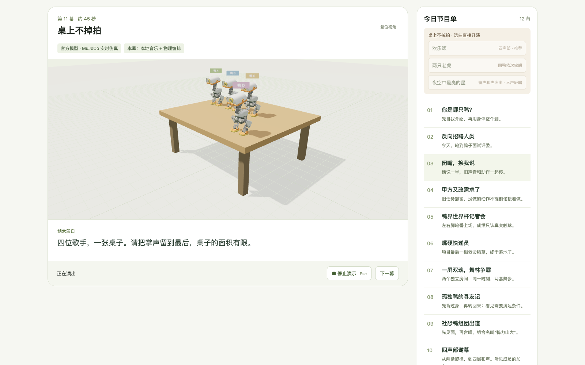

# Hackathon 演示视频

[观看／下载 MP4（4 分 02 秒）](https://github.com/zhoutingunl/DuckKing/releases/download/deploy-yzh737-20261025T165552Z/duckking-hackathon-20261026.mp4) · [GitHub Release](https://github.com/zhoutingunl/DuckKing/releases/tag/deploy-yzh737-20261025T165552Z) · [实测与录制记录](media/hackathon-video.json)

视频为真实 Chrome 页面录制，1600 × 1000、H.264 / AAC。展示预录指令经真实灵矽完成左右脚踢球、嘴部搬运、桌上掉落恢复、四鸭坐站轮唱，以及本地／灵矽延迟数据。没有实体机器人验收。

| 时间 | 内容 |
|---|---|
| 00:00 | 项目与验证范围 |
| 00:12 | 真实灵矽语音 |
| 00:21 | 左右脚踢球 |
| 01:08 | 嘴部搬运 |
| 01:17 | 夹起、搬运、放下 |
| 01:44 | 四鸭桌上合唱 |
| 01:53 | 掉落、恢复、继续合唱 |
| 02:40 | 四鸭坐站轮唱 |
| 02:48 | 轮流站起独唱 |
| 03:30 | 本地与灵矽延迟实测 |
| 03:52 | 代码与后续集成 |

## 量化数据

公网 YZH737，使用同一段合成口令“请点点头。”，每条路径各 10 轮；分四批交错运行。时间单位为毫秒，P50/P90/P95 使用 nearest-rank。

| 路径与阶段 | 样本 | 均值 | P50 | P90 | P95 |
|---|---:|---:|---:|---:|---:|
| 本地 · 识别返回 | 10 | 284.3 | 261 | 329 | 443 |
| 本地 · 动作受理 | 10 | 285.7 | 262 | 330 | 446 |
| 灵矽 · 识别返回 | 10 | 426.9 | 406 | 470 | 588 |
| 灵矽 · 动作受理 | 10 | 1660.4 | 1664 | 1813 | 1879 |

起点是 DuckKing 收到结束录音，终点分别是非空识别文本或动作受理。包含对应服务处理及网络等待，不包含麦克风、扬声器、首帧显示或实际物理动作完成；不是纯模型推理耗时或识别准确率。10 个样本的 P95 是本组最大值，不能代表稳定性能。交互统计页面显示各房间当前进程的逐轮诊断；[使用体验页面](EXPERIENCE_METRICS.md)从新增采集上线后持续记录浏览器与服务端耗时，不自动导入本表的固定口令基准。

## 来源与剪辑

- 足球段来自本次公网发布 `894d2d9d65c79f5c2c99cb239820cf1a9a379e7f`；输入为随包预录指令，识别、工具调用和回复来自真实灵矽。
- 搬运、桌上合唱、坐站轮唱来自本机提交 `c1a90175e4a77560b25ac0da05edcf9a857236cf` 的生产构建，均通过本次动作结果验证；这些段落的动作与台词由本地剧本编排，四声部音乐为本地合成的公版《欢乐颂》。本次发布保留相同物理动作实现。
- 音轨来自页面实际 Web Audio 混音，由 MediaRecorder 采集；按墙钟时间与 Playwright 画面对齐，存在采集与编码误差，不能用此视频测声画延迟。章节旁白由系统合成语音生成。
- 仅剪掉加载与章节间空白；保留各段完整动作过程，无加速或替换物理状态。没有使用实体相机视野、实体手机扬声器或 BLE 同步结果。
- 模型来自 Pollen Robotics MicroDuck，模型及改编画面遵循 CC BY-NC-SA 4.0；详见 [媒体来源](media/README.md) 与 [第三方来源](../THIRD_PARTY.md)。

SHA-256：`7427e82015f014b440e80e9dca405ee6f9e82cc440060ee7a79bd9970e1dfcef`。
