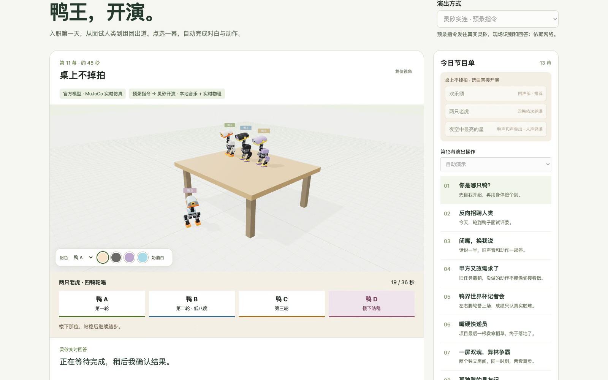

# 灵矽实连决赛演示视频

[观看／下载 MP4（约 3 分 49 秒）](media/duckking-competition-live.mp4) · [剪辑与哈希](media/duckking-competition-live.json) · [实际调用与物理证据](media/duckking-competition-live-recording.json) · [音轨校验](media/duckking-competition-live-audio-check.json) · [解说文案](media/competition-live-script.json)

[](media/duckking-competition-live.mp4)

围绕题目“智能硬件：复刻一台 Micro Duck，并在其内装上灵矽通过语音交互”，先展示 **灵矽实连 · 预录指令 → 第 11 幕《桌上不掉拍》→《两只老虎》**，再介绍本地语音识别、转盘 PPO 对照、CPU 训练记录、持续使用体验、交互统计与测试覆盖率。当前只有软件仿真，没有实体机验收；末页保留 3 秒静默，不配解说。

## 章节

| 时间 | 内容 |
|---|---|
| 00:00 | 让灵矽，真的指挥小鸭开演。 |
| 00:17 | 01 灵矽实连 · 预录指令：桌上不掉拍 |
| 01:33 | 02 本地优先：离线识别，也能驱动真实动作 |
| 01:54 | 03 转盘平衡：同种子，左右真实对照 |
| 02:16 | 04 PPO 训练：曲线、测试和公式，都能追溯 |
| 02:41 | 05 持续使用体验：把等待和变化，长期记下来 |
| 03:04 | 06 交互统计：识别原话、工具动作与实际结果 |
| 03:25 | 07 测试覆盖率：有数字，也有提交和 CI 依据 |
| 03:46 | 让语音、动作、学习与验证，连成一条链。 |

全片 229.080 秒，1600 × 1100、25 fps、H.264 / AAC、48 kHz 双声道。网页视口 1600 × 1000，底部另加 100 px 章节说明，源画面等比缩放，保留实际显示值。动作按原录制墙钟速度播放；解说较长时延长末帧，逐章披露时长，不能把停帧当作继续运行。

## 核实后的删减

上一版总长 177.600 秒。用 −48 dB 阈值核对，连续无声段约为 **1:32.45—1:46.07**，即剩余 **1:25.15—1:11.53**，约 13.62 秒；画面主体基本不动，中间有台词文字切换。人工估计的剩余 1:22—1:10 没有直接作为剪点。

保留口述结尾及约半秒停顿，剪去原片 **1:33.00—1:45.88 的 12.88 秒等待**，随后直接进入本地识别介绍。新片该转场位于 1:33。末尾 3 秒无声是有意保留的结束卡，不是漏配解说。

## 各段来源和版本

2026-11-02（北京时间）的多次真实录制合成，各章保留独立来源、提交和原始结果：

| 内容 | 实际来源 | 范围 |
|---|---|---|
| 第 11 幕、持续体验、交互统计 | 本地候选应用 `c834335` | 两轮真实灵矽 STT／MCP／TTS；实际 MuJoCo |
| 本地识别 | 本地候选 `c5f04bc` | 真实 SenseVoiceSmall INT8 和 MuJoCo；合成输入 |
| 标准 13 秒转盘对照 | 公网发布 `62c6784` 的既有实录 | 同种子基线／PPO 的一次真实对照 |
| PPO 曲线、奖励和更新公式 | 公网 `62c6784` 新采集 | 保存的 `level2-cpu-v4` 记录；本次未启动训练 |
| 覆盖率页面 | 公网 `62c6784` 新采集 | 对应提交的 Python 后端测试报告 |

本地候选的第 11 幕新接线尚未部署到公网；不能把该片称作公网已更新的证明。新增本地识别与原云端演出来自不同服务录制，不把两套统计样本混成同一次会话。各章来源和媒体摘要均在公开证据中。

## 本次实际结果

- **灵矽实连：**“请开始桌上四鸭合唱表演。”触发 `duck_table_show`，先返回受理；实际表演结束后，“请读取当前状态，告诉我桌上表演的真实结果。”触发 `duck_get_status`。两轮均 completed，下行音频共 412 帧，受理与实际完成分别记录。
- **四鸭物理：**36 秒表演中，D 于 17.38 仿真秒离桌、17.50 秒触地、19.12 秒恢复地面舞步；其余三鸭留桌，真实接触验收通过。失足是预设剧情，物理结果不是动画替代。
- **本地识别：**合成“前滚翻，再打个哈欠”经浏览器麦克风采集接口进入真实识别。模型推理 478 ms，服务器结束录音至识别返回 489 ms；前滚翻、打哈欠都完成，云端上／下行音频均为零。它不是一组识别准确率或手机实听基准。未匹配的整句仍按既有规则交灵矽，本地执行后不重复转交。
- **转盘：**第 2 关、种子 0、标准 13 秒；官方基线未达条件，任务 PPO 完成。当前一轮不等同跨种子成功率，也没有把官方底层步态说成项目从零训练。
- **PPO：**展示 `level2-cpu-v4` 的 131,072 步 CPU 记录、成功率／回报曲线、优化指标、奖励与更新公式。未见种子为 89/100，对照基线 0/100，连续验证门槛尚未达到；奖励分数与验收成功分别呈现。训练合同与范围见 [平衡教练](PPO_BALANCE_COACH.md)。
- **使用统计：**持续体验页面的 5 条观测来自两轮原实连调用与一次加载：浏览器语音 2、服务器语音 2、加载 1，不是五个用户。交互统计显示两轮识别原话、一次桌上动作的实际完成和约 36 秒执行耗时。自动化／验收标签说明触发方式，云端调用仍真实；缺失阶段留空，少量样本不作稳定性能承诺。口径见 [持续使用体验](EXPERIENCE_METRICS.md)。

## 测试覆盖率的口径

片中对应公网提交 `62c6784c077da169ea550eccb06793d687607cfd`，不是新候选版的全量覆盖率：

| 范围 | 真实计数 | 覆盖率 |
|---|---|---|
| Python 后端行 | 5600 / 5837 | 95.94% |
| Python 后端分支 | 1853 / 2046 | 90.57% |

已核对 [对应 CI](https://github.com/zhoutingunl/DuckKing/actions/runs/41323697759) 状态成功且提交相符。报告包含单元和集成测试，不作为全项目或全前端覆盖率；前端音频局部门槛也不替代后端报告。本次媒体编辑没有重跑应用完整测试或改写该历史报告。

## 声音与校验

演出章节保留实际浏览器播放的输入、真实灵矽下行声音及本地《两只老虎》合成轮唱；开场／收尾角色对白为原本地素材。预录指令为系统合成声，不是真人麦克风；新本地识别输入使用 macOS Tingting 合成后经采集接口注入。其他章节为 Microsoft `zh-CN-XiaoxiaoNeural` 解说，`edge-tts 7.3.1`、`-3%` 语速，最后一页没有旁白。

各章独立解码，按时间戳补齐静音间隔，统一 48 kHz 双声道 PCM 后合成 AAC，避免先前单／双声道切换造成的后半段损坏。成片通过完整音视频解码、逐章原音比对、静音段检查及 3 秒静默结尾检查。SHA-256：`3649c8668839b6c05f86bf2a7c14e86ad12936fd6731343022c5bfaad340cea2`。剪辑时钟仅用于编辑，性能数据应读取实际采集记录。

## 复录

环境和绑定见 [README](../README.md)；另需本地 ASR worker、Chrome、Playwright、FFmpeg/ffprobe、Python 和 uv。先保留或重新取得三份真实原始记录：实连录制、补充录制、公网功能导览录制。录制器分别是 [record-tabletop-live.mjs](../frontend/scripts/record-tabletop-live.mjs)、[record-finals-supplements.mjs](../frontend/scripts/record-finals-supplements.mjs) 和 [record-current-demo.mjs](../frontend/scripts/record-current-demo.mjs)。原始视频和私有配置留在本机忽略目录。

补充录制需要将 Tingting 合成的“前滚翻，再打个哈欠。”转换为 16 kHz 单声道 PCM WAV，放入 `.duckking/finals-input/local-skills.wav`，然后在 `frontend/` 运行补充录制器。默认本地服务为 `http://127.0.0.1:8901/`，可用 `DUCKKING_DEMO_URL` 指定；须显式启用本地 ASR。该服务不必绑定云端，本地命中应保持云端帧数为零。训练与覆盖率画面从公网读取。

```bash
python3 scripts/prepare_finals_demo.py \
  --live .duckking/competition-live-take6/recording.json \
  --supplements .duckking/finals-supplement-take5/recording.json \
  --tour .duckking/current-demo-take5/recording.json \
  --output .duckking/finals-combined/recording.json
python3 scripts/build_current_demo.py \
  --recording .duckking/finals-combined/recording.json \
  --script docs/media/competition-live-script.json \
  --work .duckking/finals-new-edit \
  --output docs/media/duckking-competition-live.mp4
```

后续重录须重新测量静音与剪点，不照抄本次 12.88 秒。补充录制支持 `DUCKKING_DEMO_RESUME` 复用已通过片段，`DUCKKING_DEMO_RERECORD=training` 可重录指定章节；选择训练记录后必须等对应数据实际渲染，不能只看下拉框值。合并时保留原完整视频的时钟锚点，再选取 13 秒片段，避免误截后面的 30 秒试跑。新文案使用新的剪辑工作目录，实际解说来源写入记录。

模型及改编画面来自 Pollen Robotics，遵循 CC BY-NC-SA 4.0；《两只老虎》为传统旋律的本地电子合成。来源见 [媒体说明](media/README.md) 和 [THIRD_PARTY.md](../THIRD_PARTY.md)。完整公网功能导览另见 [功能导览](PRODUCT_TOUR_VIDEO.md)，原竞赛素材见 [历史存档](DEMO_VIDEO_ARCHIVE.md)。
