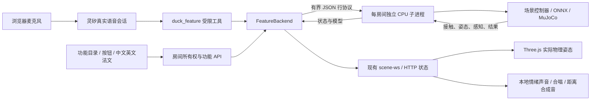

# 场景首页：TOP、最新与四十一项功能

网站根地址和导航「首页」进入 `features.html?sort=top`；旧语音工作台保留在 `index.html`。场景目录默认精选十项，可以展开全部、按类型筛选或切换「最新」。浏览目录不占物理名额、不创建渲染器。选中场景或打开带 `feature` 参数的链接后自动准备，**不自动执行动作**。合唱剧场、嘴部搬运/双鸭互动和两个 PPO 场景也有直接入口，未删除原页面。

按钮调用本地物理；连接灵矽后调用同一组受限工具。功能页目前只有灵矽云端语音，没有接入本地中文动作识别。中英法界面不改变动作的真实来源。

## TOP 与最新的统计口径

- 默认热度 = 点击数 × 平均有效体验时长，即各次有效体验时长之和；也可选「点击次数」。主动选择场景或在默认场景首次执行动作才记一次进入，刷新自动准备不增加点击。
- 仅前台可见、模型就绪、通道可用且最近一分钟有交互时累计体验时长。心跳每五秒发送；服务器还以墙钟和每次最多十五秒限制信用，去重重复/乱序心跳。加载、后台和长时间闲置不计时。
- 北京时间每天第一次读取目录时生成当天持久快照，此后全天固定，不是每次打开实时洗牌。无使用记录时按明确的十项推荐顺序展示；这些推荐不伪造点击数。
- 「最新」按本站首次提供场景的时间倒序。同批次的同一时间用固定目录顺序，不能把上游模型发布日期或代码提交时间冒称本站加入时间。
- SQLite 位于配置的数据目录 `scene-discovery.sqlite3`，重启保留。仅保存场景聚合、短期访问标识与房间租约哈希，不保存 IP、设备身份、语音或原始租约；短期访问记录超过二十四小时清理。当天排名只展示聚合值。
- 手机配色与任务状态共用底栏；场景类型标签与「场景设置」同行。网格、棋盘、木地板、跑道、舞台五种地面只是原创程序化视觉皮肤；湿滑/地形/风场的真实物理参数另由各专用场景决定。高度场网格从 MuJoCo 已编译高度场导出，射线采样验证显示高度与碰撞相符。

## 本轮新增二十三项（2026-11-13）

以下均为实时推理与 MuJoCo 积分，未播放预录轨迹，未做实体机器人验证。单轮 CPU 通过不代表多种子成功率。

| 场景 | 来源与运行契约 | 当前单轮结果 / 评分 |
|---|---|---|
| 八乘八距离视野 | 64束真实MuJoCo射线；45°×45°视野、四米上限 | RGB对照与距离热图；理想测距，无真实ToF噪声 |
| 两米冲线 / 轮滑冲线 / 八度上坡 / 红灯停 / 双鸭拔河 | 本站独立规则 + 已安装的官方通用步态；未移植Arena运行器及独立reference权重 | 两米脚行8.70s、轮滑7.10s；8°坡1.5m16.40s；红灯停6m29.56s、7次红灯；拔河绳端误差约0.12mm、45s按中点判定。本地计时不能与官方榜单比较 |
| 倒立头旋连续技 | reble2421 Apache-2.0 CPU harness、BAM/25ms延迟与独立分段judge；backroll_robust/headspin_robust等 | 完整10阶段约27.5s单轮通过；后滚翻、倒立、左右头旋可独立选择。采真实头顶接触、旋转/停转与最后站稳；不把作者50/50当本站成功率 |
| 自己站起来 | 官方 alpha_stand；明确设置仰卧/俯卧初态 | 仰卧约2.00秒、俯卧约1.26秒恢复；双脚持续稳定一秒 |
| 踩着高跷走 | 八套高度对应策略、几何与质量，10/15/20/25/50/100/140/200cm | 每档十秒保持直立并前移超过0.3m；设置更换高度会重建模型 |
| 高台后空翻 | 专用完整碰撞，0.8m落差与数值软垫 | 完成转动，但未双脚落垫持续站稳；明确失败 |
| 湿滑地面 | witcheer 齿隙策略，脚部摩擦0.2 | 十秒有正向进度且未失稳 |
| 崎岖小路 | 专用策略、固定种子真实高度场 | 十秒保持直立并前进；不是上游随机批次复测 |
| 顶着风走 | 专用策略，躯干逆向外力逐渐增至3N | 十四秒前进；外力在取消/结束时清零，不是空气流体仿真 |
| 走上缓坡 | 专用策略、真实缓坡高度场 | 十秒前进上坡；不承诺已翻越整座山 |
| 走下小台阶 | 专用下阶策略、25mm平台 | 实际越过边沿并下到地面 |
| 连续下楼梯 | 专用策略、三个25mm台阶 | 越过末级并下到地面；不是任意上楼梯 |
| 小鸭踢巨球 | 专用右脚策略，300mm/275g自由球 | 右脚真实接触且球正向位移超过0.1m；五秒后冻结，相机兼顾球鸭 |
| 站着回窝 | 原MicroDock v1监督器、磁吸力和仿真标签 | 回桩接通通过；站姿离窝尚未通过。不会偷偷关闭磁力来制造离窝成功 |
| 助跑前滚翻 | langli11 élan-v2；原PD电机/电流限幅，走→滚→恢复 | 约364.5°滚动并恢复站立；不用普通静止滚翻替代 |
| 轮滑绕锥 | slalom-v2，已知正弦路径方向误差，八个真实碰撞标记 | 单轮8/8正确通过；身体距离和实际接触共同检测碰锥。不是视觉绕障 |
| 短暂单脚滑 | short-v15，命令槽7开关，原PD与轮轴摩擦 | 一轮最长0.36s连续单侧承重，未达到0.4s门槛；明确实验失败，不宣传持久单脚滑 |
| 爬梯上桌 | 发布climber/getup双策略；源项目74cm桌面和交错梯几何，恢复增益0.8和分组滤波 | 单轮爬高约0.826m后落地；未触发完整落台恢复。不是66cm精选录像的复刻成功 |
| 窄缝攀爬 | enter→climb→exit→官方恢复；12.5cm间隙、3m平台，非镜像正y出口 | 约33.74s完整到台并双脚稳定两秒；宽度/定位和切换读仿真状态，不是视觉自主攀爬 |


## 能力和真实边界

| 组 | 入口 | 本次实现 | 验收与边界 |
|---|---|---|---|
| 1 | 认识小鸭 | 官方步态、前后走、左右转、点头、坐下/站起；可选有界时长和速度 | 物理动作完成及身体姿态；不同指令速度不保证等于实测速度 |
| 2 | 小鸭的心情 | 官方 13 种情绪关键帧，头/身体控制与官方 WAV 同步 | 使用 standing/sitting 策略；不是任意关节舞蹈，也不包括 `play_dead` |
| 2 | 四鸭临场导演 | 四只物理鸭，输入 A–D 的独唱次序，可用新任务打断重排 | 坐姿、独唱准备阶段确认后，浏览器才播放本地合唱；不是灵矽生成音乐 |
| 3 | 回窝歇会儿 | MicroDock v2 走近、转身、坐下、后退对接，随后离窝和站起 | 仿真标签位姿、磁力与插头接通代理；显示虚拟电量，不声称真实电气充电 |
| 4 | 跳一下 | happy-hop ONNX + BAM + 齿隙模型 | 双脚真实碰撞网格离地至少 15 mm，并落地站稳；这是本项目的单轮门槛，不是上游训练成功率 |
| 4 | 单脚站稳 | flamingo-cycle：抬左脚/右脚，随后放回 | 抬脚至少 35 mm，恢复双脚支撑和直立 |
| 5 | 小鸭看见什么 | 320×240 RGB 第一视角、光轴射线距离、转头 | 真正从 MuJoCo 相机绘制；射线范围 4 m，不把场景真值称为视觉识别 |
| 6 | 距离变成音乐 | 虚拟物体靠近/远离；距离驱动本地合成音高 | 感知量来自实际射线；移动物体是演示控制，不是实体手势识别 |
| 7 | 跨过小门槛 | 社区 25 mm step-up 策略和恢复站稳策略 | 双脚上台、身体直立、水平速度低于 0.05 m/s；不推广为任意楼梯 |
| 8 | 三色寻宝 | RGB 颜色连通域、转向与步态控制，找到红/绿/蓝球后停下 | 不读取目标真值控制运动；最终结果另用实际位置验证。限定本演示的颜色/光照/已知物体尺寸 |
| 8 | 先找球，再踢球 | RGB 找球、根据相机标定和已知球尺寸对齐左右脚，再调用官方踢球策略 | 不摆球、不瞬移；所选脚实际触球且球位移超过 1 cm 才通过。失败可重置或换脚再试 |
| 9 | 去那里等我 | 门口/窝旁/桌旁标记、已知地图 A* 绕障、到点停车 | 使用仿真自身位姿，不是视觉 SLAM；停车后距目标小于 9 cm |
| 9 | 踩着标记走 | FootstepNet 规划、Footsteps ONNX 执行；蓝色计划与红色实际落点 | 六次落足，每次位置误差≤25 mm、朝向误差≤10°，最后恢复直立；不是已实机验证的里程计导航 |
| 10 | 自己荡秋千 | 固定座椅、两根独立弹性绳、社区自驱 ONNX | **实验**。24 秒检查摆幅≥20°、绳长 0.370–0.394 m、侧偏≤20 mm。本地试跑能荡起，但绳长检查未通过；不标成功，不等同上游 36 秒评估 |
| 10 | 三鸭一起跳绳 | 三只自由机器人、柔性绳、摇绳/跳跃策略与相位控制 | **实验**。逐物理步检查整圈、双脚下穿、过头、无碰撞、落地及连接间隙。完整接触验收未通过，不使用只按时序计数的旧成功率 |
| 10 | 小鸭快跑 | Playground iteration 12195 ONNX，2.2 m/s 指令，五秒后暂停 | 展示身体前向实测速度、平均速度、净位移和侧向偏移；不具备避障；结束后必须显式重置才能重试 |
| 10 | 篮球上盲平衡 | b11 LSTM256，球上平衡或 0.10 m/s 向前指令，各十秒 | 61 维本体观测加递归记忆，没有球位置、速度、相机输入；起始已在球顶，不会爬球或落地后自行重上球；落地/偏离/倾倒即失败 |
| 10 | 跳台长跳 | 30 cm 间隙、25 cm 落差，带完整身体碰撞的发布 ONNX | 已知间隙/落差编码，不是视觉导航；从 A 台支撑起跳，有正向起跳速度和至少 0.1 秒腾空，双脚落 B 台并连续稳定一秒才成功；触坑底/头部接触/倾倒即失败，最多十二秒 |

秋千不属于自由站立动作：身体保留在座椅上。跳绳保留社区的理想嘴柄连接、绳速数值限制、绳相位反馈和绳/摇绳鸭碰撞排除，不声称纯视觉协作或硬件可直接复现。网页在开始前显示这两项的实验说明。失败不会被计为技能成功。

## 安装与启动

已有基础仿真资源的工作区执行：

```sh
# 使用项目已有 Python；安装到可选功能目录，不修改旧仿真资源。
.venv/bin/python scripts/fetch_feature_assets.py --runtime
PYTHONPATH=src .venv/bin/python -m duckking.app --port 8910
```

先按 [开发文档](DEVELOPMENT.md) 安装 `simulation` 依赖和基础 `scripts/fetch_scene_assets.py` 资源。新资源位于 `external/features/`，与现有 v8 资源分开；安装器锁定 Git/Hugging Face 提交，保存模型 SHA-256，拒绝覆盖修改过的上游工作树。运行依赖为固定版本 `colorama` 和 `scipy`；无需 Torch、GPU 或训练框架。

Linux 的第一视角图像需要 Mesa 离屏渲染，例如 Debian/Ubuntu 的 `libosmesa6`。子进程在 Linux 默认选择 `MUJOCO_GL=osmesa`，管理员可以显式覆盖。它不会尝试在服务器创建可见窗口。资源缺失或初始化失败会明确报错，不退回动画预览。

发布打包器默认附带这些固定版本的源文件和策略，排除 `.git`、本机 Python 二进制依赖和未跟踪文件；安装器在目标 Python 环境安装 CPU 辅助依赖并核对功能资源清单。`--without-features` 可构建不带这些资源的基础发布包，此时新增功能不可用，不能作为功能场景验收成功的版本。

## 数据流和模块规格



- `feature_catalog.py` 是能力、命令白名单和 MCP 参数约束的共同来源。每个场景仅暴露自己的动作；时长、速度、独唱成员数有上限，禁止额外字段和 NaN/Infinity。
- `feature_api.py` 沿用房间所有权、物理场景并发额度和现有模型接口；切换场景前必须断开当前语音，页面代为完成断开。没有新增公开的工作进程端口。
- `feature_backend.py` 管理子进程、RPC、重试去重与异常退出。相同 ID/相同参数只执行一次；冲突 ID 拒绝。工作进程超时或退出即失效，用户需明确重新准备。
- `feature_worker.py` 接收最长 16 KiB 的完整 JSON 行。新任务先等待旧任务取消；停止、重置、释放均可取消任务。普通任务另有 180 秒墙钟上限，较慢的跳绳为 600 秒；受理后先发布新状态再启动策略；结束后暂停物理，保留真实结束姿态。基础动作适配器也不会因读取状态而重启物理循环。
- `feature_policies.py` 对齐 61→14 观测/动作布局、50 Hz 策略周期、BAM 电机和必要的齿隙反馈。各专用模块负责回桩、情绪、传感器、落足、秋千和跳绳。`feature_playground.py` 负责快跑、篮球 LSTM 和跳台长跳，使用固定 7.35 V、25 ms 电机延迟及 20 ms 关节速度观测滞后的名义 CPU 条件；未复刻训练时随机扰动批次。篮球记忆在重置时归零，暂停时冻结；跳台动作按发布配置验证关节顺序、偏置与输出限位。
- `feature_source.py` 只对固定安装源的 `add_geom/add_site(size=...)` 做三分量兼容，不修改上游文件；纯 MJCF 场景构造函数通过 AST 提取，不加载 GPU 训练框架。`feature_bam.py` 兼容 MuJoCo 3.3.7 的阻尼接口。
- 跳绳仍逐物理步检查接触；用碰撞网格的凸包求同样的线性极值，减少重复顶点计算，不降低采样频率。它在纯 CPU 上可能慢于真实时间，页面显示仿真/墙钟比。
- 长任务的灵矽调用最多等 15 秒，之后返回 `pending=true, verified=null`；这只表示继续执行，不是成功。界面持续显示结果，也可询问状态或语音停止。
- `features.js` 以场景版本过滤旧状态，避免释放/切换后旧模型回流；手机复用可见舞台布局。音频只有在用户启用声音且实际状态相符时播放，状态超过 1 秒不更新即停止本地声音。声音权限或文件尚在准备时，停止、重置、切换或释放会撤销待发动作，避免旧动作稍后启动。

## 检查和复测

```sh
PYTHONPATH=src .venv/bin/python -m pytest tests/test_features.py -q
npm --prefix frontend run test:unit
npm --prefix frontend run build
# 在已配置 Playwright 的开发环境运行：
cd frontend
npx playwright test tests/features.spec.js
```

`tests/test_features.py` 覆盖取消先后顺序、启动前取消、重置不重播、物理失败、JSON 分帧、请求去重、崩溃、工具隔离、RGB 背景误识别和绕障路径。浏览器测试覆盖自动准备但不开赛、停止、释放后重开、缺资源的明确失败和手机舞台可见性。

每次升级策略、修改模型/接触/执行器后，都应在 CPU 真实工作进程重新跑对应功能。调参试跑不能计为多种子统计，未做云端实连或实体机器人试验时必须明确说明。控制器使用像素还是仿真真值，也必须与上表保持一致。

## 2026-11-10 本地验收记录

环境：macOS x86_64，Python 3.12.12，MuJoCo 3.3.7，NumPy 2.5.4，ONNX Runtime 1.19.2；使用 CPU。以下是固定初始场景的单轮功能检查，**不是多种子成功率或延迟分位数**。

| 检查 | 实际结果 |
|---|---|
| 回窝 → 离窝，同一个工作进程 | 仿真触点对接，虚拟电量 20→22；离窝后断开接触并站稳，电量保持 22 |
| 起跳与落地 | 双脚碰撞网格最大离地约 24.2 mm，恢复双脚支撑 |
| 单脚站立 | 左脚最大离地约 54.7 mm，随后放回；右脚流程也通过 |
| 25 mm 门槛 | 双脚上台后水平速度约 0.0005 m/s，直立余弦约 0.99997 |
| RGB 三色寻物 | 红、蓝、绿分别从重置状态通过；绿色方向的小转速死区已由测试发现并修复 |
| RGB 找球并踢球 | 左右脚都从像素对齐后实际触球。一次左脚试跑记录 2 次接触采样、球位移约 47.7 cm；球没有被摆到脚前 |
| 地点导航 | 门口、窝旁、桌旁分别通过；一次桌旁试跑停车后误差约 7.46 cm |
| FootstepNet | 六次落足误差约 16.4 / 5.4 / 21.4 / 7.2 / 12.4 / 5.8 mm，均在 25 mm 门槛内 |
| 自驱秋千 | 24 秒仿真，摆幅约 147.2°；最短/最长绳长约 0.3648 / 0.3943 m，**未通过** 0.370–0.394 m 约束 |
| 三鸭跳绳 | 30 秒演练加启动阶段，完整绳圈 0、有效跳绳 0；**未通过**，没有沿用社区的时序成功计数 |

真实浏览器检查覆盖自动准备但不开赛、停止、释放再准备、缺资源恢复、中英法切换、手机不横向溢出与舞台保持可见；人工查看了相机、地点标签、四鸭、回桩、落足标记、秋千和三鸭绳模型。该轮旧首页配色与四鸭独立配色回归通过；2026-11-13扩展后的复验与限制单独记在 [施工核销](SCENE_DISCOVERY_ROLLOUT.md)。

自动物理测试保留每个 MuJoCo 步及接触采样，仅去掉等待墙钟的展示节拍；子进程烟测另按产品节拍执行。跳绳取消检查包括终止物理线程和重置后不自动开始。声音测试检查阶段确认、采样中断后的自动静音、取消和场景切换的音频节点回收。

本次没有把 Linux Mesa 的目标机显示、真实灵矽全程对话或实体 MicroDuck 验证计为已完成；语音工具约束和结果协议有自动测试，公网升级仍须进行实连验收。

CI 将可选 CPU 物理验收放在独立 `feature-physics` 任务，与基础后端并行。`coverage` 任务合并两者的执行记录，继续执行 90% 行覆盖率、85% 分支覆盖率门槛，部署统计仍读取合并后的 `backend-coverage`；没有排除新模块或降低阈值。Linux 必须在首次导入 MuJoCo **之前**设置 `MUJOCO_GL=osmesa`，在测试 fixture 内设置已太晚。

## Playground 完整覆盖对照（更新至2026-11-13）

上次施工清单遗漏了已读来源中的部分能力，不能把“十组入口”当作覆盖所有社区实验。以下逐项对照 [Playground 固定提交的 Experiments](https://github.com/Vottivott/microduck-playground/tree/052a2494dd6372289221c7a4f24a245b443dd75f)。这个提交与上次调研相同；不是此次才新增的上游内容。页面也有同一份十项状态对照。

| 上游实验 | DuckKing 当前状态 | 接入条件 / 实际边界 |
|---|---|---|
| Self-pumped swing | 已接入，完整验收未通过 | 绳长约束仍有失败；不能只凭摆幅宣称成功 |
| Blind basketball balance | 本次接入、固定初态 CPU 检查通过 | LSTM 三输入/三输出；球状态仅用于评分，不能进入 actor |
| Fast running | 本次接入、固定初态 CPU 检查通过 | 侧向和航向漂移可见；不是精确路线跟随 |
| Stilt walking | 已接入，八高度单轮通过 | 高度设置分别加载匹配策略、质量与末端接触模型 |
| Climbing | 已接入，实验未完成 | 实时爬梯及双策略契约；当前CPU试跑未完成桌面恢复 |
| Chimney climbing | 已接入，单轮通过 | 三阶段+官方恢复，真实接触与3m平台，见上表 |
| Raised-platform long jump | 本次接入、固定初态 CPU 检查通过 | 固定发布的间隙和落差；不开放未经验证的任意平台参数 |
| Raised-platform backflip | 已接入，实验未通过 | 软垫保留，完整转动之外还要求双脚落垫并站稳 |
| Self-charging dock（原版） | 已接入，部分通过 | 站姿回桩通过、离窝未通过，区别于坐姿v2 |
| MicroDock v2 | 已接入 | 坐姿回桩、离窝和虚拟电量；不代表真实 USB-C 充电 |

当前十项都已有可运行控制器；秋千、爬梯、后空翻、原版离窝仍保留失败/实验边界。**有入口不等于技能全部验收通过**，也不代表覆盖全生态所有研究或实体机器人验证。上游批量结果不作为本站成功率。


## 2026-11-12 补充验收

沿用上述 macOS / Python / MuJoCo / ONNX Runtime CPU 环境；固定初态、名义电机设置，无随机扰动，不是多种子统计。

| 检查 | 单轮实测 |
|---|---|
| 快跑五秒 | 平均身体前向速度约 1.726 m/s；净位移约 8.476 m；侧向偏移约 2.119 m；停止后冻结实际姿态，默认相机跟随，手动调整视角可取消跟随 |
| 篮球原地平衡十秒 | 实际脚球支撑约 9.96 s；结束身体相对球心水平偏差约 1.22 cm；球位移约 20.86 cm，原地指令也不保证球完全不动 |
| 跳台长跳 | 约 3.00 s 完成；净前移约 48.28 cm，双脚落 B 台后连续稳定 1.00 s |

新物理测试保留全部积分步，覆盖上述三项及球上前进、无球状态输入、LSTM 记忆清零、重复动作需重置、非有限/越界策略输出在积分前拒绝、真实失稳返回失败。真实工作进程另外覆盖篮球任务取消、暂停不继续积分、重置和释放。语音工具沿用当前场景白名单；本次未做真实灵矽法语/英语会话或硬件验证。

页面复测：三个新增能力均由浏览器按钮经真实工作进程执行并成功；法语页面可见动态文案未发现中文残留，390 px 手机视口无横向溢出且操作区滚动时保留舞台。相关后端与物理测试 57 项通过；启动参数修复后相关物理子集 9 项复测通过；前端单测 91 项、构建、Ruff 和两项浏览器生命周期测试通过。这里的手机检查是桌面浏览器视口模拟，不计为 iPhone 真机语音验证。
