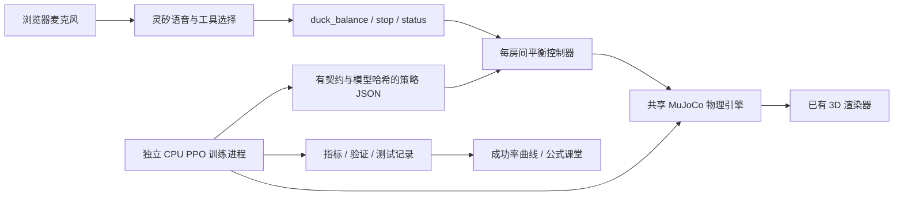

# 语音平衡教练：三关与可观察的 CPU 训练

入口为 `balance.html`。这是赛后新增的实验功能，与十三幕自动剧场独立；部署了包含此页的版本后，才可通过对应网站入口访问。按钮排练不需要灵矽，真人语音使用既有房间的真实灵矽连接。

## 用户体验与能力边界

1. 选择关卡，点击“准备圆盘”，再连接灵矽。
2. 说“开始第二关，面向我站稳”“用刚开始训练时的策略试试”“现在怎么样”“停止圆盘”。灵矽调用 `duck_balance`，结果取自当前物理世界。
3. 可以用同一个种子分别运行官方基线、训练步数 0 的任务网络、已评估 PPO。这里是实时 MuJoCo 推理；说一句话不会立即训练网络。
4. 下方独立展示 CPU 训练记录。点击奖励项、PPO 符号和曲线点，查看解释与真实数据。右侧裁剪滑块是明确标记的教学算例。

| 关卡 | 任务 | 圆盘目标运动上限 | 起始离心距离 |
|---|---|---|---|
| 1 跟着圆盘站稳 | 可随盘改变朝向，保持盘上支撑和中心区域 | 9 RPM、每轴 3° | 1.875–2.5 cm |
| 2 转盘转，我不转 | 保持世界正前方朝向，允许迈步 | 12 RPM、每轴 4° | 1.875–2.5 cm |
| 3 从边缘回到中心 | 从偏心位置回到中心，保持朝向 | 10 RPM、每轴 5° | 12–16 cm |

以上是目标值上限，实际转速、倾角来自动力学，可能存在跟踪误差；不是硬件安全转速认证。“边缘”是演示名称，初态仍保留足够的脚部边缘余量。

**当前学习范围是反馈力度，不是从零学步态。** `balance-v4-gain-bodyframe` 的 PPO 在 10 Hz 下输出三个数；取正部作为前后、横移、转向反馈力度。指向中心、抵消圆盘运动的反馈函数是明确的工程先验。冻结的官方 `velstand.onnx` 在 50 Hz 下将速度指令转换成 14 个关节的 PD 目标；MuJoCo 在 200 Hz 下计算动力学与接触。没有给鸭子的自由根加力、焊脚或在运行中改写根位置。

```
g = max(a, 0), a ∈ [-1, 1]
v前后 = clip(3 g₁ e前后, -0.18, 0.18) m/s
v横移 = clip(3 g₂ e横移, -0.12, 0.12) m/s
ω转向 = clip(-g₃ (4 ψ + 1.5 ω盘), -1.8, 1.8) rad/s
```

e 是指向世界 XY 盘心、按身体偏航角旋转后的水平位移；不是包含身体滚转/俯仰的完整三维坐标。第 1 关的转向反馈为 0。每任务步另限速度变化量为 `0.08 m/s、0.06 m/s、0.6 rad/s`。任务网络零输出就是官方步态基线；“训练步数 0”并不是一个从未训练过的机器人，因为底层官方步态本来就经过训练。

## 物理与验收

圆盘由两个倾斜铰链和一个自转铰链组成，有真实质量、惯量和有限执行器力矩。倾斜位置执行器 `kp=120, kv=10, ±25 Nm`；自转速度执行器 `kv=8, ±12 Nm`。目标轨迹逐渐加速、变速和倾斜，停盘也通过目标连续减速；这不是修改 mocap 姿态的运动学圆盘。颜色、条纹与圆柱绘制只用于可视化，位置均来自同一 MuJoCo 模型。复用 DuckKing 渲染器，没有复制 DuckKing_PPO 的 3D 界面。

每轮正常挑战为 10 秒扰动＋3 秒减速。成功须同时满足：

- 无躯干或其他非脚部触盘、无机器人落地、无脚的保守包围盒越过盘缘。
- 躯干直立度 ≥0.65、相对盘面高度 ≥7.5 cm；连续无脚部支撑不超过 0.4 秒。
- 结尾距中心 <8 cm，并连续保持至少 1 秒。
- 实际盘速 <0.25 RPM，两轴实际倾角绝对值 <1°。
- 第 2、3 关至少 85% 的任务步朝向误差 <25°。

身体速度使用 MuJoCo 普通刚体坐标系 `mjOBJ_XBODY`；接触点速度与 Jacobian 对照测试。不能把惯性坐标系 `mjOBJ_BODY` 的速度与 `xpos` 的力臂混用。

脚部支撑按官方脚部刚体归属识别，避免把脚上另一个碰撞几何体误判为躯干触盘。滑动速度是脚与**运动盘面同一接触点**的相对切向速度。全脚边缘检查使用碰撞网格的保守局部包围盒，不只看躯干中心。

手动停盘会继续保持控制直至减速过程结束，标为人为干预，不计成功。跌倒或策略/数值异常后明确结束本轮并暂停物理，不能声称已经恢复站稳。新一轮语音提问保留平衡控制；显式停止、断线、会话故障仍执行停盘。换普通场景前须断开当前语音，房间间不共享动态状态。

## 奖励、PPO 与指标口径

当前奖励版本 2 为直立、中心、朝向、回中心进展、接触滑速、动作变化、失败、终点成功八项之和。终点成功额外奖励 20 分，正常到时但未达标扣 10 分；手动停止不冒充正常结局。系数及公式在 `balance.py`、本轮 manifest 和网页中对应显示；第 1 关朝向项为 0。PPO 使用 Stable Baselines3，两个 64 维隐藏层，25 维观测、3 维动作，CPU 单 Torch 线程、多进程采样。观测来自仿真真值，不代表已经接入摄像头视觉。

25 维观测包含目标方向、朝向正余弦、投影重力、身体角/线速度、圆盘倾角/速度、支撑和高度、上次任务动作、已用时间比例与停盘状态。任务本身的 13 秒结束是 `terminated`，不是外加采样时限 `truncated`；终点不继续价值 bootstrap。输入中的时间使策略能区分任务阶段。

优化器可使用固定奖励缩放（当前 CLI 默认 `--reward-scale 0.05`），以控制价值损失的数量级；验证回报和八项奖励曲线仍是原始单位。初始高斯探索标准差由 `--initial-std` 设置，默认 0.6；训练过程中可学习的标准差另画曲线。每轮 manifest 保留实际值，历史试验不拼接成同一次训练。

- **步数**：训练环境的任务步，1 步对应 0.1 秒仿真；多环境相加。基线、验证、最终测试不加入训练步数。PPO 按完整采样批次更新，最终步数可能略大于请求预算。
- **成功率**：同一组 20 个验证种子，每约 8192 个训练步重新测量；显示 Wilson 95% 区间。连续两次各 ≥18/20 称为“达到预定验证门槛”，不是数学意义的收敛证明，两次不能合并成 40 个独立样本。
- **耗时**：单调墙钟，从环境准备开始，包括基线、采样、优化、验证与存盘。`converged_at` 是首次达到连续门槛的实测步数与耗时；未达标为 null。总耗时另包括最终测试。这里是所选固定配置的一次运行耗时，不包含此前调参、失败试验与代码修正的总工时。
- **最终测试**：选择验证最佳策略后，再测独立的 100 个未见种子。原始逐种子结果保留；训练 seed 与评估 seed 不等同。同组 100 个种子另测零任务动作的官方基线，保存为 `baseline-test.json`。验证成功率相同时选择更晚的策略。单个训练 seed 的结果不足以证明跨训练 seed 稳健性。

- **优化曲线**：近似 KL、裁剪比例、负熵、策略损失、价值损失、解释方差、动作标准差、策略隐藏层权重 L2 范数。L2 范数不是成功率，也不是完整逐权重可视化。
- **物理/奖励曲线**：训练采样的平均离心距离、相对滑速、直立度、带符号转速、各奖励分量。配置常量的曲线明确标为常量；没有自适应调整 γ、λ 等参数。

未见测试使用同一参数分布的新随机种子，未验证更高转速、新质量分布、真实机器人或新摩擦范围。

官方基线若已通过第 1 关，页面明确提示不能把这项已有能力算成 PPO 的改进。CPU 实测若与其他训练/开发检查同时运行，应视为该机器实际工作负载下的墙钟结果，不当成独占 CPU 的标准基准。

## CPU 实测结果

2026-11-01 的固定配置三轮训练已完成。第 1 关达到连续验证门槛用时 11 分 45 秒，但官方基线和 PPO 都为 100/100，没有新增能力可归因。第 2、3 关各训练 131,072 步，含最终测试和配对基线共用时 30 分 57 秒、30 分 27 秒；最终测试为 89/100、59/100，对照基线均为 0/100。两关尚未达到连续两次 ≥90% 的门槛，不能给出已经收敛的耗时。

训练硬件、置信区间、逐回合结果、失败分类与数据口径见 [实测记录](../training/results/README.md)。第一版是可复现的学习实验；第三关仍需要继续改进稳定性。

## 安装与训练

先按项目 setup 安装官方场景资源。训练使用独立环境；常规服务无需 Torch，已有 NumPy 2 运行环境不被降级。训练 CLI 需要完整源码检出（或源码发布包）；仅安装 Python wheel 不包含 `training/`。Intel macOS 使用最后支持该平台的 Torch 2.2.2 和 NumPy 1.26 ABI。

```bash
uv venv .duckking/balance-venv --python .venv/bin/python
uv pip install --python .duckking/balance-venv/bin/python -r training/requirements.txt
PYTHONPATH=src .duckking/balance-venv/bin/python training/train_balance.py \
  --level 2 --steps 65536 --envs 3 --seed 42 \
  --output .duckking/balance/runs/my-level2
```

`--level` 可取 1、2、3；`--envs` 为 1–4；不允许覆盖已有运行目录。`SIGINT`/`SIGTERM` 请求在已有网络时保存最后策略和 checkpoint 后退出；基线测量阶段还没有任务网络。中途取消不产生虚构最终测试。当前 CLI 不提供从 checkpoint 精确续训的命令，保存的 SB3 checkpoint 供后续研究使用。

展示本机记录：

```bash
DUCKKING_BALANCE_RUNS=.duckking/balance/runs uv run --frozen duckking --port 8765
```

打开 `http://127.0.0.1:8765/balance.html`。也可显式开启网页训练按钮：

```bash
DUCKKING_BALANCE_RUNS=.duckking/balance/runs \
DUCKKING_BALANCE_TRAINING=1 \
DUCKKING_TRAIN_PYTHON="$PWD/.duckking/balance-venv/bin/python" \
uv run --frozen duckking --port 8765
```

网页任务每服务最多一个、两个采样环境；默认不开启训练提交，观众仍能看记录。训练在独立进程中运行；可见页面每 5 秒检查记录状态，记录有变化才获取详情并更新曲线，worker 每 2 秒更新状态心跳。普通 Python API/语音进程不执行梯度训练。公网服务只展示已生成工件即可，不需要在服务机训练。随仓库的 `training/results/` 是只读实测证据；本地新记录从 `DUCKKING_BALANCE_RUNS` 读取。同名本地记录优先；`DUCKKING_BALANCE_BUNDLED` 可指定另一只读目录。

## 画面清晰度与浏览器资源

共享物理渲染器按需绘制：物理位置、相机、配色或尺寸改变才提交新画面，拖动的惯性结束后停止绘制；离开视口或切到后台时暂停绘制。硬件加速保留最高 2 倍设备像素比，软件渲染保留 1 倍并关闭阴影、环境贴图。不会再把模型加载、首次着色器编译或后台等待误判为显卡太慢，永久降成 160 像素宽。持续运动时，两帧之间留出至少 33 ms（坐姿场景 66 ms、软件渲染 100 ms），实际帧率还受绘制耗时限制；这不改变 MuJoCo 的物理步进频率。

平衡页对未变化的物理快照去重；静止时约每 300 ms 收一个状态，后台约每秒一次，仍保持一个未确认快照的背压协议。收起的观测表不更新，展开后复用单元格、最高 5 Hz 刷新；结束状态立即更新。训练记录未变化时保留曲线节点及键盘焦点。离页中止模型和记录请求、关闭状态流并释放渲染器，迟到的下载结果不能重新创建画布。

切换模型时同时释放实例矩阵/配色的 GPU 缓冲区、网格、材质和贴图；仅释放网格不足以释放 `InstancedMesh` 的专属缓冲区。销毁视图还释放地面、网格线、阴影、环境贴图、控件、事件监听和 WebGL 上下文。

2026-11-01 本机 Chrome、Intel UHD Graphics 630 硬件加速、1440×1050 浏览器视口、设备像素比 2，在同一静止圆盘画面各采样约 12 秒的诊断：

| 指标 | 修复前 | 修复后 |
|---|---:|---:|
| 922×480 CSS 像素画面的内部尺寸 | 160×83 | 1844×960 |
| CDP `TaskDuration` 增量（浏览器主线程工作时间） | 1.483 s | 0.056 s |
| WebGL 绘制调用增量（不是画面帧数） | 176 | 0 |
| 收起的观测表 DOM 变更记录 | 2509 | 0 |
| 成功率曲线 DOM 变更记录 | 4 | 0 |

这是修复期间同机短时对比，不能当成整机 CPU 百分比或所有设备的性能保证。强制 GC 后，两次样本的 JS 堆都仅增加约 0.01 MiB，未从这段静止样本观察到持续 JS 堆泄漏；另对反复切场景的 GPU 缓冲区释放做回归检查。长期使用、不同浏览器和训练争用仍需持续观察。

## 工件、兼容与接口

每次运行包含 `manifest.json`、`status.json`、`metrics.jsonl`、`baseline.json`、每次 `validation-*.json`、策略 JSON、SB3 checkpoint，以及正常结束后的 `test.json`、`baseline-test.json`。训练脚本与物理引擎源文件 SHA-256、模型/官方步态内容哈希、动力学、输入维数、关节顺序、控制频率和控制契约均在 manifest 中。导出策略后用 32 个输入核对 NumPy 推理与 SB3 确定性输出。服务只加载数值 JSON，不反序列化观众提交的 pickle。仓库中的只读副本保留指标、逐种子验证/测试、零步与最佳策略；不携带 SB3 checkpoint、中间策略权重或私有 worker 日志。完整本地运行目录仍保留这些训练文件。

| 接口 | 用途 |
|---|---|
| `GET /api/balance/runs`、`/{id}` | 有界记录列表、指标、配置、最终测试；不暴露私有设备身份 |
| `POST /api/balance/prepare?room=…` | 准备本房间官方模型、圆盘与物理状态 |
| `POST /api/balance/command?room=…` | 本地排练 start / stop / status、选关 select，明确标注来源 |
| `POST /api/balance/train` | 需显式配置开启，启动一个 CPU worker |
| `POST /api/balance/runs/{id}/cancel` | 取消本服务当前拥有的 worker |
| 既有 `scene-ws`、`scene-voice` 与模型接口 | 复用现有房间协议、HTTPS 前缀和网关转发 |

不匹配的契约、模型哈希、关卡或无效权重会明确失败；缺策略不会自动退回官方基线。旧版自由速度试验与当前反馈力度契约不能混用。展示当前契约的主训练记录；旧试验仍可通过记录接口核对。模型与策略来源沿用 [第三方声明](../THIRD_PARTY.md)。

算法参考：[SB3 2.4.1 PPO](https://stable-baselines3.readthedocs.io/en/v2.4.1/modules/ppo.html)、[Gymnasium 终止与截断](https://gymnasium.farama.org/tutorials/gymnasium_basics/handling_time_limits/)、[MuJoCo 3.3.7 执行器与模型](https://mujoco.readthedocs.io/en/3.3.7/XMLreference.html)。

## 分层与验证



Web 服务不导入 Torch。离线训练程序位于 `training/train_balance.py`，使用独立依赖环境；后端覆盖率仍完整覆盖 `src/duckking`，不把可选训练依赖装入常规服务或常规 CI。训练程序另有 CPU 检查：

```bash
PYTHONPATH=src .duckking/balance-venv/bin/python -m unittest discover -s training -p test_trainer.py
uv run pytest tests/test_balance.py tests/test_rooms.py
cd frontend
npm run test:unit
npx playwright test tests/balance.spec.js
```

可选训练检查会执行真实的短程 PPO 更新、导出后与 SB3 对照、验证完整终止和奖励缩放语义。常规后端测试覆盖接触速度、动力学停止、非法策略、房间占用、语音工具边界与训练进程失败；浏览器检查真实圆盘渲染、缺策略提示、停止及往返切场景。

本轮验证覆盖本地页面与工具协议；没有把协议测试记成真实灵矽云端对话，也没有测试实体圆盘或实机迁移。新增口令的真人麦克风与云端完整对话仍需现场验收。

2026-11-01 本地检查记录：

- 后端全量首轮 445 通过、3 失败，当时与 CPU 训练并行。失败项是既有坐姿合唱、四鸭同时翻滚、搬运暂停恢复；训练停止后这 3 项全部单独复测通过。没有据此把首轮写成“全量通过”。
- 补充启动阶段取消处理后，平衡教练与房间相关 35 项通过；可选训练检查 3 项通过，前端单元检查 36 项通过。
- 生产构建、Vite 开发模式的平衡页浏览器检查各 2 项通过。真实网页还验证了新 worker 记录不被旧记录遮住、Python 导入阶段立即取消和开始基线测量后取消；均结束为 cancelled，没有生成虚构测试成绩。
- 三份最终策略都通过源文件哈希、契约、同种子配对结果和 NumPy 2 服务端推理核对；实时 API 对种子 0 的实跑中，第 1、2 关成功，第 3 关在 13 秒结束后明确报告条件未达标。它与上表的 100 回合测试分开计数。

同日画面与资源修复后的补充检查：前端单元检查 42 项通过；Vite 开发模式平衡页 5 项通过。生产模式相关检查 7 项通过，另 1 项在将重建等待改为与真实模型加载一致的 45 秒后单独复测通过。检查覆盖清晰度、静止无重复绘制、拖动/缩放/复位、三轮切场景后 GPU 缓冲区及纹理数量不增长、离页中止下载、训练曲线缓存，以及既有四鸭配色、踢球/双鸭接触和舞台点选。没有据此宣称长期内存使用或所有浏览器都已验证。

同机训练会争用 CPU，独立进程不代表性能隔离。公网默认关闭训练提交；展演和训练宜错开或分别部署。
