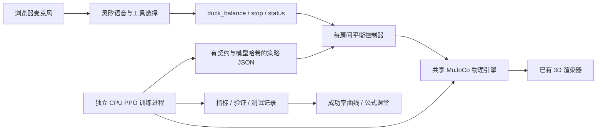

# 语音平衡教练：三关与可观察的 CPU 训练

入口为 `balance.html`，首页导航与“语音 × PPO”功能卡片均可进入。功能卡片在新标签页打开，保留原工作台；沿用当前房间。此功能是赛后新增的实验，与十三幕自动剧场独立。按钮排练不需要灵矽，真人语音使用既有房间的真实灵矽连接。

## 用户体验与能力边界

1. 选择关卡，点击“准备圆盘”，再连接灵矽。
2. 说“第二关运行 20 秒，面向我站稳”“把时长设为 20 秒，先别开始”“用刚开始训练时的策略试试”“现在怎么样”“停止圆盘”。灵矽调用 `duck_balance`，结果取自当前物理世界。语音设置与按钮使用同一接口，服务端接受后，页面同步种子、总时长和实际进度。
3. 点击“本地排练当前关卡”，左侧“未训练”运行官方步态基线，右侧“训练后”运行所选记录的已评估 PPO。两侧一次开始、一起停止，拖动/缩放视角联动。右侧也可切为训练步数 0 或官方基线，头顶标签随真实控制器变为“训练前”或“未训练”。这里是实时 MuJoCo 推理；说一句话不会立即训练网络。
4. 下方独立展示 CPU 训练记录。点击奖励项、PPO 符号和曲线点，查看解释与真实数据。右侧裁剪滑块是明确标记的教学算例。

| 关卡 | 任务 | 圆盘目标运动上限 | 起始离心距离 |
|---|---|---|---|
| 1 跟着圆盘站稳 | 可随盘改变朝向，保持盘上支撑和中心区域 | 9 RPM、每轴 3° | 1.875–2.5 cm |
| 2 转盘转，我不转 | 保持世界正前方朝向，允许迈步 | 12 RPM、每轴 4° | 1.875–2.5 cm |
| 3 从边缘回到中心 | 从偏心位置回到中心，保持朝向 | 10 RPM、每轴 5° | 12–16 cm |

以上是目标值上限，实际转速、倾角来自动力学，可能存在跟踪误差；不是硬件安全转速认证。“边缘”是演示名称，初态仍保留足够的脚部边缘余量。

“未训练”专指没有训练这项平衡任务，官方步态本身已训练。左右使用相同种子、初始位置/姿态、摩擦、目标转速与倾角程序，由服务端同一个 10 Hz 任务循环串行推进，完成一对步骤后才发布快照；机器变慢时两边一起变慢。两侧拥有独立 `MjData`、步态历史、策略动作与成绩；共享编译模型和官方 ONNX session，重置在同一锁内且种子一致，所以盘面摩擦的赋值相同。原始训练引擎、奖励与策略工件保持不变。

相同的是**判分期间圆盘执行器的目标节奏**，实际盘速与倾角仍受各侧接触力影响，不能强制画成一样。任一侧先触发训练环境的终止条件，就保留其成绩；另一侧继续完成有界挑战。失败侧在不追加判分的情况下继续最多 4 秒真实 MuJoCo 物理，显示失稳、掉落和触地过程；结束后定格。没有物理失败的正常到时结束不追加跌落展示。缺失/无效策略会在重置前报错，不启动半场对照，也不自动退回基线。计算异常会暂停两侧。第 1 关的官方基线本来就能通过，不能为了突出效果故意弱化左侧。

仅第二关“转盘转，我不转”的两侧 3D 场景显示蓝色箭头与“目标朝向”文字，固定指向 MuJoCo 世界坐标 +X（躯干 yaw=0，与物理验收一致）。标记平铺在圆盘外的地面上，像地面涂装，不悬浮、不随盘旋转，也不是碰撞物体。使用正常深度遮挡，鸭子经过时会遮住标记；旋转视角只改变投影，不改变目标方向。第一、三关不显示该标记。第三关仍沿用既有训练/验收规则，本次只调整视觉提示，没有更改策略或奖励。

失败侧先显示“失去平衡…”，实际触地后在 3D 画面内醒目显示“挑战失败 · 已掉落触地”。若只是倒在盘面或越界而没有落地，按实际接触数据说明，不强制制造掉落。时间读数标为“判定失败时刻”；盘速、距中心、脚部支撑则继续显示当前物理状态，最终暂停后盘速标为“定格时盘速”。脚部越界会显示判分时的实际越界毫米数；这个条件检查脚部碰撞网格的保守包围盒，可能在整只鸭子跌下去之前触发。重建场景期间，临时默认关卡的状态推送不会覆盖已经选择的关卡。

后续展示由 `balance_aftermath.py` 单独实现：保留最后的关节 PD 目标，不再推理任务 PPO/步态策略；圆盘目标按既有速率限制趋于零，通过执行器力矩减速。机器人继续受重力与接触力作用，不改写姿态、不额外推倒，也不修改奖励、成功率或训练引擎。触地并低速稳定后停止，最迟 4 秒停止；停止、重试、切场景会中断这段展示。两侧使用相同规则，失败侧的制动不影响另一侧仍在判分的圆盘程序。

“对照种子”与“运行时长（秒）”并排，各自标签在输入框上方。总时长支持 6–33 秒整数，默认 13 秒，始终包含最后 3 秒减速，其余为扰动阶段；是仿真时间，CPU 忙时现实耗时可能更长。页面明确区分自定义试跑与 13 秒标准评估，不把已有成功率套用到其他时长；调整时长也不会重新训练策略。输入框中尚未提交的修改不被重复状态推送覆盖，新语音/按钮设置被服务端接受后同步为实际值。

种子影响三个目标运动波形的初始相位、顺逆转向、盘面摩擦（0.8–1.1）、起点位置及小幅朝向偏差。它不改变关卡的最高转速/倾角，也不是难度刻度。相同关卡、种子、时长和策略可重复对比；不同种子可能改变完成结果，但并非每次都会有夸张的视觉差异。第 3 关 12–16 cm 的偏心起点变化最明显。可先对比种子 0 与 1：俯视分别顺时针、逆时针，页面显示本轮实际采用的方向与摩擦系数。

**当前学习范围是反馈力度，不是从零学步态。** `balance-v4-gain-bodyframe` 的 PPO 在 10 Hz 下输出三个数；取正部作为前后、横移、转向反馈力度。指向中心、抵消圆盘运动的反馈函数是明确的工程先验。冻结的官方 `velstand.onnx` 在 50 Hz 下将速度指令转换成 14 个关节的 PD 目标；MuJoCo 在 200 Hz 下计算动力学与接触。没有给鸭子的自由根加力、焊脚或在运行中改写根位置。

```
g = max(a, 0), a ∈ [-1, 1]
v前后 = clip(3 g₁ e前后, -0.18, 0.18) m/s
v横移 = clip(3 g₂ e横移, -0.12, 0.12) m/s
ω转向 = clip(-g₃ (4 ψ + 1.5 ω盘), -1.8, 1.8) rad/s
```

e 是指向世界 XY 盘心、按身体偏航角旋转后的水平位移；不是包含身体滚转/俯仰的完整三维坐标。第 1 关的转向反馈为 0。每任务步另限速度变化量为 `0.08 m/s、0.06 m/s、0.6 rad/s`。任务网络零输出就是官方步态基线；“训练步数 0”并不是一个从未训练过的机器人，因为底层官方步态本来就经过训练。

## 物理与验收

圆盘由两个倾斜铰链和一个自转铰链组成，有真实质量、惯量和有限执行器力矩。倾斜位置执行器 `kp=120, kv=10, ±25 Nm`；自转速度执行器 `kv=8, ±12 Nm`。目标轨迹逐渐加速、变速和倾斜，停盘也通过目标连续减速；这不是修改 mocap 姿态的运动学圆盘。颜色、条纹与圆柱绘制只用于可视化，位置均来自同一 MuJoCo 模型。复用 DuckKing 渲染器，没有复制 DuckKing_PPO 的 3D 界面。

标准训练/评估每轮为 10 秒扰动＋3 秒减速；自定义排练为设定总时长减去 3 秒的扰动＋3 秒减速。成功须完整经历该轮设定时长，并同时满足：

- 无躯干或其他非脚部触盘、无机器人落地、无脚的保守包围盒越过盘缘。
- 躯干直立度 ≥0.65、相对盘面高度 ≥7.5 cm；连续无脚部支撑不超过 0.4 秒。
- 结尾距中心 <8 cm，并连续保持至少 1 秒。
- 实际盘速 <0.25 RPM，两轴实际倾角绝对值 <1°。
- 第 2、3 关至少 85% 的任务步朝向误差 <25°。

身体速度使用 MuJoCo 普通刚体坐标系 `mjOBJ_XBODY`；接触点速度与 Jacobian 对照测试。不能把惯性坐标系 `mjOBJ_BODY` 的速度与 `xpos` 的力臂混用。

脚部支撑按官方脚部刚体归属识别，避免把脚上另一个碰撞几何体误判为躯干触盘。滑动速度是脚与**运动盘面同一接触点**的相对切向速度。全脚边缘检查使用碰撞网格的保守局部包围盒，不只看躯干中心。

手动停盘会继续保持控制直至减速过程结束，标为人为干预，不计成功。跌倒或策略/数值异常后明确结束本轮并暂停物理，不能声称已经恢复站稳。新一轮语音提问保留平衡控制；显式停止、断线、会话故障仍执行停盘。换普通场景前须断开当前语音，房间间不共享动态状态。

## 奖励、PPO 与指标口径

当前奖励版本 2 为直立、中心、朝向、回中心进展、接触滑速、动作变化、失败、终点成功八项之和。终点成功额外奖励 20 分，正常到时但未达标扣 10 分；手动停止不冒充正常结局。系数及公式在 `balance.py`、本轮 manifest 和网页中对应显示；第 1 关朝向项为 0。PPO 使用 Stable Baselines3，两个 64 维隐藏层，25 维观测、3 维动作，CPU 单 Torch 线程、多进程采样。观测来自仿真真值，不代表已经接入摄像头视觉。

25 维观测包含目标方向、朝向正余弦、投影重力、身体角/线速度、圆盘倾角/速度、支撑和高度、上次任务动作、已用时间比例与停盘状态。标准训练任务本身的 13 秒结束是 `terminated`，不是外加采样时限 `truncated`；终点不继续价值 bootstrap。输入中的时间使策略能区分任务阶段。自定义时长沿用同一物理引擎的有界配置，已用时间比例改按本轮总时长计算；训练脚本、奖励和已保存策略工件均未修改。

优化器可使用固定奖励缩放（当前 CLI 默认 `--reward-scale 0.05`），以控制价值损失的数量级；验证回报和八项奖励曲线仍是原始单位。初始高斯探索标准差由 `--initial-std` 设置，默认 0.6；训练过程中可学习的标准差另画曲线。每轮 manifest 保留实际值，历史试验不拼接成同一次训练。

- **步数**：训练环境的任务步，1 步对应 0.1 秒仿真；多环境相加。基线、验证、最终测试不加入训练步数。PPO 按完整采样批次更新，最终步数可能略大于请求预算。
- **成功率**：同一组 20 个验证种子，每约 8192 个训练步重新测量；显示 Wilson 95% 区间。连续两次各 ≥18/20 称为“达到预定验证门槛”，不是数学意义的收敛证明，两次不能合并成 40 个独立样本。
- **耗时**：单调墙钟，从环境准备开始，包括基线、采样、优化、验证与存盘。`converged_at` 是首次达到连续门槛的实测步数与耗时；未达标为 null。总耗时另包括最终测试。这里是所选固定配置的一次运行耗时，不包含此前调参、失败试验与代码修正的总工时。
- **最终测试**：选择验证最佳策略后，再测独立的 100 个未见种子。原始逐种子结果保留；训练 seed 与评估 seed 不等同。同组 100 个种子另测零任务动作的官方基线，保存为 `baseline-test.json`。验证成功率相同时选择更晚的策略。单个训练 seed 的结果不足以证明跨训练 seed 稳健性。

- **优化曲线**：近似 KL、裁剪比例、负熵、策略损失、价值损失、解释方差、动作标准差、策略隐藏层权重 L2 范数。L2 范数不是成功率，也不是完整逐权重可视化。
- **物理/奖励曲线**：训练采样的平均离心距离、相对滑速、直立度、带符号转速、各奖励分量。配置常量的曲线明确标为常量；没有自适应调整 γ、λ 等参数。

未见测试使用同一参数分布的新随机种子，未验证更高转速、新质量分布、真实机器人或新摩擦范围。

官方基线若已通过第 1 关，页面明确提示不能把这项已有能力算成 PPO 的改进。CPU 实测若与其他训练/开发检查同时运行，应视为该机器实际工作负载下的墙钟结果，不当成独占 CPU 的标准基准。

## CPU 实测结果

2026-11-01 的固定配置三轮训练已完成。第 1 关达到连续验证门槛用时 11 分 45 秒，但官方基线和 PPO 都为 100/100，没有新增能力可归因。第 2、3 关各训练 131,072 步，含最终测试和配对基线共用时 30 分 57 秒、30 分 27 秒；最终测试为 89/100、59/100，对照基线均为 0/100。两关尚未达到连续两次 ≥90% 的门槛，不能给出已经收敛的耗时。

训练硬件、置信区间、逐回合结果、失败分类与数据口径见 [实测记录](../training/results/README.md)。第一版是可复现的学习实验；第三关仍需要继续改进稳定性。

## 安装与训练

先按项目 setup 安装官方场景资源。训练使用独立环境；常规服务无需 Torch，已有 NumPy 2 运行环境不被降级。训练 CLI 需要完整源码检出（或源码发布包）；仅安装 Python wheel 不包含 `training/`。Intel macOS 使用最后支持该平台的 Torch 2.2.2 和 NumPy 1.26 ABI。

```bash
uv venv .duckking/balance-venv --python .venv/bin/python
uv pip install --python .duckking/balance-venv/bin/python -r training/requirements.txt
PYTHONPATH=src .duckking/balance-venv/bin/python training/train_balance.py \
  --level 2 --steps 65536 --envs 3 --seed 42 \
  --output .duckking/balance/runs/my-level2
```

`--level` 可取 1、2、3；`--envs` 为 1–4；不允许覆盖已有运行目录。`SIGINT`/`SIGTERM` 请求在已有网络时保存最后策略和 checkpoint 后退出；基线测量阶段还没有任务网络。中途取消不产生虚构最终测试。当前 CLI 不提供从 checkpoint 精确续训的命令，保存的 SB3 checkpoint 供后续研究使用。

展示本机记录：

```bash
DUCKKING_BALANCE_RUNS=.duckking/balance/runs uv run --frozen duckking --port 8765
```

打开 `http://127.0.0.1:8765/balance.html`。也可显式开启网页训练按钮：

```bash
DUCKKING_BALANCE_RUNS=.duckking/balance/runs \
DUCKKING_BALANCE_TRAINING=1 \
DUCKKING_TRAIN_PYTHON="$PWD/.duckking/balance-venv/bin/python" \
uv run --frozen duckking --port 8765
```

网页任务每服务最多一个、两个采样环境；默认不开启训练提交，观众仍能看记录。训练在独立进程中运行；可见页面每 5 秒检查记录状态，记录有变化才获取详情并更新曲线，worker 每 2 秒更新状态心跳。普通 Python API/语音进程不执行梯度训练。公网服务只展示已生成工件即可，不需要在服务机训练。随仓库的 `training/results/` 是只读实测证据；本地新记录从 `DUCKKING_BALANCE_RUNS` 读取。同名本地记录优先；`DUCKKING_BALANCE_BUNDLED` 可指定另一只读目录。

## 画面清晰度与浏览器资源

共享物理渲染器按需绘制：物理位置、相机、配色或尺寸改变才提交新画面，拖动的惯性结束后停止绘制；离开视口或切到后台时暂停绘制。硬件加速保留最高 2 倍设备像素比，软件渲染保留 1 倍并关闭阴影、环境贴图。不会再把模型加载、首次着色器编译或后台等待误判为显卡太慢，永久降成 160 像素宽。持续运动时，两帧之间留出至少 33 ms（坐姿场景 66 ms、软件渲染 100 ms），实际帧率还受绘制耗时限制；这不改变 MuJoCo 的物理步进频率。

平衡页对未变化的物理快照去重；使用 WebSocket 时，静止约每 300 ms 收一个状态，后台约每秒一次，仍保持一个未确认快照的背压协议。收起的观测表不更新，展开后复用单元格、最高 5 Hz 刷新；结束状态立即更新。训练记录未变化时保留曲线节点及键盘焦点。离页中止模型和记录请求、关闭状态流并释放渲染器，迟到的下载结果不能重新创建画布。

状态连接与挑战结果分开显示。WebSocket 被拒绝、断开或连续 3 秒没有新状态时，同源 `GET /api/scenes/state?room=…` 自动接续读取同一房间的真实 MuJoCo 状态；画面明确标注 HTTP 接续，不替换为动画预览。每次 HTTP 响应之后，运行中等 100 ms、静止等 750 ms、后台等 2 秒再读取；单次读取最多 2.5 秒，始终只有一个当前读取请求。WebSocket 从 2 秒起逐步延长重试间隔、最高 30 秒，收到有效快照后恢复主通道并取消旧 HTTP 请求。迟到的旧响应不能覆盖新状态。

未取得最新状态时禁止开始挑战，停盘按钮仍可提交；按钮请求被受理后立即显示确认并主动读取状态。两条状态通道都不可用时明确提示画面是上次记录，恢复后自动更新并允许开始。恢复过程只重试状态读取，不重放动作或语音请求。连接提示不会覆盖左右挑战成绩；离页取消读取、确认计时器和重连。原有 Origin 校验保持不变，这条 HTTP 接续仅用于平衡页物理状态，不能替代灵矽语音连接。

切换模型时同时释放实例矩阵/配色的 GPU 缓冲区、网格、材质和贴图；仅释放网格不足以释放 `InstancedMesh` 的专属缓冲区。销毁视图还释放地面、网格线、阴影、环境贴图、控件、事件监听和 WebGL 上下文。

2026-11-01 本机 Chrome、Intel UHD Graphics 630 硬件加速、1440×1050 浏览器视口、设备像素比 2，在加入左右对照前的单视图版本，同一静止圆盘画面各采样约 12 秒的诊断：

| 指标 | 修复前 | 修复后 |
|---|---:|---:|
| 922×480 CSS 像素画面的内部尺寸 | 160×83 | 1844×960 |
| CDP `TaskDuration` 增量（浏览器主线程工作时间） | 1.483 s | 0.056 s |
| WebGL 绘制调用增量（不是画面帧数） | 176 | 0 |
| 收起的观测表 DOM 变更记录 | 2509 | 0 |
| 成功率曲线 DOM 变更记录 | 4 | 0 |

这是修复期间同机短时对比，不能当成整机 CPU 百分比或所有设备的性能保证。强制 GC 后，两次样本的 JS 堆都仅增加约 0.01 MiB，未从这段静止样本观察到持续 JS 堆泄漏；另对反复切场景的 GPU 缓冲区释放做回归检查。长期使用、不同浏览器和训练争用仍需持续观察。

左右对照沿用按需绘制与资源回收：只下载一次模型，在同页两张画布使用；两侧都在静止或不可见时停止绘制。移动窄屏改为上下排列。动态运行需计算两个物理状态并绘制两个模型，开销高于原来的单场景，不把原单视图的测量值当成对照页成绩。

同日本地 Chrome 左右对照实跑（第 2 关、种子 0、`level2-cpu-v4`）：两侧初始姿态相同，4.7 秒快照的仿真时间与三个圆盘目标值完全一致；最终均经历 13 秒。官方基线距中心 11.54 cm、朝向达标率 16.15%，本轮未通过；训练策略距中心 2.53 cm、朝向达标率 100%，本轮通过。这是一个可复现的对照回合，不替代前述 100 种子测试。浏览器只请求一次模型，两张画布均以完整分辨率绘制；结束后 2.5 秒静止观察窗口内 WebGL 绘制调用增量为 0。390 px 窄屏检查无横向溢出。

## 工件、兼容与接口

每次运行包含 `manifest.json`、`status.json`、`metrics.jsonl`、`baseline.json`、每次 `validation-*.json`、策略 JSON、SB3 checkpoint，以及正常结束后的 `test.json`、`baseline-test.json`。训练脚本与物理引擎源文件 SHA-256、模型/官方步态内容哈希、动力学、输入维数、关节顺序、控制频率和控制契约均在 manifest 中。导出策略后用 32 个输入核对 NumPy 推理与 SB3 确定性输出。服务只加载数值 JSON，不反序列化观众提交的 pickle。仓库中的只读副本保留指标、逐种子验证/测试、零步与最佳策略；不携带 SB3 checkpoint、中间策略权重或私有 worker 日志。完整本地运行目录仍保留这些训练文件。

| 接口 | 用途 |
|---|---|
| `GET /api/balance/runs`、`/{id}` | 有界记录列表、指标、配置、最终测试；不暴露私有设备身份 |
| `POST /api/balance/prepare?room=…` | 准备本房间官方模型、圆盘与物理状态 |
| `POST /api/balance/command?room=…` | 本地排练 start / stop / status、设置 select；`duration_seconds` 为 6–33 秒总时长（含 3 秒减速）；`compare` 默认为 true（同房间左右对照），false 可用于单侧诊断 |
| `GET /api/scenes/state?room=…` | 同一真实房间的物理快照；状态 WebSocket 不可用时自动接续 |
| `POST /api/balance/train` | 需显式配置开启，启动一个 CPU worker |
| `POST /api/balance/runs/{id}/cancel` | 取消本服务当前拥有的 worker |
| 既有 `scene-ws`、`scene-voice` 与模型接口 | 复用现有房间协议、HTTPS 前缀和网关转发 |

不匹配的契约、模型哈希、关卡或无效权重会明确失败；缺策略不会自动退回官方基线。旧版自由速度试验与当前反馈力度契约不能混用。展示当前契约的主训练记录；旧试验仍可通过记录接口核对。模型与策略来源沿用 [第三方声明](../THIRD_PARTY.md)。

现有快照外层保留右侧姿态与成绩；`backend.comparison.baseline` 为左侧完整物理快照，`backend.balance.comparison` 为共同进度、执行状态和左侧摘要。两个视图属于一个房间，另一个房间的语音与场景仍独立。`duck_balance` 默认同样开始左右对照；语音读取结果时须区分左右，不把右侧成功当作两侧都成功。

每侧 `balance.sim_time` 与 `result.seconds` 为判分时钟，终止后固定；`physics_time` 和外层帧 `sim_time` 包含后续物理展示。`aftermath` 返回展示阶段、秒数、地面接触证据与当前测量值，明确标记 `counts_toward_score=false`。共同进度为两侧判分时间的最大值；`comparison.physics_time` 记录公共执行循环时间，两侧判分都结束但展示仍在继续时阶段为 `settling`。语音只能依据 `ground_contact` 报告落地，不能把脚部越界直接说成掉落。

`duck_balance` 同样支持 `duration_seconds` 和 `select`。省略关卡、种子、时长时沿用本房间当前值，初始为第 1 关、种子 0、13 秒。`select` 平滑停止当前挑战后设置为待机，不自动开始；`start` 开始完整新一轮。非法参数在停止或重置现有挑战前拒绝，重复 MCP 请求不重放动作。快照返回总时长、扰动/减速时长、标准评估时长、设置版本以及本轮种子的方向和摩擦信息。

算法参考：[SB3 2.4.1 PPO](https://stable-baselines3.readthedocs.io/en/v2.4.1/modules/ppo.html)、[Gymnasium 终止与截断](https://gymnasium.farama.org/tutorials/gymnasium_basics/handling_time_limits/)、[MuJoCo 3.3.7 执行器与模型](https://mujoco.readthedocs.io/en/3.3.7/XMLreference.html)。

## 分层与验证

### 自动生成排练视频：可行性调研（尚未接入产品）

可以把点击“本地排练当前关卡”后的真实 3D 过程自动生成视频；本次只确认方案，页面尚无录制、视频上传或自定义奖励函数入口。

| 方案 | 能录到的内容 | 适合的用途与边界 |
|---|---|---|
| 浏览器 `canvas.captureStream()` + `MediaRecorder` | 当前 Three.js 画布的实际渲染 | 适合先做一键录制/下载。当前左右为两个画布，需要合成到输出画布；HTML 中的失败提示、成绩和标题不属于 WebGL 画布，要单独绘入导出画面。 |
| 独立录制 worker：Playwright + FFmpeg | 指定视口内的左右画面、文字、指标 | 已有 `frontend/scripts/record-demo.mjs` 使用此路径生成演示视频，可扩展到平衡页。结束时关闭浏览器 context 才能确保视频写完；应独立于在线物理服务运行，避免 CPU 编码争用影响观众。 |
| 记录物理状态后离线重放、逐帧导出 | 同一轮真实姿态轨迹，统一镜头与输出帧率 | 更适合后续 PK 作品。需新增有界轨迹存储、版本信息和重放器；仅重新运行同一随机种子不能代替原过程的精确录像。 |

建议未来先做浏览器一键下载，再做独立 worker 生成统一的左右对照 MP4。录制开始要覆盖动作受理后的首帧，结束需等待双方挑战与后续跌落展示完成；停止、异常和切场景也应正确收尾。静止画面与后台标签页目前会暂停绘制，不能直接假设 `captureStream(30)` 就能得到稳定的 30 帧内容；要协调渲染调度/显式采帧，并限制输出分辨率、录制时长和内存。当前任务控制为 10 Hz，录制高帧率本身不会增加真实物理状态采样的频率。

视频不自动包含语音。若希望录入鸭子回复，需要从既有 Web Audio 播放链额外接出 `MediaStreamAudioDestinationNode` 音轨，再与视频流合成；真人麦克风是否录入应单独选择。浏览器编码格式须做运行时能力检测，不能承诺所有 iPhone、企业微信和 Chrome 都直接产生同一种 MP4；本次未做跨设备录制验收。

PK 的视频可以直观展示效果，但成绩应附带关卡、种子、时长、策略/模型哈希、奖励函数版本、结果与真实轨迹，并由同一环境复评。用户上传奖励函数的隔离执行、评测规则和作品上传都属于后续设计，本次没有实现。

依据：[Canvas 视频流](https://developer.mozilla.org/en-US/docs/Web/API/HTMLCanvasElement/captureStream)、[显式采帧与兼容性](https://developer.mozilla.org/en-US/docs/Web/API/CanvasCaptureMediaStreamTrack/requestFrame)、[MediaRecorder](https://developer.mozilla.org/en-US/docs/Web/API/MediaStream_Recording_API)、[Web Audio 录音出口](https://developer.mozilla.org/en-US/docs/Web/API/MediaStreamAudioDestinationNode)、[Playwright 视频录制](https://playwright.dev/docs/videos)。以上为 API 与已有代码的可行性分析，不代表已经接入当前按钮或测试了移动设备录制。

### 架构与检查



Web 服务不导入 Torch。离线训练程序位于 `training/train_balance.py`，使用独立依赖环境；后端覆盖率仍完整覆盖 `src/duckking`，不把可选训练依赖装入常规服务或常规 CI。训练程序另有 CPU 检查：

```bash
PYTHONPATH=src .duckking/balance-venv/bin/python -m unittest discover -s training -p test_trainer.py
uv run pytest tests/test_balance.py tests/test_rooms.py
cd frontend
npm run test:unit
npx playwright test tests/balance.spec.js
```

可选训练检查会执行真实的短程 PPO 更新、导出后与 SB3 对照、验证完整终止和奖励缩放语义。常规后端测试覆盖接触速度、动力学停止、非法策略、房间占用、语音工具边界与训练进程失败；浏览器检查真实圆盘渲染、缺策略提示、停止及往返切场景。

本轮验证覆盖本地页面与工具协议；没有把协议测试记成真实灵矽云端对话，也没有测试实体圆盘或实机迁移。新增口令的真人麦克风与云端完整对话仍需现场验收。

2026-11-01 本地检查记录：

- 后端全量首轮 445 通过、3 失败，当时与 CPU 训练并行。失败项是既有坐姿合唱、四鸭同时翻滚、搬运暂停恢复；训练停止后这 3 项全部单独复测通过。没有据此把首轮写成“全量通过”。
- 补充启动阶段取消处理后，平衡教练与房间相关 35 项通过；可选训练检查 3 项通过，前端单元检查 36 项通过。
- 生产构建、Vite 开发模式的平衡页浏览器检查各 2 项通过。真实网页还验证了新 worker 记录不被旧记录遮住、Python 导入阶段立即取消和开始基线测量后取消；均结束为 cancelled，没有生成虚构测试成绩。
- 三份最终策略都通过源文件哈希、契约、同种子配对结果和 NumPy 2 服务端推理核对；实时 API 对种子 0 的实跑中，第 1、2 关成功，第 3 关在 13 秒结束后明确报告条件未达标。它与上表的 100 回合测试分开计数。

同日画面与资源修复后的补充检查：前端单元检查 42 项通过；Vite 开发模式平衡页 5 项通过。生产模式相关检查 7 项通过，另 1 项在将重建等待改为与真实模型加载一致的 45 秒后单独复测通过。检查覆盖清晰度、静止无重复绘制、拖动/缩放/复位、三轮切场景后 GPU 缓冲区及纹理数量不增长、离页中止下载、训练曲线缓存，以及既有四鸭配色、踢球/双鸭接触和舞台点选。没有据此宣称长期内存使用或所有浏览器都已验证。

左右对照补充检查：后端平衡/房间 39 项通过，随后新增的单侧诊断检查单独通过；前端单元 42 项通过；生产模式平衡页及四鸭配色、舞台点选共 7 项通过。开发模式平衡页 5 项通过，补充加载前选择第 3 关、切场景后保留所选关卡后，对应视角/资源检查再次通过。后端新增断言覆盖相同初态和盘面目标、独立动态状态、同步停止、缺策略保留原运行、单侧失败定格及真实已训练策略的两份结果。

状态连接恢复补充检查：前端单元 49 项、生产与 Vite 开发模式平衡页各 6 项、后端 Origin/WebSocket 相关 3 项通过。新增浏览器检查触发真实的 `origin_mismatch` 拒绝，验证 HTTP 接续时两侧同步推进、状态读取全断时禁止开始但仍可停盘、恢复后保留实际成绩且不重复提交动作；单元检查另覆盖读取超时、静默连接、迟到快照、轮询间隔和离页取消。本地 8899 服务在 WebSocket 始终被拒绝时，使用第 2 关、种子 0、`level2-cpu-v4` 完整显示至 13 秒：基线未通过，训练策略通过；只提交 1 次开始请求，没有页面脚本异常，结束后 2.5 秒窗口内绘制调用增量为 0。该实跑只验证一个种子，不替代训练评估。

自定义时长补充检查：平衡/房间/MCP 后端 60 项、前端单元 49 项、生产与 Vite 开发模式平衡页各 7 项通过。新增断言覆盖 6/20/33 秒真实物理到时终止、非法时长保留原运行、提前停止、语音工具单独设置与重复请求去重、相同种子复现/不同种子变化、网页参数不被重复推送覆盖、手机标签位置和输入越界拦截。训练引擎与脚本内容哈希仍与三份原始训练记录一致，未修改既有训练证据。

同日本地 20 秒自定义实跑（第 2 关、种子 0、`level2-cpu-v4`，HTTP 状态接续）：左侧在 13.4 秒脚部越过盘缘后定格；右侧运行至 20 秒，朝向达标率 100%，结束距中心 10.99 cm，未达到小于 8 cm 的条件，因此如实显示未通过。没有页面脚本异常，完成后 2.5 秒窗口内绘制调用增量为 0。该单次排练不计入原有 100 种子评估；语音时长验证覆盖工具协议与参数传递，未把它当作新的真人麦克风/灵矽云端识别测试。

目标朝向与定格提示补充检查：前端单元 50 项通过；修复重建时默认关卡覆盖用户选择、首页手机导航溢出后，生产模式平衡页及配色检查 9 项通过；最终箭头位置调整后，Vite 开发模式的参数/语音工具设置、视角/资源检查 2 项通过。检查包含延迟准备响应时保留第 3 关、三轮切场景后资源数量不增长、静止不重复绘制。另检查了本地页面默认视角、旋转后视角和 390 px 手机视口，目标朝向标签完整可见，没有页面脚本异常。

读取用户保留的第 2 关、种子 0、30 秒排练终态：左侧在 13.4 秒、右侧在 25.2 秒分别终止，脚部越界量为 4.4 mm、9.7 mm；两侧躯干仍直立且没有非脚部触地记录，因此提示脚部越过盘缘，不描述为整只鸭子已掉落。当时版本的页面正确显示两侧各自的定格时间与当时盘速。这是既有排练状态的界面核验，没有重新计入策略评估，也没有改动训练引擎、策略或原始成绩。

继续展示真实跌落过程后的补充检查：平衡后端 34 项、房间 14 项、前端单元 51 项通过；生产模式平衡页 8 项、Vite 开发模式跌落/重试及视角/资源 2 项通过。浏览器新增检查执行第 2 关、种子 0 的真实越界、掉落、失败提示、再次开始、停止与切关卡；后端另覆盖判分记录不变、没有额外根部力或姿态改写、未落地也在 4 秒内终止、异常时钟拒绝、单侧展示期间另一侧继续及停止中断。CI 用例分组校验确认生产 88 项、开发 92 项均未遗漏或重复，这只是用例清单检查，不代表运行了全部用例。

本地 8899 再次完整运行第 2 关、种子 0、30 秒、`level2-cpu-v4`：判分时间仍为左侧 13.4 秒、右侧 25.2 秒。左侧随后实际掉落触地，在物理时间 15.2 秒结束展示；右侧倒在盘面上，没有地面接触记录，在 29.2 秒达到 4 秒展示上限。两侧文字分别如实显示“已掉落触地”“倒在盘面上”；左侧落地时右侧仍在运行。页面无脚本异常，结束后 1.5 秒观察窗口内额外绘制次数为 0。另拓宽默认取景、留出地面空间，生产模式跌落与资源检查复测 2 项通过，最终镜头微调后目视检查桌面与 390 px 手机截图，落地鸭子完整可见。训练引擎和训练脚本未改动，原有评估记录保持不变。

同机训练会争用 CPU，独立进程不代表性能隔离。公网默认关闭训练提交；展演和训练宜错开或分别部署。

共享渲染器的按需绘制另补充点选修复：点击前更新相机与世界矩阵，使屏幕外的新模型不必等第一帧 GPU 绘制才能被射线命中。专门回归在同一事件任务内完成加载和点选；移除修复后返回空目标，修复后选中鸭 D。真实舞台点选、重复取消及后续翻滚检查通过；可选 CPU 训练检查 3 项通过。

2026-11-01 发布前跨平台检查：Linux CI 暴露装饰条纹坐标的 `libm` 末位差异（`-0.16970562748477136` 与 `-0.1697056274847714`），使原先逐字节 XML 校验误拒绝策略。现仅在模型签名中将条纹坐标规范为 12 位有效数字，编译给 MuJoCo 的 XML 不变。三份已训练记录与两种导出策略更新兼容性标识，并在 `training_model_sha256` 保留原训练模型签名和迁移说明；网络权重、训练脚本哈希、奖励、曲线和评测成绩均未改写。本机与 YZH737 的新签名一致。不同 CPU 的接触判定仍可能相差一个任务步，故检查真实失败原因、提前终止和成绩冻结，不把单机的 13.4 秒当作跨平台常数。历史评测数值仍表示原训练环境的结果。
