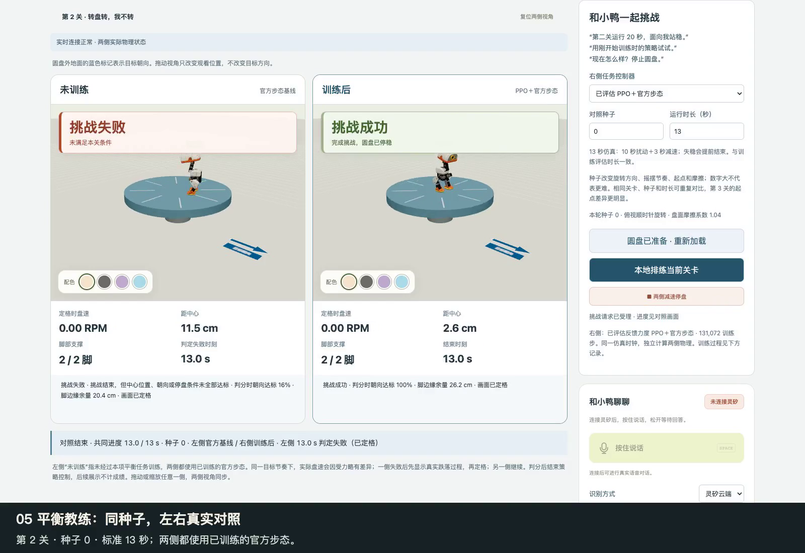

# 当前功能导览（按钮与本地排练）

[观看／下载 2026-11-02 导览 MP4（约 4 分 09 秒）](media/duckking-current-demo.mp4) · [剪辑与哈希](media/duckking-current-demo.json) · [实际操作与结果](media/current-demo-recording.json) · [解说文案](media/current-demo-script.json)

[](media/duckking-current-demo.mp4)

2026-11-02（北京时间）从 <https://ztmonitor.qbox.net/duckking/> 重新录制。线上发布为 `deploy-yzh737-20261101T160751Z`，提交 `62c6784c077da169ea550eccb06793d687607cfd`；本次文档基线 `e82948e` 与它的应用文件相同。视频覆盖当前首页、物理实验室、第十三幕现场点选、互动工坊、平衡左右对照和训练课堂，并非十三幕完整验收录像。

全片 248.960 秒，1600 × 1100、25 fps、H.264 / AAC。网页原始视口为 1600 × 1000，底部另加 100 px 章节说明。所有动作片段保持录制时墙钟速度；章节之间剪去准备等待，片段内的场景切换仍保留。解说较长时延长末帧，具体时长逐章写在 JSON 的 `end_hold_seconds`，不将停帧冒充继续仿真。

旁白为 Microsoft `zh-CN-XiaoxiaoNeural` 合成声音，使用 `edge-tts 7.3.1`、`-3%` 语速，按 -18 LUFS 归一化。页面原声未收录；配音是编辑解说，不是页面中的灵矽回答。本次操作使用按钮／本地排练，没有使用真人麦克风、调用真实灵矽会话或验证实体机。真实云端语音的历史材料见 [2026-10 竞赛视频存档](DEMO_VIDEO_ARCHIVE.md)，不能据此宣称新增平衡口令已完成现场云端验收。

## 章节

| 时间 | 内容 |
|---|---|
| 00:00 | 让一句话，变成一个动作。 |
| 00:14 | 01 先认识它：四种配色与动作预览 |
| 00:34 | 02 进入物理实验室：成绩看本轮实测 |
| 01:16 | 03 十三幕剧场：这次选 B 和 C 翻跟头 |
| 02:14 | 04 互动工坊：只用头，也是一条约束 |
| 02:29 | 05 平衡教练：同种子，左右真实对照 |
| 02:50 | 06 拉长到 30 秒：让能力边界也出镜 |
| 03:26 | 07 打开训练记录：学习效果有数据，也有限制 |
| 03:50 | 先体验，再决定想让它做什么。 |

时间按秒向下取整，精确切点见剪辑 JSON。浏览器视频时钟与页面标记时钟按末帧对齐，仅用于剪辑；不能用本片测量声画延迟或控制时延。

## 录制当次实际结果

| 操作 | 当次结果 | 能说明的范围 |
|---|---|---|
| 首页切换四种配色与闪身步 | 官方网格显示、换色与按钮动作运行 | 动画预览；不用于物理验收 |
| 物理实验室左脚踢球 | 左脚接触采样 6，球最终位移约 0.884 m | 本轮固定摆球后执行；不是每次都踢同样远 |
| 动作练习场前滚翻 | `roulade=completed` | 本轮真实翻转与站稳验收 |
| 第十三幕集结、B/C 翻滚 | `stage_gather`、`stage_roll` 均 completed；实际选中集合为 B/C | 本地点选；不是云端或实体多机同步 |
| 工坊“只用头” | 本地任务 completed | 已有受限动作编排；未训练新步态 |
| 第 2 关、种子 0、13 秒 | 基线未满足条件；PPO 完整 13 秒通过 | 相同初态的一次线上对照，不加入历史离线评估 |
| 第 2 关、种子 0、30 秒 | 基线约 13.5 秒越界失败，随后实际落地；PPO 运行至 30 秒但结尾未达标 | PPO 末尾距中心约 17.1 cm，超出小于 8 cm 的条件；没有将仍直立写成通关 |
| 训练课堂 | 显示已有 `level2-cpu-v4` 记录、89/100 测试和未达连续门槛提示 | 录制期间未启动训练；公网训练按钮默认禁用 |

基线在 30 秒试跑中的判分停止于约 13.5 秒；后续 1.8 秒展示检测到实际地面接触，不计成绩。PPO 末尾朝向达标率约 96.7%、盘已停止，仍因结尾条件未全部满足而失败。具体读数以本次 JSON 为准，不把它们写成跨 CPU、跨种子的不变常数。

原训练环境的 13 秒未见种子测试仍为第 1/2/3 关 100/100、89/100、59/100；对应基线 100/100、0/100、0/100。当前单轮没有重写这些样本。完整口径与限制见 [CPU 实测记录](../training/results/README.md) 和 [平衡教练](PPO_BALANCE_COACH.md)。

## 重新录制

需要 Node.js、项目的 `frontend/node_modules`、Chrome（或用 `DUCKKING_BROWSER_CHANNEL` 选择已安装的 Playwright 浏览器）、Python 3.12+、FFmpeg/ffprobe 和 uv。解说通过 `uvx` 临时运行固定版 edge-tts；若该服务不可用，macOS 可回退到 `say / Tingting`，实际来源写入每章记录。不要在已有解说缓存中直接换文案；修改后使用新的 `--work` 目录。

```bash
# 在仓库根目录执行；录制脚本自动领取专用空闲房间并释放自己使用的物理世界。
cd frontend
DUCKKING_DEMO_URL=https://ztmonitor.qbox.net/duckking/ \
  DUCKKING_DEMO_OUTPUT=../.duckking/current-demo-new \
  node scripts/record-current-demo.mjs
cd ..
python3 scripts/build_current_demo.py \
  --recording .duckking/current-demo-new/recording.json \
  --work .duckking/current-demo-new-edit
```

也可将录制 URL 改为本机生产服务。录制器等待页面与真实动作结果，不拦截协议或写入假成绩；每次记录发布提交、原始视频、截图、结果与页面异常。只有完成录制、无页面脚本异常、13/30 秒两侧都已结束，合成器才继续；失败录制保留在 `.duckking/`，不作为通过素材。它不会连接云端、读取凭证或启动训练任务。

剪辑完成后逐段复看，核对动作开始/结束、物理判分、停帧和章节说明；再核对新环境中实际显示的结果并更新此表，不能把本次 0.884 m 或 13.5 秒抄成下次成绩。原始 WebM 和解说缓存留在 `.duckking/`，成片、截图及脱离机器路径的记录写入 `docs/media/`。本次全片已通过 FFmpeg 视频／音频完整解码检查。

## 来源与历史

模型和模型改编画面来自 Pollen Robotics，遵循 CC BY-NC-SA 4.0；配色与材质映射来源及其他第三方许可见 [媒体说明](media/README.md) 和 [THIRD_PARTY.md](../THIRD_PARTY.md)。本片没有复用旧 UI、旧成绩或旧云端回复来证明新版运行。

[2026-10 竞赛自然配音版](DEMO_VIDEO_ARCHIVE.md)及其原始延迟样本继续保留原录制版本与时间；不是被新版结果覆盖。当前视频 SHA-256：`6c9d0637ca5bb0847d565ff34d886853bf33e0daceb38f315f1e68399d47824d`。

后续训练入口已统一为“训练新动作”，新增跷跷板和真人语音 PK。此导览保留录制版本，不含该场景；当前操作见 [跷跷板教练](SEESAW_COACH.md)。
