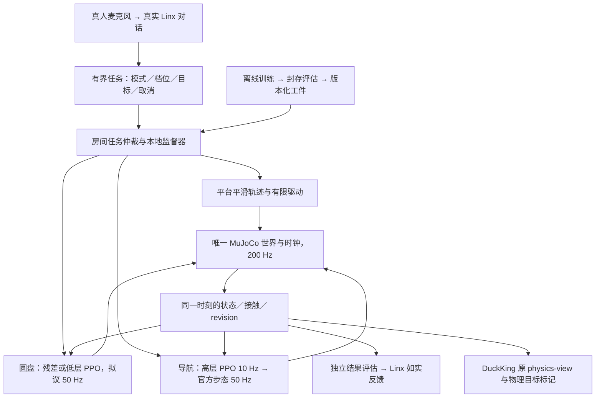

# MicroDuck 语音 PPO 技能设计

**持续变速、变倾角的圆盘值得成为新增 PPO 演示的主角，但目前没有证据证明 MicroDuck 已能站稳。** 首期应挑战“靠近圆心、允许随盘转动、在经实验确认的范围内保持平衡”，以后分别研究固定世界朝向和偏心位置回中心；不承诺任意转速、倾角或所谓最高安全 RPM。它的吸引力在于真人通过灵矽持续提出挑战，鸭子根据真实状态回应，身体控制的成败直接可见。工程上用已有分层导航训练做一次小规模接入检查，验证工件、取消与评估链；不需要先建设完整导航演示或新页面，首个新节目仍是圆盘。原有二维导航 PPO 不能直接承担足底平衡。自由滑板可作为第二条研究路线，普通把手滑板车暂不作为首期目标。

研究日期：**2026-11-01，Asia/Shanghai**。本文综合四份[研究笔记](../research_notes/MicroDuck%20语音%20PPO%20技能设计/)，区分“外部研究先例”“本地源码/工件事实”和“拟议设计”。本轮只调研与设计，未训练、复跑物理验收、修改应用、推送或部署。

## 八个候选中，圆盘最适合让语音持续改变挑战

**已有能力必须充当基线。** DuckKing 已有 A* 与 waypoint 闭环到点、官方足轮 skating、坐站/翻滚、单次踢球和动作编排。因此“说一句话走到点”“脚上有轮子滑行”不能直接改名为新学习成果。应展示过去没有的条件控制、连续物体控制或新接触环境中的身体协调。（[A* 与闭环导航](/Users/zhouting/Documents/QiNiuWork/github_base/DuckKing/src/duckking/stage.py:89)、[官方技能](/Users/zhouting/Documents/QiNiuWork/github_base/DuckKing/src/duckking/official_skills.py:110)）

下表是**展示优先级与研发判断**，不是成功率预测。所有语言约束都必须进入任务定义并在训练范围内；“慢一点”“别碰红区”不能只是回复台词。

| 排序与候选 | 语音必须改变什么 | PPO 真正学习什么 | 当前底座与公平基线 | 工作量／主要风险 |
|---|---|---|---|---|
| **1 语音平衡教练：旋转倾斜盘** | 准备确认、扰动档位、途中降难度、停止与复盘 | 足盘接触下的全身平衡；后续换步/回中心 | 官方站立策略、固定姿态保持 | 高；新平台动力学、摩擦与舵机能力；首选可行性实验 |
| **2 带球快递：送入指定彩门** | 选球/门，途中改门、要求轻推 | 调整接近角度、持续控球、选择触球时机 | 走路/单次踢球；几何绕后＋固定踢球状态机 | 中；冻结步态未必能稳定触球；不得自动摆球掩盖失败 |
| **3 自由四轮板惯性滑行** | 选已验证初始速度、保持时长、询问稳定情况 | 相对板面的平衡；转向单独追加 | 固定站姿/官方站立，同样的初速度 | 高；新轮地/足板接触；不宣称自主起步、上板或刹车 |
| **4 会让行的跟随鸭** | 指定伙伴、跟随间距、途中改目标和停止 | 动态目标追踪、等待、避碰与距离控制 | 现有多鸭世界；A*＋跟随/停走规则 | 中低；最适合较早交付，需证明比强基线有增益 |
| **5 推包裹入库** | 指定箱、目标格及朝向、禁碰对象 | 选择推点、绕侧、控制箱体位置与朝向 | 步行；几何绕后推箱状态机 | 中；无手臂，接触点受形体限制，防止撞飞取巧 |
| **6 守门员** | 守哪侧、发球档位、暂停下一球 | 从球位/速度决定拦截时机并恢复稳定 | 侧步/踢球；轨迹预测＋固定拦截 | 中；碰到球不等于守住门，需门线与接触判定 |
| **7 踏石过河** | 指定可踩区、中间停点、继续条件 | 精确落脚与重心转移 | 原平地步态＋目标引导 | 高；新低层策略，禁止隐藏地面补支撑 |
| **8 自己蹬起来的无把手低板** | 直行距离、推进/滑行阶段、结果追问 | 一足留板、一足蹬地、收脚与周期切换 | 自由板平衡与单次蹬推阶段 | 很高；几何可达、接触切换、推进和停车需分开验收 |

研究先例支持任务拆分，不提供 MicroDuck 成功保证。DribbleBot 提供连续球控制与专门感知的先例；路径条件导航展示了高层决策与低层运动分离；旋转平台上的 NAO 工作报告仿真平衡，使用模型式强化学习与 Q(λ)，并非 PPO；NTNU 的平衡板项目才是关节级 PPO 先例，也不是高速自旋圆盘或 MicroDuck 验证。（[DribbleBot 原论文](https://arxiv.org/abs/2304.01159)、[分层导航原论文](https://arxiv.org/html/2603.13888v1)、[NAO 旋转平台论文](https://www.ieee-jas.net/en/article/doi/10.1109/JAS.2019.1911567)、[NTNU 作者代码](https://github.com/NTNU-ERC/Robinion-Balance-Board-PPO)）

滑行路线必须拆清物理边界：**现有足轮**是四个被动轮轴固定在两脚，没有独立板；**自由四轮板**需独立浮动板体、被动轮轴，转向时另加弹性转向桥；**自主蹬地板**还需一足留板时另一足能触地，并在没有外部推力或驱动轮的条件下产生推进；**普通双轮把手车**还要求转向、侧向平衡及握把力传递，而当前鸭没有手臂。嘴咬把手增加承载接触与颈部力矩，转向柱加电机属于改装车，不能直接声称原形态学会普通滑板车。REEM-C 的 PPO 滑板研究只完成仿真单足蹬地直行，双足滑行、转向和实机仍是后续工作；LEONARDO 则有螺旋桨辅助，不能当纯足底平衡的证明。（[现有轮轴](/Users/zhouting/Documents/QiNiuWork/github_base/DuckKing/external/microduck_rl/src/mjlab_microduck/robot/microduck/robot_groundcontact_rollers.xml:175)、[14 关节构型](/Users/zhouting/Documents/QiNiuWork/github_base/DuckKing/src/duckking/simulation.py:31)、[REEM-C 作者论文](https://willthibault.com/assets/pdf/rl_skateboarding.pdf)、[Caltech 官方说明](https://www.caltech.edu/about/news/leonardo-the-bipedal-robot-can-ride-a-skateboard-and-walk-a-slackline)）

## 圆盘先允许随盘转，再研究朝向和回中心

**拟议任务 A**是在中心区保持站立并允许随盘偏航；**B**是在 A 的基础上跟踪世界中的观众方向，必须允许合法换脚，有限关节行程不允许双脚长期粘盘而身体永远不转；**C**是偏心起步、守住盘边余量并纠正回中心。三项分别训练、分别统计，A 成功不能代替 B/C。简化平盘匀速条件下，点质量随盘不滑动需要 `ω²r ≤ μg`，但它忽略重心高度、有限支撑、加速、倾斜和执行器约束，**不能据此算出 MicroDuck 安全转速**。

拟议平台结构为“固定基座 → 两个受限倾斜轴 → 沿盘法线的自旋轴 → 有厚度、质量和惯性的圆盘”，明确轴顺序。电机驱动是公开的环境扰动；轨迹生成器同时限制转速、角加速度、jerk、倾角、倾斜速度与加速度，记录目标与实际关节运动。鸭以自由根节点、有限摩擦和真实接触站立；禁止焊脚、重写根位姿救回、隐藏稳定力或只旋转画面。MuJoCo 的关节与执行器可以表达这些结构，但模型配置本身不证明物理可行。（[MuJoCo 关节与执行器](https://mujoco.readthedocs.io/en/3.3.7/XMLreference.html#body-joint)）

先比较固定 nominal 姿态和官方站立策略，再做**有界关节残差 PPO**：`q_ref = q_base + clip(Δq, −δ, δ)`，最终目标同时限制关节位置与变化率。若基策略抵抗必要动作或残差幅度不足，再试独立 14 关节低层 PPO；`δ`、频率和动作界限均待标定。圆盘 actor 可用关节状态、重力投影、机身角速度、动作历史、盘实际姿态/角速度、相对盘心位置和足盘接触；首期明确标为**仿真真值感知**，不声称视觉理解。critic 可有额外真值，但需列明；actor 不读取尚未发出的未来扰动。后续转真机需用传感器/估计替代这些量，并重新验收。

课程从静止平盘与小初态扰动开始，分别加入慢倾斜、低速自旋及变速，再组合双轴倾斜与转速变化；随后随机化初态、摩擦、质量/重心、延迟和扰动相位。每级都包含减速放平；A 通过后才分别加入 B/C。奖励关注可用姿态、有效支撑、允许区域、动作平滑和必要朝向，惩罚足盘滑移、触边、过大受力及非预期身体接触。独立成功判定必须排除跪着、趴着、贴边拖行刷存活分。

**滑移要相对运动盘面测量。** 在接触点，用足速度减去 `v_center + ω_disc × (p_contact − p_center)`，再投影到盘面切向；允许迈步时只对支撑接触计算滑移。盘边余量检查整个足底投影/有效接触区域，不能只看机身中心。旧训练仓库的 mocap 平台、接触统计与世界坐标滑移公式存在待验证问题，应重新建模，不能搬来就称为已验证圆盘。（[旧平台与接触计算](/Users/zhouting/Documents/QiNiuWork/github_base/DuckKing_PPO/src/microduck_ppo/env.py:310)）

## 100 秒现场对话，让每句回应对应物理事件

以下是**训练与验收通过后**的 100 秒分镜。真人声音经真实 Linx 会话完成理解、工具调用和回复；文本只是示例，实播必须随当前状态生成。语音是选择挑战、纠正和追问结果的主要入口，而非“开始”按钮的替代包装。

| 时间／轮次 | 真人说 | Linx 回复依据与实际行为 |
|---|---|---|
| 0–15 秒：资格确认 | “小鸭，今天挑战旋转圆盘，准备好了吗？” | 核对策略、盘静止、足部支撑和中心区：“准备好了，这版能随盘转；始终面朝你还没通过测试。”未就绪则说明原因。 |
| 15–35 秒：定义挑战 | “慢档开始，站稳十秒。” | “慢档，保持中心，开始挑战。”盘平滑加速；实际开始事件触发计时，鸭由 PPO 闭环调节。 |
| 35–55 秒：变速变倾角 | “快一点，再向右倾一点。” | 只接受已验收组合：“切到二级速度和右倾档，逐步增加。”若组合超范围，说明可用档位并保持现有合法状态。 |
| 55–75 秒：途中纠正 | “现在稳吗？先慢下来。” | 读取本轮滑移/支撑/边缘余量：“出现了一次滑移，开始降低速度。”平台更换连续参考目标，物理状态不跳变；A 阶段不冒充会回中心。 |
| 75–100 秒：停止与复盘 | “停止圆盘，告诉我刚才怎么样。” | 先答“正在减速并放平，我继续保持平衡”。测得停止后才报告保持时长、滑移/越界与是否完成；失败如实报告。停止超过分镜预算则延长镜头，不能为凑时长提前宣称完成。 |

**“停止圆盘”是受限减速、逐步放平，物理时间继续推进，鸭继续平衡；“紧急暂停仿真”才冻结时间。** 后者是本地保护操作，不是学会制动，也不能计作完整成功。自由板同样不能将暂停称为刹车、场景给初速度称为自主推进、脚粘板称为学到平衡。云失联或策略异常时，本地监督器停止接收新挑战，并执行已验证的减速或明确暂停；保留失败原因，不能切动画掩盖。

页面突出“按住与鸭说话”、转写、真实回复及本轮目标；常驻标明“灵矽实连／本地安全控制”“新 PPO／官方策略”“实时 MuJoCo／离线回放”，并展示实际转速、倾角和结果。盘面用径向条纹和参考刻度增强转动可读性，不靠未验收的高转速或加速播放制造“飞转”；仅在实测实时率支持时显示“1× 实时”，否则如实显示。初期/成熟策略对照用相同 seed 的真实记录，明确回放身份。**现场是已训练策略推理，几句鼓励不会现场更新 PPO 权重。** PPO 本身是采样与优化算法，并非语言模型。（[PPO 原论文](https://arxiv.org/abs/1707.06347)、[当前语音来源边界](/Users/zhouting/Documents/QiNiuWork/github_base/DuckKing/docs/ARCHITECTURE.md:119)）

## 只复用训练内核，统一动力学和坐标契约

**本地审计确认 DuckKing_PPO 确实调用 SB3 PPO 学习。** 最可复用的是 10 Hz 高层 `(vx, wz)` 策略，经冻结 50 Hz、61 维观测到 14 关节的步态网络，驱动 200 Hz MuJoCo。高层只有 11 维目标/自身状态和上次动作，没有障碍、图像、目标朝向或速度偏好；输出界限是 `vx ±0.25 m/s`、`wz ±1.5 rad/s`。这些是旧导航配置事实，**不是圆盘速度建议**。（[PPO 训练调用](/Users/zhouting/Documents/QiNiuWork/github_base/DuckKing_PPO/src/microduck_ppo/navigation_train.py:189)、[观测与频率](/Users/zhouting/Documents/QiNiuWork/github_base/DuckKing_PPO/src/microduck_ppo/navigation.py:123)、[动作与奖励](/Users/zhouting/Documents/QiNiuWork/github_base/DuckKing_PPO/src/microduck_ppo/navigation.py:381)）

本地 `navigation-full` 和 `navigation-direct-100k` 工件记录各自固定/随机测试均为 100/100；30,720 步的一份记录为固定 100/100、随机 85/100，负动作比例约 81%/88%。这些是**未在本轮复现的历史工件证据**：单训练 seed、短距离空场、狭窄分布，没有障碍或与 A* 的公平比较。负动作比例是命令统计，不是实际倒退位移；原“进圈保持 0.3 秒”也没有要求实际停稳。direct 奖励仍奖励正向命令，扩展障碍后存在“堵住仍给前进命令得分”的投机风险，需要用实际进展和独立成功条件约束。（[旧验收工件](/Users/zhouting/Documents/QiNiuWork/github_base/DuckKing_PPO/runs/navigation-full/acceptance.json:1)、[direct 工件](/Users/zhouting/Documents/QiNiuWork/github_base/DuckKing_PPO/runs/navigation-direct-100k/acceptance.json:1)、[30k 随机结果](/Users/zhouting/Documents/QiNiuWork/github_base/DuckKing_PPO/runs/navigation-20261031-215451-0cdc/acceptance.json:2822)）

现 DuckKing 用 XML 位置伺服和被动阻尼；固定上游训练代码则使用 **BAM M6 电压/负载摩擦及延迟模型**。stage 的 allcollisions、多鸭、地面摩擦也不同于旧导航的 groundcontact 单鸭场景。首期应直接以最终 DuckKing 圆盘模型训练/评估；如决定引入 BAM，就同时统一训练、验收和运行端。官方要求导出归一化一致，新增滤波也须三端一致。**ONNX 是推理工件，不等于可原样恢复 PPO 训练状态**；原样恢复需要训练 checkpoint，以及 critic、optimizer、normalizer 等状态。也可研究迁移 actor 后重建 critic 与 optimizer 来微调，但须重建可训练网络并验证观测、归一化和动作输出等价，不能称为无缝续训；首期仍优先冻结 ONNX 作为残差基策略。（[XML 伺服](/Users/zhouting/Documents/QiNiuWork/github_base/DuckKing/external/microduck_rl/src/mjlab_microduck/robot/microduck/robot_allcollisions.xml:41)、[BAM 配置](/Users/zhouting/Documents/QiNiuWork/github_base/DuckKing/external/microduck_rl/src/mjlab_microduck/robot/microduck_constants.py:149)、[官方固定版开发约定](https://github.com/pollen-robotics/microduck_rl/blob/bae39f5900b318f7e87fc485c30a31213cfa14eb/AGENTS.md)）

拟议架构如下；语音与网络始终在高频身体控制环之外。

共享契约至少固定模型及完整资产树 hash、关节名/索引、HOME、执行器、碰撞/摩擦、观测顺序/单位/坐标系、动作限幅/滤波、归一化、控制频率与采样阶段。MuJoCo 积分后派生状态可能仍属于前一子步，训练/运行不能一端插入 `forward`、另一端保持旧采样而不复验。工件先检查兼容性，再对同一封存状态比较观测、动作和 CPU 长 rollout；失败明确返回。（[MuJoCo 状态一致性](https://mujoco.readthedocs.io/en/3.3.7/computation/index.html#consistency-in-mjdata)、[现步进](/Users/zhouting/Documents/QiNiuWork/github_base/DuckKing/src/duckking/simulation.py:274)）

**不复用 DuckKing_PPO 的错误渲染器。** 鸭、圆盘、目标标记均从唯一物理世界取状态，经现 DuckKing 的 `(x,y,z) → (x,z,−y)` 映射显示，校验四象限、朝向、场景 revision 及多鸭索引；不能从像素反推目标。当前 primitive 渲染主要处理 box/sphere，圆盘需要补齐真实 cylinder/mesh 支持，并检查可见盘面与碰撞盘面的尺寸、位姿及接触点一致。保留一个物理时钟，每个房间独立任务状态与动作历史；新命令使旧 generation 失效，reset 后拒绝旧 revision。（[状态输出](/Users/zhouting/Documents/QiNiuWork/github_base/DuckKing/src/duckking/simulation.py:802)、[原渲染器](/Users/zhouting/Documents/QiNiuWork/github_base/DuckKing/frontend/src/physics-view.js:24)、[取消机制](/Users/zhouting/Documents/QiNiuWork/github_base/DuckKing/src/duckking/motion.py:328)）

## 用分阶段门槛决定继续，而不是用漂亮回放宣布成功

以下数字全部是**待几何、力学及吞吐标定后冻结的实验提案，不是已达成成绩或训练保证**。训练与正式服务分离；当前硬件、可用 GPU、预算、实时并发能力未知。可先用 4,096–8,192 个导航 transition 检查吞吐，用少量圆盘 rollout 检查接触、动作方向、NaN 和奖励分量，再按实测速率估预算。官方训练工作流使用 CUDA/mjlab，但既有步行耗时和旧导航分钟级记录不能外推到新圆盘；若换加速器/引擎，仍需最终 CPU MuJoCo 一致性验收。（[现 benchmark](/Users/zhouting/Documents/QiNiuWork/github_base/DuckKing_PPO/src/microduck_ppo/navigation_train.py:372)、[官方固定版训练说明](https://github.com/pollen-robotics/microduck_rl/blob/bae39f5900b318f7e87fc485c30a31213cfa14eb/README.md)）

| 阶段 | 要完成的证据 | 拟议 go／no-go 门槛 |
|---|---|---|
| **0 契约与接入** | 用既有导航训练作小规模复现与接入检查，统一模型/观测/动作、原 renderer 目标对齐、语音任务状态；不建设完整导航节目 | 有限值/兼容性检查及取消、重复/乱序、协议 framing、reset、房间隔离用例全部通过；旧命令下个任务 tick 不再写入。契约未过则不接新技能，圆盘建模与物理可行性研究可继续 |
| **1 圆盘物理可行性** | 静盘站立、独立倾斜/自旋、真实接触与受力、原策略基线 | 无隐藏约束/外力；几何和力矩允许目标姿态；先用 10 秒静盘及低扰动重复试验。静态都不可行则改模型/任务，不加大 PPO 预算硬训 |
| **2 A 的残差／低层实验** | 真实初始、早期、训练后 checkpoint，学习曲线和分项奖励 | 起步建议 3 个训练 seed，每 seed 100 个封存回合；包含 20 秒挑战及实际停止。可提议完成率 ≥90%、较最强基线提高 ≥10 个百分点，并报告 95% CI；无增益则不得宣称 PPO 优势 |
| **3 Linx 现场闭环** | 五轮真人对话、超范围拒绝、改口/停止/断线、真实结果播报 | 无错误成功播报、旧任务复活或静默 fallback；测量含状态构造、推理、约束、物理步进和调度的完整控制循环，报告耗时分布、超期率与实时率。仅推理 <20 ms 不能证明 50 Hz 实时运行；停止完成依实际状态判定 |
| **4 扩展能力** | B 世界朝向、C 回中心，之后自由板平衡 | 每项新建成功标准和隐藏测试；一项失败不借另一项成绩背书。真机/robotd 另立实测门槛 |

公平比较采用**相同 seed、初态、平台轨迹、摩擦、执行器和动作约束**的固定姿态、官方策略、真实早期 checkpoint 与训练后策略；导航另加同信息条件、同速度/加速度界限的 A*＋steer。训练、验证、测试按扰动组合/布局族分开，封存未见的变速与倾斜组合、延迟、摩擦和偏心位置；选择模型后才看最终测试，不拿反复调过的 seed 充当泛化。若 baseline 已很强，应扩大有物理意义的挑战范围，或诚实认定不需要 PPO。

圆盘指标包括完整挑战并停止的成功率、跌落/非预期身体接触、支撑中断、切向相对滑移速度与累积距离、最小足底盘边余量、机身倾角、关节限幅/受力，以及平台目标与实际运动误差；B 另报世界朝向误差，C 另报回中心时间。紧急暂停算干预，不算完整成功。导航若展示“到点停好”，可先提议距离 ≤0.10 m、实际速度 <0.05 m/s 并保持 0.5 s，随后根据自然步态摆动标定；奖励总分不能代替这些物理结果。

语音单独记录转写正确率、目标解析正确率与任务执行结果，以及“说完→识别完成”“识别→工具接受”“说完→首次物理响应”“停止请求→实际停住”“说完→首次语音确认”的耗时。每项固定起止事件定义，报告样本数、均值、P50/P90/P95，样本量足够时才增加 P99。统一采用可比较的墙钟耗时口径；同机优先用单调时钟，跨客户端/服务端使用已验证的时钟同步或同一观测端的往返测量，不直接相减未同步时钟，也不混用仿真秒。先确认回复不等于动作完成。状态流中断、NaN、模型不匹配、超时、跌落都必须输出明确失败；不把本地安全动作叫云回复，不把仿真真值叫机器人视觉，不从仿真成绩推断硬件能力。

## 决策清单

本轮形成以下设计选择。

- 主节目定为“语音平衡教练”，首期只承诺研究 A：中心区随盘转动。
- 用已有导航训练做小规模接入检查，建立共享契约；不把完整导航节目作为圆盘的前置项目，涉及导航效果时公开 A* 对照。
- 圆盘使用最终运行动力学，先残差 PPO 可行性实验，再决定是否训练独立低层策略。
- 自由四轮板作为后续研究；自推进、上板、转向与刹车逐项验收，普通把手车暂缓。
- 用真实 Linx 对话、封存成对评估和物理结果决定是否进入演示；不足时保留失败记录，不制造“几秒学会”的叙事。
